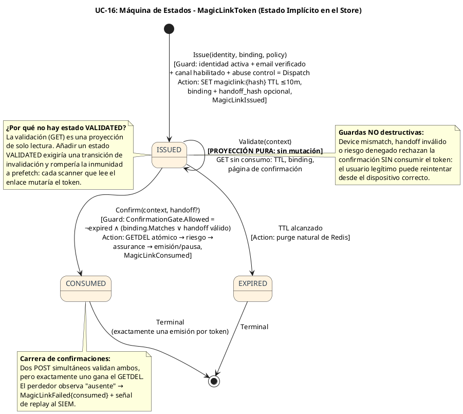
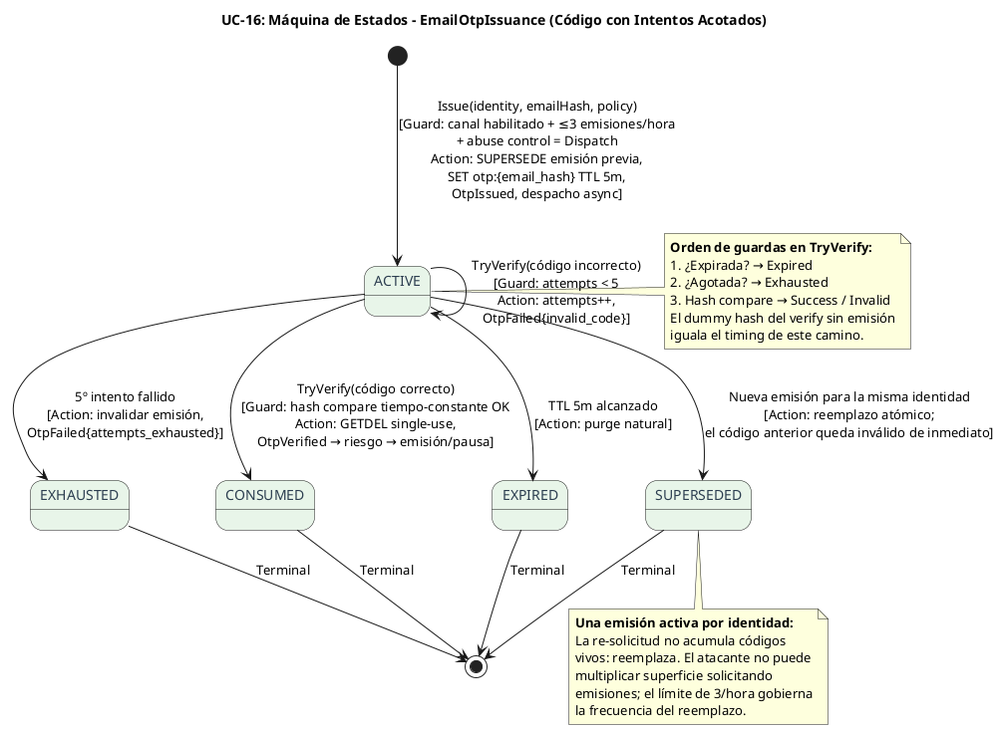
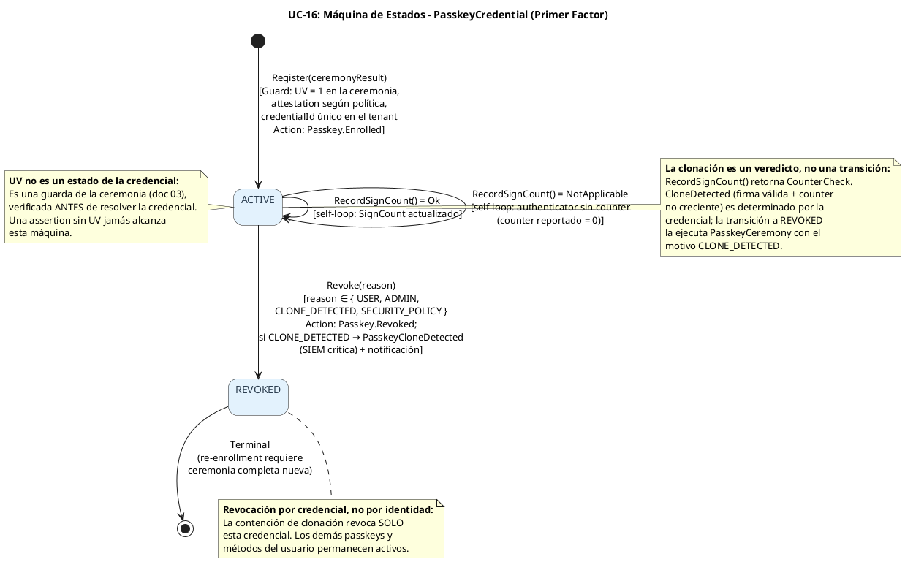
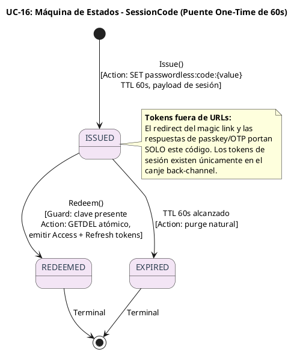
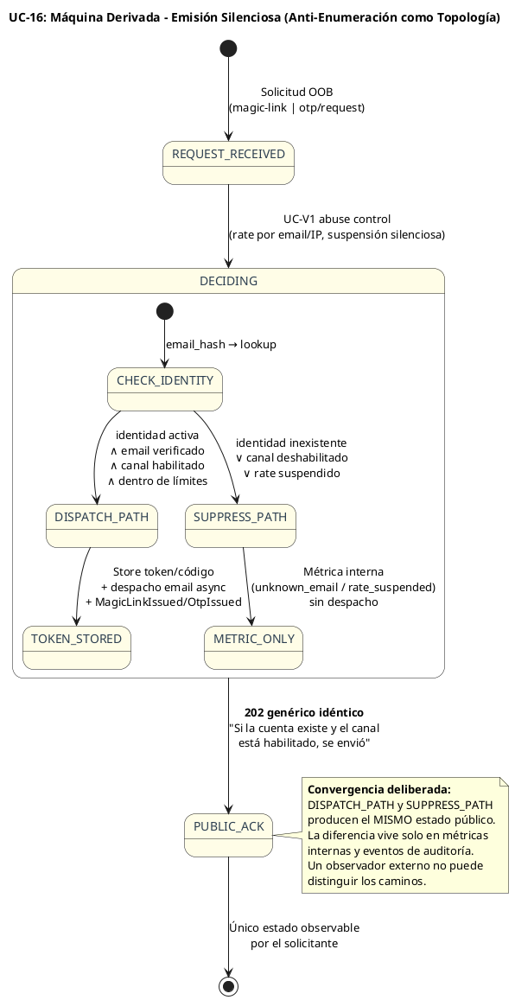

# UC-16: Passwordless Authentication - Diagrama de Máquina de Estados

| Metadatos del Documento | |
| :--- | :--- |
| **Proyecto:** | SHUGO - Identity & Access Platform |
| **Caso de Uso:** | UC-16 - Passwordless Authentication (Passkeys + Magic Links + OTP Restringido) |
| **Documento:** | 05_State_Machine_Diagram.md |
| **Metodología:** | UML 2.5 + DDD (State Pattern) + Implicit State Modeling + Security by Design |
| **Autor:** | Gastón Ruiz |
| **Versión Actual:** | 1.0.0 |
| **Fecha:** | 09/11/2026 |

---

## Historial de Versiones

| Versión | Fecha | Autor | Descripción de Cambios | Impacto |
| :--- | :--- | :--- | :--- | :--- |
| **1.0.0** | 09/11/2026 | Gastón Ruiz | **Creación inicial.** Definición de cinco máquinas de estados para UC-16: (1) `MagicLinkToken` con **estado implícito derivado del almacenamiento** (la validación es una proyección pura sin transición; el consumo GETDEL es la única transición terminal) y guardas no destructivas; (2) `EmailOtpIssuance` con self-loop de intentos, agotamiento, expiración y supersede; (3) `PasskeyCredential` con clonación como vía de revocación determinada por `CounterCheck`; (4) `SessionCode` como puente efímero de 60s; y (5) la máquina derivada de **Emisión Silenciosa**, donde todos los caminos internos convergen a un único estado público observable. Se documenta por qué el magic link deliberadamente NO tiene un estado VALIDATED: añadirlo rompería la inmunidad a prefetch. | Documento base del paquete de diseño Tier 1 del UC-16. Convierte las reglas de los tres canales en transiciones ejecutables y demuestra que la topología de cada máquina es en sí misma una propiedad de seguridad: guards que fallan sin destruir, consumo como única mutación terminal, y convergencia pública que hace la anti-enumeración visible en el diagrama. |

---

## 1. Introducción y Propósito

El **Diagrama de Máquina de Estados** para el UC-16 visualiza las restricciones de comportamiento temporal de cinco sujetos con naturalezas radicalmente distintas:

1. **`MagicLinkToken` (estado implícito):** Su máquina no vive en un campo `status` sino en la **presencia en el store y el TTL**. Esta decisión no es accidental: es lo que hace posible que la validación sea pura (GET sin efectos) y el consumo atómico (GETDEL como única transición terminal).
2. **`EmailOtpIssuance` (estado por atributos):** Los intentos fallidos son un self-loop que acumula hacia el agotamiento; la emisión tiene cuatro terminales distintos que reflejan cuatro causas diferentes de muerte del código.
3. **`PasskeyCredential` (estado explícito persistente):** Ciclo de vida largo con una vía de revocación específica para clonación, donde el veredicto lo emite el counter y la transición la ejecuta la ceremonia.
4. **`SessionCode` (estado efímero de puente):** 60 segundos de vida, un solo canje, expiración natural.
5. **Emisión Silenciosa (máquina derivada de decisión):** Todos los caminos internos (despachar, suprimir por identidad desconocida, suspender por rate) convergen a **un único estado público** — la anti-enumeración dibujada como topología.

Estas máquinas garantizan las propiedades cardinales del UC:
- **Validar nunca destruye:** Los fallos de guarda en magic link no consumen el token.
- **Consumir es la única mutación terminal:** Una confirmación ganadora, un verify exitoso, un canje.
- **La clonación revoca credenciales, no identidades:** El passkey comprometido muere solo.
- **La respuesta pública es independiente del camino interno:** Ningún estado observable revela la decisión de despacho.

---

## 2. Máquina de Estados #1: MagicLinkToken (Estado Implícito, Validación Pura)

### 2.1. Diagrama de Máquina de Estados (PlantUML)



### 2.2. Descripción de Estados y Transiciones

| Estado | Descripción | Persistencia | Transiciones de Salida |
| :--- | :--- | :--- | :--- |
| **ISSUED** | El token existe en Redis con TTL vigente. Derivado de `GET != null ∧ ¬IsExpired`. | Clave `magiclink:{token_hash}` | → `CONSUMED` (confirmación con gate aprobado), → `EXPIRED` (TTL) |
| **CONSUMED** | El GETDEL ganó; la emisión ocurrió o pausó hacia UC-15. Ausencia de la clave. | Clave ausente | Terminal |
| **EXPIRED** | TTL alcanzado sin consumo. Clave purgada naturalmente. | Clave ausente | Terminal |

### 2.3. Guardas (Guards) de las Transiciones

#### Transición: `ISSUED` → `CONSUMED` (La Única Mutación Terminal)

```csharp
// ConfirmationGate: el veredicto combina expiración, binding y handoff
// SIN tocar el estado del token (operación pura sobre el AR).
public ConfirmationGate CanBeConfirmedBy(DeviceBinding context, HandoffCode? handoff, DateTime now)
{
    if (IsExpired(now))
        return ConfirmationGate.Deny(MagicLinkStage.Expired);

    return ValidateBinding(context) switch
    {
        BindingCheck.SameDevice      => ConfirmationGate.Allow(),
        BindingCheck.HandoffRequired => VerifyHandoffOrDeny(handoff),
        _                            => ConfirmationGate.Deny(MagicLinkStage.DeviceMismatch)
    };
}
```

**Propiedad clave — guardas no destructivas:** Un device mismatch, un handoff incorrecto o una denegación de riesgo rechazan la confirmación **sin consumir el token**. El enlace sobrevive para el reintento legítimo (desde el dispositivo correcto, con el código correcto). Solo el GETDEL exitoso transiciona a CONSUMED.

#### Validez del Estado Implícito

```csharp
// El estado se DERIVA, no se almacena:
public MagicLinkState DeriveState(MagicLinkToken? stored, DateTime now) =>
    stored is null            ? MagicLinkState.ConsumedOrNeverExisted :
    stored.IsExpired(now)     ? MagicLinkState.Expired :
                                MagicLinkState.Issued;
```

**Justificación del diseño:** Un campo `status` mutable habría exigido transiciones de invalidación para los GETs de validación (rompiendo la inmunidad a prefetch) o locks para la carrera de consumo. La presencia-en-store + TTL hace ambas propiedades gratuitas: el GET es inherentemente puro, y el GETDEL es inherentemente atómico.

---

## 3. Máquina de Estados #2: EmailOtpIssuance (Intentos, Agotamiento, Supersede)

### 3.1. Diagrama de Máquina de Estados (PlantUML)



### 3.2. Descripción de Estados y Transiciones

| Estado | Descripción | Transiciones de Salida | Invariante Clave |
| :--- | :--- | :--- | :--- |
| **ACTIVE** | Emisión viva con intentos restantes. | Self-loop (intento fallido), → `CONSUMED`, → `EXHAUSTED`, → `EXPIRED`, → `SUPERSEDED`. | `Attempts < 5` ∧ `¬IsExpired` ∧ es la emisión activa de su identidad. |
| **CONSUMED** | Código verificado y canjeado single-use. | Terminal. | exactly-once: el GETDEL posterior falla. |
| **EXHAUSTED** | Cinco intentos fallidos. | Terminal. | Emisión invalidada; nueva emisión sujeta a 3/hora. |
| **EXPIRED** | TTL de 5 minutos alcanzado. | Terminal. | Purge natural. |
| **SUPERSEDED** | Reemplazada por una emisión nueva. | Terminal. | El código superseded nunca verifica, aunque no haya expirado. |

### 3.3. Guardas (Guards) de TryVerify

```csharp
public OtpVerifyResult TryVerify(OtpCode presented, DateTime now)
{
    // Guarda 1: expiración primero (el código muerto no gasta intentos)
    if (IsExpired(now)) return OtpVerifyResult.Expired();

    // Guarda 2: agotamiento (el código agotado no revela si acertó)
    if (IsExhausted) return OtpVerifyResult.Exhausted();

    // Guarda 3: comparación en tiempo constante
    if (!presented.ConstantTimeEquals(CodeHash))
    {
        Attempts++;
        return IsExhausted
            ? OtpVerifyResult.Exhausted()
            : OtpVerifyResult.Invalid(remaining: MaxAttempts - Attempts);
    }

    return OtpVerifyResult.Success();
}
```

**Justificación del orden:** La expiración precede a los intentos porque un código expirado no debe consumir presupuesto (el usuario que llega tarde no quema intentos de nadie); el agotamiento precede al compare porque un código agotado no debe revelar mediante timing si el código presentado era correcto.

---

## 4. Máquina de Estados #3: PasskeyCredential (Ciclo de Vida con Clonación)

### 4.1. Diagrama de Máquina de Estados (PlantUML)



### 4.2. Descripción de Estados y Transiciones

| Estado | Descripción | Transiciones de Salida | Invariante Clave |
| :--- | :--- | :--- | :--- |
| **ACTIVE** | Credencial enrolada y utilizable como primer factor. | Self-loop (counter), → `REVOKED`. | `Status == Active`; `SignCount` monótono creciente (o siempre 0 en authenticators sin counter). |
| **REVOKED** | Credencial invalidada con motivo auditable. | Terminal. | `RevokedAt != null` ∧ `RevocationReason != null`. |

### 4.3. Guardas y Determinaciones

#### Registro (Única Entrada a ACTIVE)

```csharp
public static PasskeyCredential Register(
    TenantId tenant, IdentityId identity, RegistrationValidation ceremony, DateTime now)
{
    // INV-105: el registro exige la misma evidencia que el login
    if (!ceremony.UserVerified)
        throw new DomainException("Passkey registration requires userVerification.");

    // La unicidad de credentialId por tenant se garantiza por índice único (doc 10)
    return new PasskeyCredential { /* ... */ Status = CredentialStatus.Active };
}
```

#### Clonación: Veredicto de la Credencial, Transición de la Ceremonia

```csharp
// La credencial DETERMINA; la ceremonia TRANSICIONA.
public CounterCheck RecordSignCount(long presented, DateTime now)
{
    EnsureUsable();
    if (presented == 0) return CounterCheck.NotApplicable;   // self-loop silencioso
    if (presented <= SignCount) return CounterCheck.CloneDetected;
    SignCount = presented;                                    // self-loop con mutación
    return CounterCheck.Ok;
}

// En PasskeyCeremony (orquestador):
var check = credential.RecordSignCount(assertion.SignCount, now);
if (check == CounterCheck.CloneDetected)
{
    credential.Revoke(CredentialRevocationReason.CloneDetected, now);
    await _credentials.SaveAsync(credential, ct);   // TX con outbox PasskeyCloneDetected
}
```

**Justificación de la separación:** La credencial posee los datos para el veredicto (su propio counter); la ceremonia posee el contexto para la contención (outbox, notificación, respuesta). Ningún objeto hace el trabajo del otro.

---

## 5. Máquina de Estados #4: SessionCode (Puente Efímero)



---

## 6. Máquina Derivada: Emisión Silenciosa (Convergencia Pública)

Esta máquina no modela un objeto sino el **protocolo de decisión** de los canales OOB (magic link y OTP) en la fase de solicitud. Su propiedad definitoria es topológica: todos los caminos internos convergen al mismo estado público.



**Justificación:** Dibujar la convergencia hace la anti-enumeración **revisable en el diagrama**: cualquier futuro camino que evite `PUBLIC_ACK` o que produzca una respuesta diferenciada sería visible como una violación topológica, no como un bug de lógica enterrado en un handler.

---

## 7. Implementación en el Dominio (Código C#)

### 7.1. MagicLinkToken: Estado sin Campo de Estado

```csharp
// El AR NO tiene campo Status: el estado es derivado del almacenamiento.
// Esto hace estructuralmente imposible:
//  - una "validación que consume" (no hay transición de validación)
//  - una doble confirmación (el GETDEL es la única transición terminal)
public enum MagicLinkState { Issued, ConsumedOrNeverExisted, Expired }

public static class MagicLinkStateResolver
{
    public static MagicLinkState Derive(MagicLinkToken? stored, DateTime now) =>
        stored is null        ? MagicLinkState.ConsumedOrNeverExisted :
        stored.IsExpired(now) ? MagicLinkState.Expired :
                                MagicLinkState.Issued;
}
```

### 7.2. EmailOtpIssuance: Transiciones con Validación

```csharp
public void Consume(DateTime now)
{
    if (IsExpired(now)) throw new DomainException("Cannot consume an expired OTP issuance.");
    if (IsExhausted) throw new DomainException("Cannot consume an exhausted OTP issuance.");
    Status = OtpStatus.Consumed;
}

public void MarkExhausted(DateTime now)
{
    if (Attempts < MaxAttempts) throw new DomainException("Issuance not exhausted.");
    Status = OtpStatus.Exhausted;
}

public void Supersede(DateTime now)
{
    if (Status != OtpStatus.Active) return;   // idempotente
    Status = OtpStatus.Superseded;
    SupersededAt = now;
}
```

### 7.3. PasskeyCredential: Máquina con Transición Única de Salida

```csharp
private void ValidateTransition(CredentialStatus next)
{
    var allowed = Status switch
    {
        CredentialStatus.Active  => new[] { CredentialStatus.Revoked },
        _ => Array.Empty<CredentialStatus>()   // REVOKED es terminal
    };

    if (!allowed.Contains(next))
        throw new DomainException($"Invalid passkey transition {Status} → {next}.");
}
```

### 7.4. Testing de Máquinas de Estados

```csharp
[Test]
public void MagicLink_GuardFailure_DoesNotTransition()
{
    var token = IssuedToken(OtherDeviceBinding, withHandoff: true);

    token.CanBeConfirmedBy(WrongDevice, handoff: null, Now).Allowed.Should().BeFalse();
    token.CanBeConfirmedBy(WrongDevice, HandoffCode.Wrong, Now).Allowed.Should().BeFalse();

    // El token sigue ISSUED: la validación fallida es no-destructiva
    MagicLinkStateResolver.Derive(token, Now).Should().Be(MagicLinkState.Issued);
}

[Test]
public async Task MagicLink_ConcurrentConfirms_ExactlyOneWins()
{
    var results = await Task.WhenAll(
        Flow.ConfirmAsync(confirmCmd, deviceCtx, Policy, CT),
        Flow.ConfirmAsync(confirmCmd, deviceCtx, Policy, CT));

    results.Count(r => r.IsSessionIssued || r.IsPausedForMfa).Should().Be(1);
    results.Count(r => r.Stage == MagicLinkStage.Consumed).Should().Be(1);
}

[Test]
public void Otp_FourInvalidAttempts_StayActive_FifthExhausts()
{
    var issuance = ActiveIssuance();

    for (var i = 1; i <= 4; i++)
    {
        var r = issuance.TryVerify(OtpCode.Wrong, Now);
        r.Kind.Should().Be(OtpVerifyResultKind.Invalid);
        r.Remaining.Should().Be(5 - i);
    }

    issuance.TryVerify(OtpCode.Wrong, Now).Kind.Should().Be(OtpVerifyResultKind.Exhausted);
    issuance.IsExhausted.Should().BeTrue();
}

[Test]
public void Otp_ExpiredIssuance_DoesNotConsumeAttempts()
{
    var issuance = ExpiredIssuance(attempts: 2);
    issuance.TryVerify(OtpCode.Correct, Now.AddMinutes(6)).Kind
        .Should().Be(OtpVerifyResultKind.Expired);
    issuance.Attempts.Should().Be(2);   // la expiración no gasta presupuesto
}

[Test]
public void Passkey_CloneVerdict_LeadsToRevocation_WithCorrectReason()
{
    var credential = ActivePasskey(signCount: 57);
    credential.RecordSignCount(presented: 55, Now).Should().Be(CounterCheck.CloneDetected);

    credential.Revoke(CredentialRevocationReason.CloneDetected, Now);

    credential.Status.Should().Be(CredentialStatus.Revoked);
    credential.RevocationReason.Should().Be(CredentialRevocationReason.CloneDetected);
}

[Test]
public void Passkey_Revoke_IsIdempotent_AndTerminal()
{
    var credential = ActivePasskey();
    credential.Revoke(CredentialRevocationReason.User, Now);
    credential.Revoke(CredentialRevocationReason.User, Now);   // sin excepción

    var act = () => credential.EnsureUsable();
    act.Should().Throw<DomainException>();                     // terminal: nunca reutilizable
}

[Test]
public void SessionCode_SecondRedeem_Fails()
{
    Store.Issue(Code, Payload);
    Store.Redeem(Code.Value).Should().NotBeNull();
    Store.Redeem(Code.Value).Should().BeNull();                // GETDEL: exactamente un canje
}
```

---

## 8. Trazabilidad con Otros Documentos del Paquete

| Documento | Relación |
| :--- | :--- |
| `01_Requirements_Specification.md` | INV-106 (máquina del magic link con TTL y binding), INV-108 (emisión/pausa como salida de la confirmación), INV-109 (convergencia pública de la emisión silenciosa), RN-37 (validación pura), RN-38 (máquina del OTP), INV-105/INV-110 (máquina de la credencial passkey). |
| `03_Activity_Diagram.md` | Las guardas de los diagramas de actividad (binding/handoff, intentos OTP, UV/counter) son las condiciones de transición aquí formalizadas. |
| `04_Initial_Domain_Model.md` | `CanBeConfirmedBy`/`VerifyHandoff` (guardas puras), `TryVerify` (self-loop y agotamiento), `RecordSignCount`/`Revoke` (veredicto y transición) ejecutan estas máquinas. |
| `07_Sequence_Diagram.md` | Detallará el orden temporal de las transiciones: GETs puros, GETDEL de consumo, supersede del OTP y contención de clonación. |
| `10_UC_Specific_Data_Model.md` | Los estados implícitos del magic link y el session code viven en keyspaces Redis con TTL; el estado del OTP en su hash de emisión; la credencial passkey en tabla persistente. |
| `11_UC_Specific_Security_Threats.md` | Las transiciones CONSUMED (replay), EXHAUSTED (brute-force), SUPERSEDED (multiplicación de superficie) y REVOKED/CLONE_DETECTED (clonación) son las respuestas de máquina a esas amenazas. |
| `UC-15/05_State_Machine_Diagram.md` | `CounterCheck` se reutiliza con la misma semántica; la vía CLONE_DETECTED es análoga entre MFA y passkeys. |
| `UC-14/05_State_Machine_Diagram.md` | `SessionCode` replica la máquina de `FederateCode` (puente one-time de 60s). |

---

## 9. Glosario de Términos Específicos de UC-16

| Término | Definición |
| :--- | :--- |
| **Estado Implícito** | Máquina cuyo estado se deriva de la presencia en el store y el TTL, no de un campo mutable. Hace estructuralmente gratuitas la pureza de la validación y la atomicidad del consumo. |
| **Proyección Pura** | Operación de validación (GET) que no transiciona la máquina: puede ejecutarse infinitas veces sin efecto, habilitando la inmunidad a prefetch. |
| **Guarda No Destructiva** | Condición de transición cuyo fallo rechaza la operación sin consumir el artefacto: el usuario legítimo puede reintentar; el atacante no progresa. |
| **Consumo como Única Mutación Terminal** | Principio del magic link y el session code: exactamente una operación (GETDEL) produce la transición terminal; todo lo demás es lectura o guarda. |
| **Supersede** | Transición terminal del OTP disparada por una nueva emisión: el código anterior muere de inmediato, garantizando una única emisión activa por identidad. |
| **Veredicto vs Transición** | Separación en la credencial passkey: `RecordSignCount` determina (CounterCheck), la ceremonia transiciona (Revoke con motivo). |
| **Convergencia Pública** | Propiedad topológica de la emisión silenciosa: todos los caminos internos terminan en el mismo estado observable, haciendo la anti-enumeración verificable en el diagrama. |
| **Self-Loop de Intentos** | Transición ACTIVE→ACTIVE del OTP que acumula fallos sin cambiar de estado hasta el umbral de agotamiento. |

---
*Fin del Documento 05_State_Machine_Diagram para UC-16*