# UC-16: Passwordless Authentication - Diagrama de Robustez

| Metadatos del Documento | |
| :--- | :--- |
| **Proyecto:** | SHUGO - Identity & Access Platform |
| **Caso de Uso:** | UC-16 - Passwordless Authentication (Passkeys + Magic Links + OTP Restringido) |
| **Documento:** | 06_Robustness_Diagram.md |
| **Metodología:** | ICONIX (Diagrama de Robustez) + DDD + Security by Design (Two-Step Consumption & Silent Issuance) + Hexagonal Architecture |
| **Autor:** | Gastón Ruiz |
| **Versión Actual:** | 1.0.0 |
| **Fecha:** | 10/11/2026 |

---

## Historial de Versiones

| Versión | Fecha | Autor | Descripción de Cambios | Impacto |
| :--- | :--- | :--- | :--- | :--- |
| **1.0.0** | 10/11/2026 | Gastón Ruiz | **Creación inicial.** Diagrama de Robustez para UC-16, validando la arquitectura del Passwordless Core de KAGI. Muestra la colaboración estricta entre dos Boundary Objects (API Gateway y Passwordless API), siete Control Objects (PasswordlessHandler, PasswordlessAbuseControl, MagicLinkFlow, OtpFlow, PasskeyCeremony, PasskeyEnrollment, PasswordlessSessionIssuer) y los Entity Objects (MagicLinkToken, EmailOtpIssuance, PasskeyCredential, SessionCode, Redis, KAGAMI, Email Dispatcher, Outbox, UC-17, UC-15 Pause Broker). Valida la separación Peek/GETDEL del magic link, la convergencia silenciosa de la emisión OOB, la puerta única de assurance y el orden UV→registro→firma→counter de la ceremonia passkey. | Documento base del paquete de diseño Tier 1 del UC-16. Sirve como puente crítico entre el Modelo de Dominio (04/05) y el Diagrama de Secuencia (07), asegurando que cada canal tenga un único flujo responsable, que el consumo sea siempre single-writer, y que la anti-enumeración y la pausa por assurance sean propiedades estructurales de la colaboración, no lógica dispersa. |

---

## 1. Introducción y Propósito

El **Diagrama de Robustez** para el UC-16 valida que los tres canales passwordless pueden ser orquestados respetando las reglas estrictas de acoplamiento de **ICONIX** y los principios de **DDD**, **Zero Trust** y **Evidence-Based Assurance**.

El desafío específico de este caso de uso es séxtuple:

1. **Tres flujos, un orquestador, un emisor:** Passkey, magic link y OTP divergen en captura de prueba y dependen de actores externos distintos (authenticator, email), pero deben converger en un único punto de emisión con la misma puerta de assurance.
2. **Consumo single-writer:** El magic link tiene dos operaciones de lectura (GET de validación, GETDEL de confirmación) que deben estar separadas por construcción — el mismo objeto de flujo es responsable de ambas, y ninguna otra colaboración puede consumir.
3. **Emisión silenciosa:** La decisión de despachar es interna al flujo OOB; el resultado público es idéntico exista o no la identidad. El abuse control y el directorio de identidades colaboran sin que su veredicto alcance el boundary.
4. **Despacho fire-and-forget:** El proveedor de email está fuera del camino crítico; su fallo no puede alterar la respuesta ni el estado de seguridad del token ya almacenado.
5. **Orden de ceremonia como seguridad:** La ceremonia passkey ejecuta sus guardas en un orden fijo (challenge → origin → UV → registro → firma → counter) donde cada paso falla barato antes del siguiente más caro.
6. **Pausa por assurance centralizada:** Los canales AAL1 no deciden si pausan: el issuer compara la proveniencia contra la política y delega en el pause broker de UC-15.

---

## 2. Diagrama de Robustez (PlantUML)

A continuación, se presenta el Diagrama de Robustez organizado de izquierda a derecha para mostrar el flujo natural: **Actor → Boundary → Control → Entity**.

```plantuml
@startuml UC-16_Robustez
<style>
diagram {
  BackgroundColor #FEFEFE
}
</style>
left to right direction
skinparam roundcorner 20
skinparam maxMessageSize 170

title UC-16: Diagrama de Robustez - Motor KAGI (Passwordless Core)

' ============================================
' ACTORES
' ============================================
actor "Usuario" as User
actor "Authenticator de\nPlataforma" as Authenticator
actor "Cliente\n(SPA / Mobile)" as Client
actor "Proveedor de Email\n(Transporte externo)" as EmailProv

' ============================================
' BOUNDARY OBJECTS (UI / API)
' ============================================
boundary "API Gateway\n(WAF / Rate Limit)" as GW
boundary "Passwordless API\n(options / verify / magic-link /\nlink / confirm / otp / enroll / token)" as API

' ============================================
' CONTROL OBJECTS (Aplicación / Dominio)
' ============================================
control "Passwordless Handler\n<<Application Service>>" as Handler
control "Passwordless Abuse Control\n<<Domain Service>>" as Abuse
control "Magic Link Flow\n<<Domain Service>>" as MagicFlow
control "OTP Flow\n<<Domain Service>>" as OtpFlow
control "Passkey Ceremony\n<<Domain Service>>" as Ceremony
control "Passkey Enrollment\n<<Domain Service>>" as Enroll
control "Passwordless Session Issuer\n<<Domain Service>>" as Issuer

' ============================================
' ENTITY OBJECTS (Dominio / Persistencia)
' ============================================
entity "MagicLinkToken\n<<AR transitorio>>" as MLT
entity "EmailOtpIssuance\n<<AR transitorio>>" as OTP
entity "PasskeyCredential\n<<Aggregate Root>>" as PKC
entity "SessionCode\n<<VO one-time 60s>>" as SC
entity "Redis\n(challenges, tokens,\nOTP, codes, rate)" as Redis
entity "KAGAMI\n(identidades, credenciales,\nfamilias)" as Kagami
entity "Email Dispatcher\n<<Adapter async>>" as EmailDisp
entity "UC-17\nRisk Engine" as Risk
entity "UC-15\nPause Broker" as Pause
entity "Auth Outbox\n<<KAGE>>" as Outbox

' ============================================
' NOTAS EXPLICATIVAS
' ============================================
note top of Handler
  **Un orquestador, tres canales:**
  Enruta por canal, delega en el flujo
  experto, y colapsa outcomes a HTTP.
  Nunca consume tokens ni emite sesiones.
end note

note bottom of MagicFlow
  **Validar ≠ consumir:**
  Peek (GET) para validación pura;
  GETDEL solo en Confirm, tras
  binding/handoff aprobados.
  Single-writer de consumo.
end note

note right of Abuse
  **Convergencia silenciosa:**
  La decisión (Dispatch |
  SuppressSilently) es interna.
  El resultado público es idéntico
  en todos los caminos.
end note

note left of Issuer
  **Puerta única de assurance:**
  AAL2/3 → emisión directa.
  AAL1 + required ≥ AAL2 →
  pausa vía UC-15.
  Nunca emisión insuficiente.
end note

note bottom of Ceremony
  **Orden de ceremonia fijo:**
  challenge → origin → UV →
  registro → firma → counter.
  Cada paso falla barato
  antes del siguiente.
end note

' ============================================
' FLUJO PASSKEY (Autenticación)
' ============================================
User --> Authenticator : 1. Biometría / PIN local
Authenticator --> Client : 2. Assertion firmada (UV=1)
Client --> GW : 3. POST /webauthn/options\n→ POST /webauthn/verify
GW --> API : 4. Forward
API --> Handler : 5. Enrutar canal passkey
Handler --> Ceremony : 6. BuildOptions / Verify

Ceremony --> Redis : 7. SET/GETDEL challenge\n(single-use, TTL 5m)
Ceremony --> Kagami : 8. FindActive por\n(tenant, credentialId)
Ceremony --> PKC : 9. RecordSignCount()\n(Ok | CloneDetected | NotApplicable)
Ceremony --> Kagami : 10. UPDATE counter o\nREVOKE (CLONE_DETECTED)
Ceremony --> Outbox : 11. (clonación) PasskeyCloneDetected
Ceremony --> Risk : 12. Evaluar contexto
Ceremony --> Issuer : 13. Proveniencia AAL2/3

' ============================================
' FLUJO MAGIC LINK (Solicitud → Validación → Confirmación)
' ============================================
Client --> GW : 14. POST /magic-link {email}
GW --> API : 15. Forward
API --> Handler : 16. RequestMagicLink
Handler --> MagicFlow : 17. RequestAsync
MagicFlow --> Abuse : 18. EvaluateIssuance\n(rate silencioso)
Abuse --> MagicFlow : 19. IssuanceDecision\n(Dispatch | Suppress)
MagicFlow --> Kagami : 20. Lookup identidad\n(solo si Dispatch)
MagicFlow --> MLT : 21. Issue(token, binding, handoff?)
MagicFlow --> Redis : 22. SET magiclink:{hash}\nTTL ≤10m
MagicFlow --> EmailDisp : 23. DispatchMagicLinkAsync
EmailDisp --> EmailProv : 24. Transporte (fire-and-forget)
MagicFlow --> Outbox : 25. MagicLinkIssued (solo si despacho)
MagicFlow --> Handler : 26. PublicIssuanceResult\n(IDÉNTICO en todos los caminos)

User --> EmailProv : 27. Recibe email
User --> Client : 28. Clic en el enlace
Client --> GW : 29. GET /link?token=...
GW --> API : 30. Forward
API --> Handler : 31. ValidateMagicLink
Handler --> MagicFlow : 32. ValidateAsync
MagicFlow --> Redis : 33. Peek (GET, sin consumo)
MagicFlow --> MLT : 34. ValidateBinding (pura)
MagicFlow --> Handler : 35. LinkValidationView\n(página confirmación / mismatch)

Client --> GW : 36. POST /link/confirm
GW --> API : 37. Forward
API --> Handler : 38. ConfirmMagicLink
Handler --> MagicFlow : 39. ConfirmAsync
MagicFlow --> MLT : 40. CanBeConfirmedBy\n(gate: binding/handoff/TTL)
MagicFlow --> Redis : 41. GETDEL magiclink:{hash}\n(consumo single-writer)
MagicFlow --> Risk : 42. Evaluar riesgo confirm
MagicFlow --> Issuer : 43. Proveniencia AAL1

' ============================================
' FLUJO OTP (Solicitud → Verificación)
' ============================================
Client --> GW : 44. POST /otp/request
GW --> API : 45. Forward
API --> Handler : 46. RequestOtp
Handler --> OtpFlow : 47. RequestAsync
OtpFlow --> Abuse : 48. EvaluateIssuance\n(≤3/hora, silencioso)
OtpFlow --> Kagami : 49. Lookup identidad (si Dispatch)
OtpFlow --> OTP : 50. Issue(código 8 dígitos)
OtpFlow --> Redis : 51. SUPERSEDE + SET otp:{email_hash}\nTTL 5m, intentos=0
OtpFlow --> EmailDisp : 52. DispatchOtpAsync
OtpFlow --> Handler : 53. PublicIssuanceResult idéntico

Client --> GW : 54. POST /otp/verify {code}
GW --> API : 55. Forward
API --> Handler : 56. VerifyOtp
Handler --> OtpFlow : 57. VerifyAsync
OtpFlow --> Redis : 58. GetActive / dummy hash\n(si no hay emisión)
OtpFlow --> OTP : 59. TryVerify\n(success | invalid | exhausted | expired)
OtpFlow --> Risk : 60. Evaluar riesgo
OtpFlow --> Issuer : 61. Proveniencia AAL1

' ============================================
' EMISIÓN CONVERGENTE (Puerta de Assurance)
' ============================================
Issuer --> Pause : 62. (AAL1 + required ≥ AAL2)\nPauseForMfa → mfa_token
Issuer --> Kagami : 63. CreateRoot familia\n(auth_method=passwordless_*)
Issuer --> SC : 64. SessionCode.Issue (60s)
Issuer --> Redis : 65. SET passwordless:code
Issuer --> Outbox : 66. Passwordless.SessionIssued
Issuer --> Handler : 67. Outcome (session_code | paused)

' ============================================
' REDEEM (Canje de tokens)
' ============================================
Client --> GW : 68. POST /passwordless/token
GW --> API : 69. Forward
API --> Handler : 70. Redeem(session_code)
Handler --> Redis : 71. GETDEL passwordless:code
Handler --> Kagami : 72. Emitir Access + Refresh\n(familia existente)
Handler --> Client : 73. Tokens (nunca en URLs)

' ============================================
' ENROLLMENT PASSKEY (Sesión autenticada)
' ============================================
Client --> GW : 74. POST /webauthn/enroll (Bearer)
GW --> API : 75. Forward
API --> Handler : 76. EnrollPasskey
Handler --> Enroll : 77. BuildRegistration /\nComplete (step-up si política)
Enroll --> Redis : 78. SET/GETDEL enrollment challenge
Enroll --> Kagami : 79. INSERT credencial\n(usage=first_factor, counter=0)
Enroll --> Outbox : 80. Passkey.Enrolled

@enduml
```



---

## 3. Explicación Detallada de los Objetos

### 3.1. Boundary Objects (Objetos de Límite)

| Objeto | Responsabilidad | Mapeo a Clean Architecture |
| :--- | :--- | :--- |
| **`API Gateway`** | WAF y Rate Limiting grueso sobre la superficie passwordless (endpoints anónimos atacables: solicitudes OOB, verifies, confirms). | Middleware (Kong, AWS WAF). |
| **`Passwordless API`** | Expone los nueve endpoints del UC (options, verify, enroll, magic-link, link, link/confirm, otp/request, otp/verify, token). Es el **único** lugar donde los `PasswordlessOutcome` se colapsan a respuestas HTTP genéricas. | Controllers (ASP.NET Core). |

### 3.2. Control Objects (Objetos de Control)

| Objeto | Responsabilidad | Mapeo a Clean Architecture |
| :--- | :--- | :--- |
| **`Passwordless Handler`** | **Application Service.** Enruta por canal hacia los flujos expertos y ejecuta el redeem del session_code. No consume tokens, no emite sesiones, no decide assurance. | Application Service. |
| **`Passwordless Abuse Control`** | **Domain Service.** Evalúa solicitudes OOB contra rate silencioso y límites de emisión; produce `IssuanceDecision` interna que nunca alcanza el boundary. | Domain Service. |
| **`Magic Link Flow`** | **Domain Service.** Posee el ciclo completo del enlace: emisión silenciosa, validación pura (Peek), confirmación con gate y consumo GETDEL. Único escritor del consumo de magic links. | Domain Service. |
| **`OTP Flow`** | **Domain Service.** Emisión con supersede, verificación con dummy hash e intentos, agotamiento e invalidación. Único escritor del estado de emisiones OTP. | Domain Service. |
| **`Passkey Ceremony`** | **Domain Service.** Orquesta la ceremonia de autenticación en orden fijo: challenge → origin → UV → registro → firma → counter → riesgo → emisión. Orquesta la contención de clonación. | Domain Service. |
| **`Passkey Enrollment`** | **Domain Service.** Ceremonia de registro desde sesión autenticada (step-up según política), validación de attestation y creación de credencial. | Domain Service. |
| **`Passwordless Session Issuer`** | **Domain Service.** Punto único de emisión: compara proveniencia vs `required_level`, pausa hacia UC-15 si AAL1 es insuficiente, crea familia y session_code, y audita. | Domain Service. |

### 3.3. Entity Objects (Objetos de Entidad e Infraestructura)

| Objeto | Responsabilidad | Mapeo a DDD / Infra |
| :--- | :--- | :--- |
| **`MagicLinkToken`** | **AR transitorio.** Token con binding y handoff; validación pura, consumo por store. | AR persistido en Redis vía puerto. |
| **`EmailOtpIssuance`** | **AR transitorio.** Código con intentos, TTL y supersede. | AR persistido en Redis vía puerto. |
| **`PasskeyCredential`** | **Aggregate Root.** Credencial de primer factor con counter y revocación. | Entity (PostgreSQL). |
| **`SessionCode`** | **VO one-time.** Puente de canje de 60s. | VO persistido en Redis. |
| **`Redis`** | **Infrastructure.** Challenges, tokens magic link, OTPs, session codes, rate limits — todos efímeros con TTL. | Infraestructura fail-secure. |
| **`KAGAMI`** | **Infrastructure.** Directorio de identidades (resolución por email), credenciales passkey y familias de tokens. | Infraestructura (EF Core). |
| **`Email Dispatcher`** | **Adapter.** Transporte asíncrono de enlaces y códigos con 1 retry; su fallo es métrica, no error. | Adapter `IEmailDispatcher`. |
| **`UC-17 Risk Engine`** | **Sistema hermano.** Evalúa cada emisión/confirmación passwordless; su ausencia degrada telemetría, no bloquea. | Puerto `IRiskEvaluator`. |
| **`UC-15 Pause Broker`** | **Sistema hermano.** Receptor de las pausas cuando un canal AAL1 no satisface la política del tenant. | Puerto `IPauseBroker`. |
| **`Auth Outbox`** | **Infrastructure.** Eventos de emisión, consumo, fallo y contención con entrega eventual. | Outbox Pattern. |

---

## 4. Reglas de Robustez de ICONIX (Validación del Diagrama)

### ✅ Regla 1: Actor → Boundary
- **Cumplida:** `Usuario → Authenticator → Cliente → API Gateway`; y `Usuario → Proveedor de Email → Cliente` para el clic del magic link. El Proveedor de Email es además destino del despacho (Control → Actor externo vía adapter).

### ✅ Regla 2: Boundary → Boundary
- **Cumplida:** `API Gateway → Passwordless API` para todos los endpoints.

### ✅ Regla 3: Boundary → Control
- **Cumplida:** `Passwordless API → Passwordless Handler` exclusivamente. Ningún endpoint invoca directamente un flujo de canal ni el issuer.

### ✅ Regla 4: Control → Control
- **Cumplida y Crítica:** El `Handler` delega en los cuatro flujos expertos (MagicLinkFlow, OtpFlow, PasskeyCeremony, PasskeyEnrollment); los flujos OOB delegan en `AbuseControl`; todos los flujos de autenticación delegan en `Issuer`; el `Issuer` delega en `PauseBroker`.
- **Validación:** Cada regla de seguridad vive en exactamente un control: el rate silencioso en AbuseControl, el consumo en MagicLinkFlow, la puerta de assurance en Issuer, el orden de ceremonia en PasskeyCeremony. El handler permanece como enrutador delgado.

### ✅ Regla 5: Control → Entity
- **Cumplida:**
  - `MagicLinkFlow` crea/lee/consume `MagicLinkToken` vía Redis; `OtpFlow` hace lo propio con `EmailOtpIssuance`.
  - `PasskeyCeremony` y `PasskeyEnrollment` leen/escriben `PasskeyCredential` en KAGAMI.
  - `Issuer` crea `SessionCode` y familias en KAGAMI/Redis.
  - `AbuseControl` lee/escribe contadores de rate en Redis.
  - `Email Dispatcher` interactúa con el Proveedor de Email.

### ✅ Regla 6: NO Entity → Control / Boundary
- **Cumplida:** Ninguna entidad inicia interacciones. El Proveedor de Email entrega el mensaje al Usuario, pero el clic regresa por el camino Actor → Boundary → Control; el email nunca invoca nada.

### ✅ Regla 7: NO Entity → Entity (Directo sin Control)
- **Cumplida:** Todas las interacciones entre entidades están orquestadas por controles. `MagicLinkToken` no escribe en Redis por sí mismo: el store lo persiste bajo dirección del flujo. `PasskeyCredential` no emite eventos de clonación: la ceremonia orquesta la revocación + outbox + notificación.

---

## 5. Consideraciones de Arquitectura (Security & Resilience)

### 5.1. Tres Flujos Expertos detrás de un Orquestador Delgado

El `Handler` enruta por canal y no conoce criptografía, bindings ni intentos:

*   **Justificación:** Cada canal tiene su adversario específico (clonación para passkeys, intercepción para magic links, brute-force para OTP) y su flujo experto concentra las defensas. Añadir un cuarto canal (ej. device binding push) es registrar un flujo nuevo; el handler, el issuer y la puerta de assurance no cambian.
*   **Consecuencia de seguridad:** Las reglas comunes (rate, assurance, colapso genérico) existen una sola vez; las reglas específicas existen una sola vez por canal.

### 5.2. Peek/GETDEL: Separación de Lectura y Consumo por Operación de Store

El `IMagicLinkStore` expone dos operaciones distintas con semánticas distintas:

| Operación | Uso | Efecto |
| :--- | :--- | :--- |
| `PeekAsync` (GET) | Validación (UC-16c) y pre-validación de confirmación | Ninguno: lectura pura |
| `ConsumeAsync` (GETDEL) | Confirmación tras gate aprobado (UC-16d) | Terminal: exactamente un ganador |

*   **Justificación:** La separación a nivel de puerto hace imposible que una validación consuma (no existe operación que lo haga) y que una confirmación omita la validación (el flujo ejecuta el gate antes del consume). La inmunidad a prefetch y el single-use son propiedades del contrato del puerto, no disciplina del código.

### 5.3. Emisión Silenciosa con Despacho Desacoplado

El `AbuseControl` produce una `IssuanceDecision` que el flujo OOB consume internamente:

*   **Dispatch:** El flujo genera el artefacto, lo persiste en Redis **antes** del despacho, y entrega el email al dispatcher async.
*   **Suppress:** El flujo retorna sin persistir ni despachar; solo una métrica interna registra la causa.
*   **Resultado público:** `PublicIssuanceResult.Accepted` idéntico en ambos caminos (pasos 26 y 53).
*   **Justificación del orden persistir-antes-despachar:** Si el despacho fallara antes de la persistencia, el usuario recibiría un email inexistente; persistiendo primero, el token está listo aunque el transporte falle, y la re-solicitud supersede limpiamente.

### 5.4. Puerta Única de Assurance con Delegación de Pausa

Solo el `Issuer` compara `provenance.AuthLevel` contra `policy.RequiredLevel` (paso 62):

*   Passkeys llegan con AAL2/3 → emisión directa.
*   Magic link/OTP llegan con AAL1 → emisión directa en tenants AAL1, pausa hacia UC-15 en tenants AAL2+.
*   **Justificación:** Ningún flujo de canal decide assurance por su cuenta; la invariante INV-108 es estructural. El `PauseBroker` traduce la pausa al `mfa_token` de UC-15, manteniendo la dirección de dependencia hacia adentro.

### 5.5. Orden de Ceremonia Passkey como Escalera de Costo

`PasskeyCeremony` ejecuta las guardas de la más barata a la más cara (pasos 7-10):

1. **Challenge** (Redis GETDEL): mata replays de ceremonia sin tocar nada más.
2. **Origin/rpId** (comparación de strings): mata assertions de otros orígenes.
3. **UV** (lectura de flag): mata assertions sin verificación de usuario antes de gastar criptografía o lookups (INV-105).
4. **Registro** (lookup KAGAMI): resuelve identidad por credencial.
5. **Firma** (ECDSA/EdDSA verify): el paso criptográfico.
6. **Counter** (comparación + update): la detección de clonación.

Un atacante que inunde con assertions basura paga solo los pasos 1-3; el costo criptográfico y de base de datos queda reservado para assertions estructuralmente plausibles.

### 5.6. Contención de Clonación Orquestada por la Ceremonia

El veredicto `CounterCheck.CloneDetected` lo emite la credencial (paso 9), pero la contención la orquesta la ceremonia (pasos 10-11): revocación de **esta** credencial en la misma transacción que el outbox `PasskeyCloneDetected`, con notificación consecuente. Ninguna otra colaboración puede revocar por clonación, y la clonación no escala a la identidad sin pasar por UC-21 explícitamente.

### 5.7. Session Code como Único Vehículo de Tokens

Ningún camino entrega tokens directamente al boundary: todos terminan en `SessionCode` (pasos 64-65) canjeado por back-channel (pasos 68-73).

*   **Justificación:** El magic link no puede llevar tokens en la URL final (historial, logs, referer); el passkey desde conditional UI y el OTP desde formularios públicos tampoco deben exponer tokens en respuestas navegables. El puente de 60s replica el patrón de `federate_code` de UC-14.

### 5.8. Mapa Fail-Secure por Dependencia

| Fallo de Dependencia | Punto del Flujo | Comportamiento | Justificación |
| :--- | :--- | :--- | :--- |
| **Redis caído** | Cualquier operación con store | 503 fail-secure; ningún artefacto consumido ni emitido; solicitudes OOB retornan 503 (sin token no hay vuelo) | Sin single-use no hay garantía de consumo único |
| **KAGAMI caído** | Lookup de identidad/credencial o creación de familia | 503 fail-secure; las pausas y tokens pendientes sobreviven en Redis | Sin fuente de verdad no hay resolución ni emisión |
| **Proveedor de email caído** | Despacho de magic link/OTP | Token persistido; despacho fallido = métrica; 202 ya retornado; usuario re-solicita (supersede) | El transporte es conveniencia; el artefacto ya existe |
| **UC-17 caído** | Evaluación de riesgo | Fail-mode por política: `open` (continúa con warning) o `stepup` (degrada a MFA) | El riesgo aumenta seguridad; su ausencia no bloquea autenticación |
| **UC-15 Pause Broker caído** | Pausa por assurance | 503 fail-secure: nunca emitir AAL1 donde se exige AAL2 | La pausa es la garantía de la política; sin ella, no hay emisión |
| **Outbox/KAGE caído** | Eventos de emisión/contención | Completitud continúa; eventos encolados con retry | La evidencia ya está verificada; la auditoría es eventual |

---

## 6. Trazabilidad con Otros Documentos del Paquete

| Documento | Relación |
| :--- | :--- |
| `01_Requirements_Specification.md` | Valida que los escenarios 2.1-2.2.4 y 4.1-4.10, INV-105 a INV-111 y RN-36 a RN-39 pueden implementarse con los objetos y colaboraciones definidos. |
| `02_Use_Case_Diagram.md` | Los controles materializan UC-16a-g y UC-V1 a UC-V4; las extensiones EXT_HANDOFF/MFA_PAUSE/RISK_STEPUP/CLONE_CONTAIN/REPLAY_SIGNAL/OTP_EXHAUST viven en MagicLinkFlow, Issuer, Ceremony y OtpFlow. |
| `03_Activity_Diagram.md` | Cada carril de los cuatro diagramas de actividad se mapea a los controles y entidades de este diagrama; los pasos 1-80 corresponden a los nodos del flujo. |
| `04_Initial_Domain_Model.md` | `MagicLinkToken`, `EmailOtpIssuance`, `PasskeyCredential`, `SessionCode`, `IssuanceDecision`, `ConfirmationGate` y los seis Domain Services son exactamente las clases del modelo de dominio. |
| `05_State_Machine_Diagram.md` | Las transiciones de las cinco máquinas se ejecutan cuando los controles invocan `CanBeConfirmedBy`/`Consume`, `TryVerify`/`Supersede`, `RecordSignCount`/`Revoke` y `Redeem`. |
| `07_Sequence_Diagram.md` | Este diagrama define "qué objetos colaboran"; el de secuencia definirá el orden temporal exacto, incluidos el despacho async, los dos pasos del enlace y el canje del session_code. |
| `08_Final_Class_Design.md` | Definirá las firmas exactas de los métodos mostrados aquí (ej. `MagicLinkFlow.ConfirmAsync`, `PasskeyCeremony.VerifyAsync`, `PasswordlessSessionIssuer.IssueOrPauseAsync`). |
| `10_UC_Specific_Data_Model.md` | Los keyspaces Redis (`passwordless:magiclink:*`, `passwordless:otp:*`, `passwordless:code:*`, rate) y la tabla de credenciales passkey soportan las entidades de este diagrama. |
| `UC-15/06_Robustness_Diagram.md` | El `Pause Broker` consume el mecanismo de pausa de UC-15; la contención de clonación replica el patrón de `WebAuthnVerifier` de ese diagrama. |
| `UC-14/06_Robustness_Diagram.md` | El `SessionCode` replica el patrón de `federate_code` y su canje back-channel. |

---

## 7. Notas de Implementación

### 7.1. Inyección de Dependencias

```csharp
// Aplicación (por request)
services.AddScoped<IPasswordlessHandler, PasswordlessHandler>();

// Dominio: flujos expertos por canal
services.AddScoped<IMagicLinkFlow, MagicLinkFlow>();
services.AddScoped<IOtpFlow, OtpFlow>();
services.AddScoped<IPasskeyCeremony, PasskeyCeremony>();
services.AddScoped<IPasskeyEnrollment, PasskeyEnrollment>();

// Dominio: servicios transversales
services.AddScoped<IPasswordlessAbuseControl, PasswordlessAbuseControl>();
services.AddScoped<IPasswordlessSessionIssuer, PasswordlessSessionIssuer>();
services.AddScoped<IPasswordlessPolicyResolver, TenantPasswordlessPolicyResolver>();

// Puertos / Adapters
services.AddScoped<IMagicLinkStore, RedisMagicLinkStore>();        // Peek + GETDEL
services.AddScoped<IOtpStore, RedisOtpStore>();                    // Supersede + intentos
services.AddScoped<ISessionCodeStore, RedisSessionCodeStore>();
services.AddScoped<IChallengeStore, RedisChallengeStore>();
services.AddScoped<IPasskeyCredentialRepository, KagamiPasskeyCredentialRepository>();
services.AddScoped<IIdentityDirectory, KagamiIdentityDirectory>();
services.AddScoped<IRiskEvaluator, RiskEngineClient>();            // UC-17
services.AddScoped<IPauseBroker, MfaPauseBroker>();                // UC-15
services.AddScoped<ITokenFamilyFactory, TokenFamilyFactory>();     // maquinaria UC-11
services.AddScoped<IOutboxPublisher, OutboxPublisher>();

// Singletons stateless
services.AddSingleton<IEmailDispatcher, SesEmailDispatcher>();     // async con 1 retry
services.AddSingleton<IWebAuthnAssertionValidator, WebAuthnL2Validator>(); // compartido con UC-15
services.AddSingleton<ICryptographicRandom, CryptoRandom>();
services.AddSingleton<IClock, SystemUtcClock>();
```

### 7.2. Esqueleto de Enrutamiento del Handler (Control → Control → Entity)

```csharp
public class PasswordlessHandler : IPasswordlessHandler
{
    public Task<PasswordlessOutcome> RequestMagicLinkAsync(MagicLinkRequestCommand cmd, CancellationToken ct) =>
        _magicLink.RequestAsync(cmd, Context.From(Request), await Policy(cmd), ct);

    public Task<PasswordlessOutcome> ValidateMagicLinkAsync(string token, CancellationToken ct) =>
        _magicLink.ValidateAsync(token, Context.From(Request), ct);          // Peek: sin consumo

    public Task<PasswordlessOutcome> ConfirmMagicLinkAsync(MagicLinkConfirmCommand cmd, CancellationToken ct) =>
        _magicLink.ConfirmAsync(cmd, Context.From(Request), await Policy(cmd), ct);  // GETDEL: consumo

    public Task<PasswordlessOutcome> VerifyWebAuthnAsync(WebAuthnVerifyCommand cmd, CancellationToken ct) =>
        _ceremony.VerifyAsync(cmd.Assertion, await Policy(cmd), ct);

    public async Task<PasswordlessOutcome> RedeemAsync(RedeemCommand cmd, CancellationToken ct)
    {
        // Canje del puente one-time: el único camino que entrega tokens
        var payload = await _codes.RedeemAsync(cmd.SessionCode, ct);         // GETDEL
        if (payload is null) return PasswordlessOutcome.Failed(RedeemReason.InvalidOrExpired);

        var tokens = await _families.MintForExistingAsync(payload.FamilyId, payload.Provenance, ct);
        return PasswordlessOutcome.TokensIssued(tokens);
    }
}
```

### 7.3. Convenciones de Nomenclatura del Diagrama

- **Flujos por canal con sufijo `Flow` / `Ceremony` / `Enrollment`:** `MagicLinkFlow` y `OtpFlow` para ciclos asíncronos mediados por email; `PasskeyCeremony` y `PasskeyEnrollment` para rituales síncronos criptográficos. El nombre comunica la naturaleza temporal del flujo.
- **AbuseControl e Issuer como transversales:** Ni `AbuseControl` ni `Issuer` pertenecen a un canal: sirven a todos y concentran las propiedades comunes (rate silencioso, puerta de assurance).
- **Stores nombrados por artefacto y semántica de operación:** `IMagicLinkStore` expone `Peek`/`Consume` (no `Get`/`Delete` genéricos), haciendo la diferencia de efectos visible en la firma.
- **Notas con propiedad citada:** Cada nota referencia la propiedad que justifica la colaboración (validar≠consumir, convergencia silenciosa, puerta única, orden de ceremonia), manteniendo el diagrama autoexplicativo para auditores.

---
*Fin del Documento 06_Robustness_Diagram para UC-16*