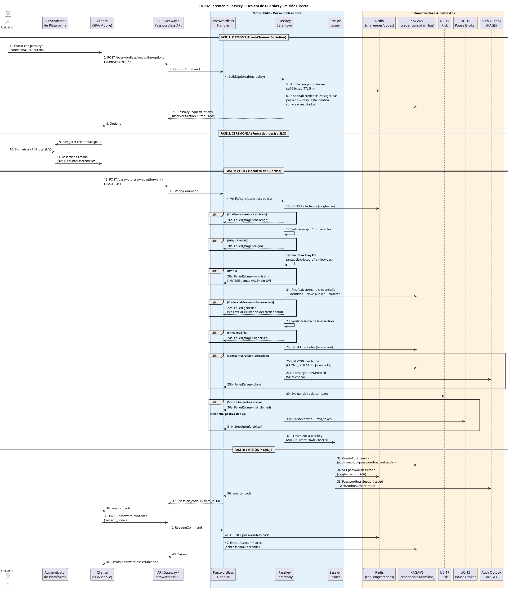
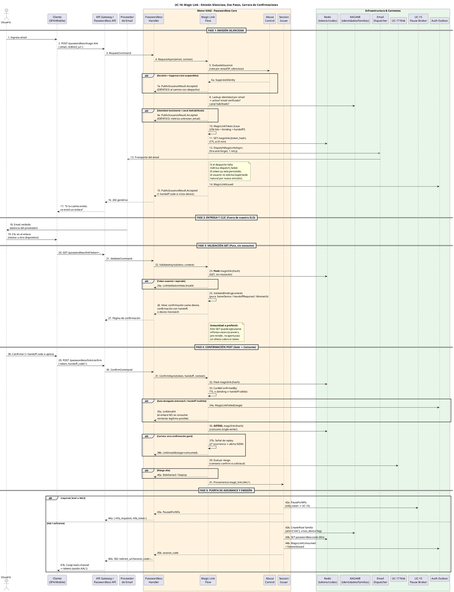
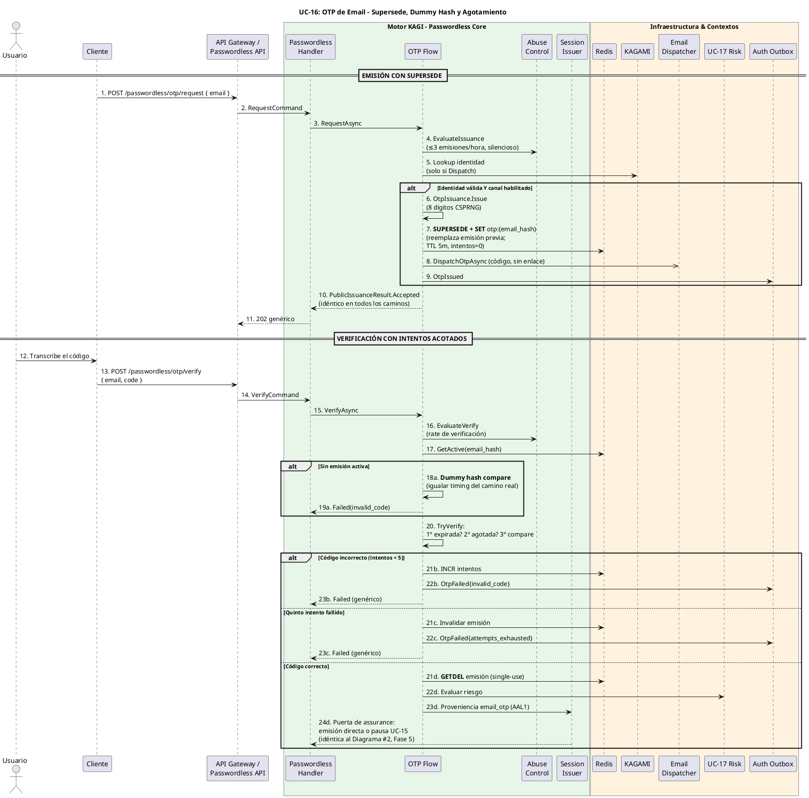
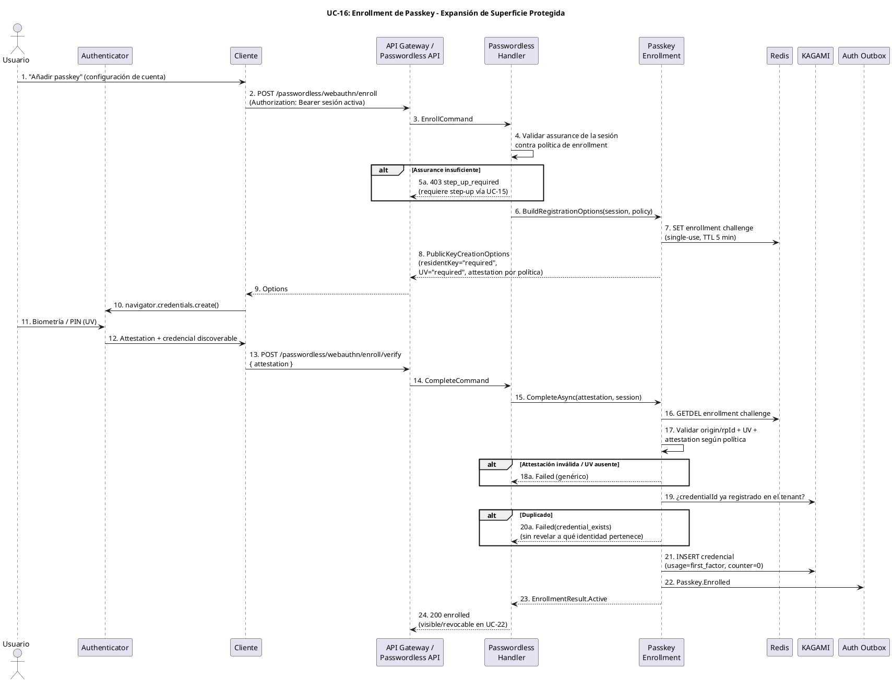

# UC-16: Passwordless Authentication - Diagrama de Secuencia

| Metadatos del Documento | |
| :--- | :--- |
| **Proyecto:** | SHUGO - Identity & Access Platform |
| **Caso de Uso:** | UC-16 - Passwordless Authentication (Passkeys + Magic Links + OTP Restringido) |
| **Documento:** | 07_Sequence_Diagram.md |
| **Metodología:** | ICONIX (Diagrama de Secuencia) + DDD + Security by Design (Two-Step Consumption & Silent Issuance) + Temporal Boundary Analysis |
| **Autor:** | Gastón Ruiz |
| **Versión Actual:** | 1.0.0 |
| **Fecha:** | 10/11/2026 |

---

## Historial de Versiones

| Versión | Fecha | Autor | Descripción de Cambios | Impacto |
| :--- | :--- | :--- | :--- | :--- |
| **1.0.0** | 10/11/2026 | Gastón Ruiz | **Creación inicial.** Diagrama de Secuencia completo para UC-16 en cuatro partes: (1) la ceremonia passkey con la escalera de guardas (challenge → origin → UV → registro → firma → counter) y contención de clonación transaccional; (2) el ciclo magic link con emisión silenciosa, despacho async, validación GET sin consumo, confirmación POST con gate pre-consumo y carrera de confirmaciones resuelta por GETDEL; (3) el ciclo OTP con supersede atómico, dummy hash en ausencia de emisión, agotamiento de intentos y consumo single-use; y (4) el enrollment de passkey desde sesión autenticada con step-up condicional. Incluye presupuesto de timeouts por dependencia, análisis de carreras y trazas por canal. | Documento base del paquete de diseño Tier 1 del UC-16. Sirve como guion temporal exacto para la codificación de los flujos por canal, fijando que el consumo ocurre siempre después de la validación de guardas, que la emisión silenciosa responde antes de decidir el despacho, y que ninguna completitud ocurre sin pasar por la puerta única de assurance. |

---

## 1. Introducción y Propósito

El **Diagrama de Secuencia** para el UC-16 materializa temporalmente las colaboraciones definidas en el Diagrama de Robustez. Su propósito es:

1. **Ordenar las guardas por costo:** La ceremonia passkey ejecuta sus validaciones de la más barata a la más cara; el orden es la optimización y la defensa simultáneamente.
2. **Separar los tiempos de cada canal:** Passkey es síncrono (criptografía local), magic link es asíncrono mediado por email y humano, OTP es asíncrono con intentos acotados — cada uno tiene su presupuesto de timeout y su SLO correcto.
3. **Fijar el orden validación→consumo:** En magic link, el gate de binding/handoff se evalúa **antes** del GETDEL; en OTP, el compare ocurre **antes** del consumo. Un fallo de guarda nunca destruye el artefacto.
4. **Modelar las carreras reales:** Doble confirmación de enlace, doble solicitud de OTP (supersede), doble verify con el mismo challenge — cada una con su mecanismo de resolución observable.
5. **Documentar la convergencia de emisión:** Los tres canales terminan en el mismo emisor con la misma puerta de assurance y el mismo puente de session_code.

---

## 2. Diagrama de Secuencia #1: Ceremonia Passkey (Primer Factor)



---

## 3. Diagrama de Secuencia #2: Ciclo Completo de Magic Link



---

## 4. Diagrama de Secuencia #3: Ciclo OTP de Email (Restringido)



---

## 5. Diagrama de Secuencia #4: Enrollment de Passkey (Sesión Autenticada)



---

## 6. Análisis Detallado del Flujo

### 6.1. Diagrama #1: La Escalera de Guardas Passkey

El verify passkey (pasos 15-25) ejecuta las guardas en orden estricto de costo creciente:

1. **Challenge GETDEL (paso 15):** Mata ceremonias replayadas sin tocar nada más.
2. **Origin/rpId (17):** Comparación de strings; mata assertions de otros orígenes.
3. **UV (19):** Lectura de un flag; mata assertions sin verificación **antes** de gastar criptografía o lookups.
4. **Registro (21):** Lookup indexado; resuelve identidad desde KAGAMI, nunca desde la assertion.
5. **Firma (23):** El único paso criptográfico del camino.
6. **Counter (25):** Detección de clonación con contención transaccional.

**Justificación:** Un flood de assertions basura muere en los peldaños 1-3 (~2-3 ms); solo las assertions estructuralmente plausibles alcanzan la criptografía y la base de datos.

### 6.2. Diagrama #2: Los Cinco Momentos del Magic Link

1. **Emisión silenciosa (pasos 1-17):** El 202 se construye antes de que termine la decisión interna; el despacho (12-13) es fire-and-forget fuera de la respuesta. La identidad inexistente y la rate-suspendida producen exactamente la misma secuencia observable.
2. **Entrega (18-19):** Fuera de todo SLO; el TTL de 10 min es el horizonte duro.
3. **Validación pura (20-27):** Peek + ValidateBinding sin mutación; cualquier número de GETs es inofensivo.
4. **Gate antes del consumo (31-35):** Binding/handoff se evalúan con el token aún vivo; el fallo preserva el enlace para reintento legítimo.
5. **Consumo y emisión (36-47):** GETDEL como único escritor terminal; riesgo; puerta de assurance; emisión o pausa.

### 6.3. Diagrama #3: Las Tres Defensas del OTP

1. **Supersede (paso 7):** La nueva emisión reemplaza atómicamente la previa — nunca coexisten dos códigos activos.
2. **Dummy hash (pasos 18a-19a):** La verificación contra email sin emisión iguala el timing del camino real, cerrando el oráculo en el verify (no solo en el request).
3. **Agotamiento ordenado (paso 20):** Expiración → agotamiento → compare; el código expirado no gasta intentos y el agotado no revela por timing si el código presentado era correcto.

### 6.4. Diagrama #4: Enrollment como Expansión Protegida

El enrollment exige sesión autenticada con assurance suficiente (step-up condicional), challenge single-use, UV en la ceremonia de registro, y verificación de duplicado de credentialId **sin revelar** a qué identidad pertenece el duplicado. La credencial nace con `usage=first_factor` y counter inicializado.

---

## 7. Flujos Alternativos y Excepciones

| # | Escenario | Secuencia abreviada | Resultado |
| :--- | :--- | :--- | :--- |
| 7.1 | **Assertion sin UV** | Paso 19 → 20a | `uv_missing`; sin lookup de credencial ni criptografía gastada |
| 7.2 | **CredentialId desconocido** | Paso 21 → 22a | Rechazo genérico; no revela si el credentialId existe en otro tenant |
| 7.3 | **Clonación de passkey** | Paso 25 → 26b-28b | Revocación + `PasskeyCloneDetected` en la misma TX; sesión denegada |
| 7.4 | **Challenge reutilizado** | Paso 15 falla | `stage=challenge`; una ceremonia por challenge |
| 7.5 | **Enlace expirado** | Paso 23 → 24a | Página de expirado con re-solicitud; sin efectos |
| 7.6 | **Doble confirmación (carrera)** | Paso 36: un GETDEL gana | Ganador emite; perdedor → `stage=consumed` + señal de replay |
| 7.7 | **Device mismatch sin handoff** | Paso 33 → 34a-35a | Enlace intacto; usuario reintenta desde dispositivo origen |
| 7.8 | **Handoff incorrecto** | Paso 33 → 34a | Rechazo sin consumo; intentos de handoff acotados |
| 7.9 | **Riesgo denegado en confirmación** | Paso 39 → 40a | `MagicLinkFailed{risk_denied}`; token ya consumido (la prueba era válida; el contexto no) |
| 7.10 | **OTP agotado** | Paso 20 → 21c-23c | Emisión invalidada; re-emisión sujeta a 3/hora |
| 7.11 | **Email inexistente (OOB)** | Paso 8 → 9a | 202 idéntico al caso con despacho; métrica interna `unknown_email` |
| 7.12 | **Redis caído** | Cualquier paso con store | 503 fail-secure; ningún artefacto consumido ni emitido; pausas y solicitudes preservadas donde sea posible |
| 7.13 | **Despacho de email fallido** | Paso 12/8 falla | Token persistido; métrica `dispatch_failed`; usuario re-solicita |
| 7.14 | **Pause Broker caído con required ≥ AAL2** | Paso 42a falla | 503: nunca emitir AAL1 donde la política exige AAL2 |

---

## 8. Consideraciones de Arquitectura (Security & Performance)

### 8.1. Presupuesto de Timeouts por Dependencia

| Dependencia | Operación | Timeout / Latencia esperada | Comportamiento de fallo |
| :--- | :--- | :--- | :--- |
| **Redis** | GETDEL/Peek/SET de tokens, challenges, codes | 50 ms | Fail-secure: 503, sin efectos laterales |
| **KAGAMI** | Lookup identidad/credencial, UPDATE counter, CreateRoot | 200 ms c/u | Fail-secure: 503; counter update fallido bloquea la emisión passkey |
| **Firma WebAuthn** | Verificación ECDSA/EdDSA | ~1 ms | Fallo = prueba inválida |
| **Email Dispatcher** | Transporte SES/SMTP | 2 s, 1 retry, fire-and-forget | Métrica; el 202 ya fue retornado |
| **UC-17 Risk** | Evaluación de contexto | 100 ms | Fail-mode por política (`open` / `stepup`) |
| **TTLs de artefactos** | Challenge 5m / Magic link ≤10m / OTP 5m / Session code 60s | — | Expiración natural; purge sin jobs |

**SLOs locales (excluyen email y decisión humana):** options p95 < 50 ms; passkey verify p95 < 80 ms; magic confirm p95 < 150 ms; OTP verify p95 < 50 ms; redeem p95 < 50 ms.

### 8.2. Carreras y sus Mecanismos de Resolución

| Carrera | Mecanismo | Comportamiento observable |
| :--- | :--- | :--- |
| Doble confirmación de magic link | GETDEL atómico | Un ganador emite; el otro recibe `consumed` + señal de replay |
| Doble solicitud de magic link | Segunda emisión supersede la primera | El enlace anterior queda inválido al confirmarse el nuevo; ambos 202 idénticos |
| Doble solicitud de OTP | SUPERSEDE + SET atómico | Exactamente un código activo por identidad |
| Doble verify del mismo challenge passkey | GETDEL del challenge | Una ceremonia gana; la otra falla en `stage=challenge` |
| Doble canje de session_code | GETDEL del code | Un canje emite tokens; el segundo falla genérico |
| Prefetch del enlace (scanners) | GET sin mutación | Sin carrera: la validación es idempotente por construcción |

### 8.3. Identidad Desde el Registro, Nunca Desde la Assertion

El paso 21 del Diagrama #1 resuelve la identidad por `(tenant, credentialId)` contra KAGAMI; el `userHandle` de la assertion se verifica **contra** el registro (paso implícito en `FindActive`). Una assertion forjada con userHandle ajeno y credentialId propio no produce sesión de otra identidad — la fuente de verdad es el registro, no el authenticator.

### 8.4. Riesgo en la Posición Correcta por Canal

*   **Passkey (paso 29):** Tras la verificación completa de la prueba; el riesgo es la única causa de pausa/denegación para un canal que ya demostró AAL2+.
*   **Magic link (paso 39):** Compara el contexto de la confirmación contra el de la solicitud (device, geo, tiempo transcurrido) — un enlace solicitado en una red y confirmado en otra es señal de intercepción.
*   **OTP (paso 22d):** Riesgo sobre el contexto del verify.

### 8.5. Trazas por Canal (OpenTelemetry)

```text
POST /passwordless/webauthn/verify [~55ms]
├── redis.challenge.getdel [2ms]
├── guard.origin_uv [0.2ms]
├── kagami.credential.fetch [3ms]
├── webauthn.verify_signature [1ms]
├── kagami.counter.update [4ms]
├── risk.evaluate [30ms]
└── issuer.complete [15ms]

POST /passwordless/magic-link [~18ms, respuesta antes del despacho]
├── abuse.evaluate [2ms]
├── kagami.identity.lookup [5ms]
├── redis.token.set [2ms]
├── outbox.insert [4ms]
└── email.dispatch [async, fuera de la respuesta]

POST /passwordless/link/confirm [~70ms]
├── redis.token.peek [2ms]
├── gate.binding_handoff [0.5ms]
├── redis.token.getdel [2ms]
├── risk.evaluate [30ms]
└── issuer.or_pause [20ms]

POST /passwordless/otp/verify [~40ms]
├── redis.issuance.get [2ms]
├── otp.compare [0.1ms]
├── redis.issuance.getdel [2ms]
├── risk.evaluate [30ms]
└── issuer.or_pause [5ms]
```

---

## 9. Trazabilidad con Otros Documentos del Paquete

| Documento | Relación |
| :--- | :--- |
| `01_Requirements_Specification.md` | Los escenarios 2.1-2.2.4 y 4.1-4.10 se secuencian aquí paso a paso; las excepciones 4.1-4.7 corresponden a las filas de la tabla §7. |
| `03_Activity_Diagram.md` | Los cuatro diagramas de actividad se proyectan en los cuatro diagramas de secuencia con los mismos carriles y decisiones. |
| `05_State_Machine_Diagram.md` | Las transiciones ISSUED→CONSUMED (GETDEL paso 36/21d), ACTIVE→EXHAUSTED (paso 21c) y ACTIVE→REVOKED/CLONE (pasos 26b-28b) ocurren exactamente en estos mensajes. |
| `06_Robustness_Diagram.md` | Este diagrama define el orden temporal de las 80 colaboraciones que el de robustez define estructuralmente. |
| `08_Final_Class_Design.md` | Definirá las firmas exactas con `CancellationToken`, el record `PasswordlessTimeouts` y el colapso `PasswordlessOutcome.Match` en el boundary. |
| `10_UC_Specific_Data_Model.md` | Los GETDEL/Peek/SUPERSEDE de estos diagramas consumen los keyspaces `passwordless:magiclink:*`, `passwordless:otp:*`, `passwordless:challenge:*` y `passwordless:code:*`. |
| `11_UC_Specific_Security_Threats.md` | El orden gate→consumo (§6.2), el dummy hash (§6.3) y la escalera de guardas (§6.1) son las mitigaciones ejecutables de intercepción, enumeración y flood. |
| `12_UC_Specific_Performance_Benchmarks.md` | El presupuesto de timeouts (§8.1) y las trazas (§8.5) son la base de los SLOs y escenarios k6 con despacho simulado. |

---

## 10. Notas de Implementación

### 10.1. Configuración Tipada de Timeouts (C#)

```csharp
public sealed record PasswordlessTimeouts
{
    public TimeSpan RedisOperation     { get; init; } = TimeSpan.FromMilliseconds(50);
    public TimeSpan KagamiOperation    { get; init; } = TimeSpan.FromMilliseconds(200);
    public TimeSpan EmailDispatch      { get; init; } = TimeSpan.FromSeconds(2);
    public TimeSpan RiskEvaluation     { get; init; } = TimeSpan.FromMilliseconds(100);
    public TimeSpan ChallengeTtl       { get; init; } = TimeSpan.FromMinutes(5);
    public TimeSpan MagicLinkTtl       { get; init; } = TimeSpan.FromMinutes(10);  // tope INV-106
    public TimeSpan OtpTtl             { get; init; } = TimeSpan.FromMinutes(5);   // tope RN-38
    public TimeSpan SessionCodeTtl     { get; init; } = TimeSpan.FromSeconds(60);
    public int EmailDispatchRetries    { get; init; } = 1;   // único retry del UC: transporte no crítico
    public int Retries                 { get; init; } = 0;   // GETDEL/SUPERSEDE no son reintentables
}
```

### 10.2. Verificación de Orden en Tests de Integración

```csharp
[Test]
public async Task PasskeyVerify_ChecksUv_BeforeRegistryLookup()
{
    var order = new List<string>();
    CeremonyHooks.OnUvCheck(() => order.Add("uv"));
    CeremonyHooks.OnRegistryLookup(() => order.Add("registry"));

    await Ceremony.VerifyAsync(AssertionWithoutUv, Policy, CT);

    order.Should().StartWith("uv");
    order.Should().NotContain("registry");   // UV falla antes del lookup
}

[Test]
public async Task MagicLinkConfirm_ValidatesGate_BeforeConsumption()
{
    var order = new List<string>();
    Store.Setup(s => s.ConsumeAsync(It.IsAny<string>(), It.IsAny<CancellationToken>()))
         .Callback(() => order.Add("consume")).ReturnsAsync(Token);
    // Gate denegado por device mismatch:
    var outcome = await Flow.ConfirmAsync(CmdFromOtherDevice, handoff: null, CT);

    outcome.Stage.Should().Be(MagicLinkStage.DeviceMismatch);
    order.Should().BeEmpty();                // el consumo nunca ocurrió
}

[Test]
public async Task OtpVerify_WithoutIssuance_ExecutesDummyCompare()
{
    Store.Setup(s => s.GetActiveAsync(It.IsAny<string>(), It.IsAny<CancellationToken>()))
         .ReturnsAsync((EmailOtpIssuance?)null);

    await Flow.VerifyAsync(cmd, context, Policy, CT);

    Dummy.Verify(d => d.Compare(It.IsAny<OtpCode>()), Times.Once);
}

[Test]
public async Task ConcurrentMagicLinkConfirms_ExactlyOneIssues()
{
    var results = await Task.WhenAll(
        Flow.ConfirmAsync(cmd, deviceCtx, Policy, CT),
        Flow.ConfirmAsync(cmd, deviceCtx, Policy, CT));

    results.Count(r => r.IsSessionIssued || r.IsPausedForMfa).Should().Be(1);
    results.Count(r => r.Stage == MagicLinkStage.Consumed).Should().Be(1);
}
```

### 10.3. Convenciones de Numeración

- Cada diagrama tiene numeración independiente (1-n) con sufijos `a/b/c/d` para ramas mutuamente excluyentes dentro de un `alt`.
- Los pasos que corresponden a operaciones puras (validación GET, gate de binding) se anotan explícitamente como **sin mutación** para que la revisión de seguridad verifique el contrato de dos pasos directamente sobre el diagrama.
- Las flechas `->>` marcan despachos async fire-and-forget (email), diferenciándolos de los round-trips síncronos del verify.

---
*Fin del Documento 07_Sequence_Diagram para UC-16*