# UC-16: Passwordless Authentication - Diagrama de Clases de Diseño Final

| Metadatos del Documento | |
| :--- | :--- |
| **Proyecto:** | SHUGO - Identity & Access Platform |
| **Caso de Uso:** | UC-16 - Passwordless Authentication (Passkeys + Magic Links + OTP Restringido) |
| **Documento:** | 08_Final_Class_Design.md |
| **Metodología:** | ICONIX (Modelo de Diseño) + DDD + Clean Architecture + Hexagonal (Ports & Adapters) + Strategy por Canal + Typed Results |
| **Autor:** | Gastón Ruiz |
| **Versión Actual:** | 1.0.0 |
| **Fecha:** | 10/11/2026 |

---

## Historial de Versiones

| Versión | Fecha | Autor | Descripción de Cambios | Impacto |
| :--- | :--- | :--- | :--- | :--- |
| **1.0.0** | 10/11/2026 | **Gastón Ruiz** | **Creación inicial.** Definición del Modelo de Diseño (Clases de Implementación) para UC-16. Se detallan las firmas exactas del Application Service (`PasswordlessHandler` como enrutador delgado + redeem), los cuatro flujos expertos (`PasskeyCeremony` con escalera de guardas, `MagicLinkFlow` con Peek/GETDEL separados, `OtpFlow` con supersede y dummy hash, `PasskeyEnrollment` con gate de assurance), el `PasswordlessAbuseControl` con decisión interna tipada, el `PasswordlessSessionIssuer` como puerta única de assurance, y el resultado tipado `PasswordlessOutcome` con diez casos y colapso Zero Info Leakage compilable. Se incorporan cinco refinamientos: CAS condicional en el update de counter passkey, store de OTP como hash Redis con HINCRBY atómico de intentos, fail-mode del riesgo por canal, header de seguridad en la respuesta de emisión, y política de reintentos nulos salvo despacho de email. | Documento base del paquete de diseño Tier 1 del UC-16. Sirve como plano exacto de codificación: hace imposible emitir sesión sin proveniencia, consumir un enlace sin pasar por el gate, o revelar por respuesta la decisión interna de despacho — cada propiedad garantizada por tipos, firmas o primitivas atómicas. |

---

## 1. Introducción y Propósito

Este documento presenta el **Modelo de Diseño** (Diagrama de Clases de Implementación) para el Caso de Uso UC-16 (Passwordless Authentication).

A diferencia del Modelo de Dominio Inicial (documento 04), que era conceptual, este documento define las **clases concretas con firmas de métodos específicas**, visibilidad, manejo de `CancellationToken`, presupuestos de timeout tipados y contratos de fallo, listas para implementar en C# / .NET 8. El diseño debe garantizar:

1. **Un Enrutador, Cuatro Expertos, Un Emisor:** El handler no conoce canales; cada flujo experto concentra su adversario específico; el issuer es el único punto donde la evidencia se convierte en sesión o pausa.
2. **Consumo Single-Writer por Artefacto:** Cada artefacto efímero (enlace, OTP, challenge, session code) tiene exactamente una operación de consumo y exactamente un flujo que la invoca.
3. **Zero Info Leakage Compilable:** `PasswordlessOutcome` con diez casos exactos; los dieciocho motivos internos de fallo son dato de auditoría, nunca respuesta HTTP.
4. **Validación Pura como Contrato de Puerto:** `IMagicLinkStore.PeekAsync` no puede consumir porque la interfaz no expone cómo; `ConsumeAsync` es la única operación terminal.
5. **Fail-Secure Asimétrico:** El counter passkey bloquea la emisión si no persiste; el despacho de email y la emisión del trusted code son best-effort; el pause broker caído con política AAL2+ bloquea la emisión insuficiente.

---

## 2. Diagrama de Clases de Diseño (PlantUML)

```plantuml
@startuml UC-16_ClasesDiseno
<style>
diagram {
  BackgroundColor #FFFFFF
}
</style>
skinparam classAttributeIconSize 0
skinparam classBackgroundColor #FFFFFF
skinparam classBorderColor #34495E
skinparam classHeaderBackgroundColor #E3F2FD

title UC-16: Diagrama de Clases de Diseño Final - Passwordless Core (Tres Canales, Un Emisor)

' ============================================
' CAPA DE APLICACIÓN (Application Layer)
' ============================================
package "Aplicación (Application Layer)" {

    class PasswordlessHandler <<Application Service>> {
        - ceremony: IPasskeyCeremony
        - enrollment: IPasskeyEnrollment
        - magicLink: IMagicLinkFlow
        - otp: IOtpFlow
        - codes: ISessionCodeStore
        - families: ITokenFamilyMinter
        - policies: IPasswordlessPolicyResolver
        + WebAuthnOptionsAsync(cmd, ct): Task<PasswordlessOutcome>
        + WebAuthnVerifyAsync(cmd, ct): Task<PasswordlessOutcome>
        + RequestMagicLinkAsync(cmd, ct): Task<PasswordlessOutcome>
        + ValidateMagicLinkAsync(token, ct): Task<PasswordlessOutcome>
        + ConfirmMagicLinkAsync(cmd, ct): Task<PasswordlessOutcome>
        + RequestOtpAsync(cmd, ct): Task<PasswordlessOutcome>
        + VerifyOtpAsync(cmd, ct): Task<PasswordlessOutcome>
        + EnrollPasskeyAsync(cmd, ct): Task<PasswordlessOutcome>
        + RedeemAsync(cmd, ct): Task<PasswordlessOutcome>
    }

    class PasswordlessController <<Boundary>> {
        + WebAuthnOptions(cmd): IActionResult
        + WebAuthnVerify(cmd): IActionResult
        + MagicLinkRequest(cmd): IActionResult
        + MagicLinkValidate(token): IActionResult
        + MagicLinkConfirm(cmd): IActionResult
        + OtpRequest(cmd): IActionResult
        + OtpVerify(cmd): IActionResult
        + Enroll(cmd): IActionResult
        + Redeem(cmd): IActionResult
        - Map(outcome: PasswordlessOutcome): IActionResult
    }

    class PasswordlessOutcome <<Typed Result>> {
        + {static} CeremonyOptions(payload): PasswordlessOutcome
        + {static} IssuanceAccepted(handoffDigits?): PasswordlessOutcome
        + {static} LinkView(view: LinkValidationView): PasswordlessOutcome
        + {static} SessionIssued(code, redirectUri?): PasswordlessOutcome
        + {static} PausedForMfa(ticket): PasswordlessOutcome
        + {static} StepUpRequired(): PasswordlessOutcome
        + {static} Enrolled(result): PasswordlessOutcome
        + {static} TokensIssued(tokens): PasswordlessOutcome
        + {static} Failed(reason: PasswordlessFailReason): PasswordlessOutcome
        + {static} ServiceUnavailable(dependency): PasswordlessOutcome
        + Match<T>(...diez funciones...): T
    }

    enum PasswordlessFailReason {
        ChallengeInvalid
        OriginInvalid
        UvMissing
        UnknownCredential
        SignatureInvalid
        Clone
        RiskDenied
        LinkExpired
        LinkConsumed
        DeviceMismatch
        HandoffInvalid
        OtpInvalid
        OtpExhausted
        OtpExpired
        RateLimited
        EnrollmentDuplicate
        EnrollmentAssuranceInsufficient
        RedeemInvalid
    }

    class PasswordlessTimeouts <<Record>> {
        + RedisOperation: TimeSpan = 50ms
        + KagamiOperation: TimeSpan = 200ms
        + EmailDispatch: TimeSpan = 2s
        + RiskEvaluation: TimeSpan = 100ms
        + ChallengeTtl: TimeSpan = 5m
        + MagicLinkTtl: TimeSpan = 10m
        + OtpTtl: TimeSpan = 5m
        + SessionCodeTtl: TimeSpan = 60s
        + EmailDispatchRetries: int = 1
        + Retries: int = 0
    }

    class PasswordlessMetrics <<Telemetry>> {
        + VerifyTotal: Counter<long>      {channel, result}
        + UnknownEmailTotal: Counter<long>
        + RateSuspendedTotal: Counter<long>
        + DispatchFailuresTotal: Counter<long>
        + CloneDetectedTotal: Counter<long>
        + ReplaySignalsTotal: Counter<long>
        + OtpExhaustedTotal: Counter<long>
        + PauseByAssuranceTotal: Counter<long>
    }
}

' ============================================
' CAPA DE DOMINIO (Domain Layer)
' ============================================
package "Dominio (Domain Layer)" {

    class PasskeyCeremony <<Domain Service>> {
        - challenges: IChallengeStore
        - credentials: IPasskeyCredentialRepository
        - webauthn: IWebAuthnAssertionValidator
        - risk: IRiskEvaluator
        - issuer: IPasswordlessSessionIssuer
        + BuildOptionsAsync(hint, policy, ct): Task<PasswordlessOutcome>
        + VerifyAsync(assertion, context, policy, ct): Task<PasswordlessOutcome>
    }

    class PasskeyEnrollment <<Domain Service>> {
        - challenges: IChallengeStore
        - credentials: IPasskeyCredentialRepository
        - webauthn: IWebAuthnAssertionValidator
        + BuildRegistrationOptionsAsync(session, policy, ct): Task<PasswordlessOutcome>
        + CompleteAsync(attestation, session, policy, ct): Task<PasswordlessOutcome>
    }

    class MagicLinkFlow <<Domain Service>> {
        - abuse: IPasswordlessAbuseControl
        - identities: IIdentityDirectory
        - links: IMagicLinkStore
        - email: IEmailDispatcher
        - risk: IRiskEvaluator
        - issuer: IPasswordlessSessionIssuer
        + RequestAsync(cmd, context, policy, ct): Task<PasswordlessOutcome>
        + ValidateAsync(token, context, ct): Task<PasswordlessOutcome>
        + ConfirmAsync(cmd, context, policy, ct): Task<PasswordlessOutcome>
    }

    class OtpFlow <<Domain Service>> {
        - abuse: IPasswordlessAbuseControl
        - identities: IIdentityDirectory
        - otpStore: IOtpStore
        - email: IEmailDispatcher
        - risk: IRiskEvaluator
        - issuer: IPasswordlessSessionIssuer
        + RequestAsync(cmd, context, policy, ct): Task<PasswordlessOutcome>
        + VerifyAsync(cmd, context, policy, ct): Task<PasswordlessOutcome>
    }

    class PasswordlessAbuseControl <<Domain Service>> {
        - store: IAbuseRateStore
        - outbox: IOutboxPublisher
        + EvaluateIssuanceAsync(emailHash, context, policy, ct): Task<IssuanceDecision>
        + EvaluateVerifyAsync(emailHash, context, policy, ct): Task<bool>
    }

    class PasswordlessSessionIssuer <<Domain Service>> {
        - families: ITokenFamilyFactory
        - pauses: IPauseBroker
        - codes: ISessionCodeStore
        - outbox: IOutboxPublisher
        + IssueOrPauseAsync(provenance, policy, identity, ct): Task<PasswordlessOutcome>
    }

    interface IMagicLinkStore {
        + SaveAsync(token, ct): Task
        + PeekAsync(tokenHash, ct): Task<MagicLinkToken?>
        + ConsumeAsync(tokenHash, ct): Task<MagicLinkToken?>
    }
    interface IOtpStore {
        + SupersedeAndSaveAsync(issuance, ct): Task
        + GetActiveAsync(emailHash, ct): Task<EmailOtpIssuance?>
        + IncrementAttemptsAsync(emailHash, ct): Task<int>
        + InvalidateAsync(emailHash, ct): Task
        + ConsumeAsync(emailHash, ct): Task<bool>
    }
    interface IChallengeStore {
        + SaveAsync(challenge, ct): Task
        + ConsumeAsync(challengeRef, ct): Task<CeremonyChallenge?>
    }
    interface ISessionCodeStore {
        + IssueAsync(code, payload, ct): Task
        + RedeemAsync(code, ct): Task<PasswordlessSessionPayload?>
    }
    interface IPasskeyCredentialRepository {
        + FindActiveAsync(tenant, credentialId, ct): Task<PasskeyCredential?>
        + ExistsAsync(tenant, credentialId, ct): Task<bool>
        + SaveCounterCasAsync(credential, presented, ct): Task<CounterCasResult>
        + RevokeWithEventAsync(credential, now, ct): Task
        + InsertAsync(credential, ct): Task
    }
    interface IEmailDispatcher {
        + DispatchMagicLinkAsync(email, link, ct): Task
        + DispatchOtpAsync(email, code, ct): Task
    }
    interface IPauseBroker {
        + PauseForMfaAsync(identity, provenance, ct): Task<MfaPauseTicket>
    }
}

' ============================================
' CAPA DE INFRAESTRUCTURA (Adapters)
' ============================================
package "Infraestructura (Adapters)" {
    class RedisMagicLinkStore <<GET / GETDEL>>
    class RedisOtpStore <<Hash: SET supersede,\nHINCRBY intentos, DEL consumo>>
    class RedisChallengeStore <<GETDEL>>
    class RedisSessionCodeStore <<GETDEL>>
    class RedisAbuseRateStore <<INCR + EX>>
    class KagamiPasskeyCredentialRepository <<EF Core + CAS condicional>>
    class SesEmailDispatcher <<timeout 2s, 1 retry>>
}

' ============================================
' RELACIONES
' ============================================
PasswordlessController --> PasswordlessHandler
PasswordlessController ..> PasswordlessOutcome : Match<T> (colapso ZIL)
PasswordlessOutcome ..> PasswordlessFailReason

PasswordlessHandler --> PasskeyCeremony
PasswordlessHandler --> PasskeyEnrollment
PasswordlessHandler --> MagicLinkFlow
PasswordlessHandler --> OtpFlow
PasswordlessHandler --> ISessionCodeStore

MagicLinkFlow --> PasswordlessAbuseControl
MagicLinkFlow --> IMagicLinkStore
MagicLinkFlow --> IEmailDispatcher
MagicLinkFlow --> PasswordlessSessionIssuer

OtpFlow --> PasswordlessAbuseControl
OtpFlow --> IOtpStore
OtpFlow --> IEmailDispatcher
OtpFlow --> PasswordlessSessionIssuer

PasskeyCeremony --> IChallengeStore
PasskeyCeremony --> IPasskeyCredentialRepository
PasskeyCeremony --> PasswordlessSessionIssuer
PasskeyEnrollment --> IChallengeStore
PasskeyEnrollment --> IPasskeyCredentialRepository

PasswordlessSessionIssuer --> IPauseBroker
PasswordlessAbuseControl --> IAbuseRateStore

RedisMagicLinkStore ..|> IMagicLinkStore
RedisOtpStore ..|> IOtpStore
RedisChallengeStore ..|> IChallengeStore
RedisSessionCodeStore ..|> ISessionCodeStore
RedisAbuseRateStore ..|> IAbuseRateStore
KagamiPasskeyCredentialRepository ..|> IPasskeyCredentialRepository
SesEmailDispatcher ..|> IEmailDispatcher

note right of PasswordlessOutcome
  **Diez casos exactos:**
  Match<T> exhaustivo (CS8509 +
  TreatWarningsAsErrors). Los 18
  FailReason son dato de auditoría;
  el boundary los colapsa a un
  único cuerpo 400.
end note

note bottom of IMagicLinkStore
  **Validar ≠ consumir en la firma:**
  PeekAsync no puede consumir
  porque la interfaz no expone cómo.
  ConsumeAsync (GETDEL) es la única
  operación terminal del enlace.
end note

note left of PasswordlessSessionIssuer
  **Puerta única de assurance:**
  AAL insuficiente → PauseBroker.
  PauseBroker caído con required ≥ AAL2
  → 503, nunca emisión insuficiente.
end note

@enduml
```



---

## 3. Detalle de Clases por Capa

### 3.1. Capa de Aplicación (Application Layer)

#### **PasswordlessOutcome (Typed Result con Diez Casos)**

```csharp
public sealed class PasswordlessOutcome
{
    private enum Kind
    {
        CeremonyOptions, IssuanceAccepted, LinkView, SessionIssued,
        PausedForMfa, StepUpRequired, Enrolled, TokensIssued,
        Failed, ServiceUnavailable
    }

    private readonly Kind _kind;
    private readonly object? _payload;
    private readonly PasswordlessFailReason _reason;
    private readonly string? _dependency;

    private PasswordlessOutcome(Kind kind, object? payload = null,
                                PasswordlessFailReason reason = default, string? dependency = null)
        => (_kind, _payload, _reason, _dependency) = (kind, payload, reason, dependency);

    public static PasswordlessOutcome CeremonyOptions(CeremonyOptionsPayload p)        => new(Kind.CeremonyOptions, p);
    public static PasswordlessOutcome IssuanceAccepted(string? handoffDigits)          => new(Kind.IssuanceAccepted, handoffDigits);
    public static PasswordlessOutcome LinkView(LinkValidationView v)                   => new(Kind.LinkView, v);
    public static PasswordlessOutcome SessionIssued(SessionCode c, Uri? redirect)      => new(Kind.SessionIssued, (c, redirect));
    public static PasswordlessOutcome PausedForMfa(MfaPauseTicket t)                   => new(Kind.PausedForMfa, t);
    public static PasswordlessOutcome StepUpRequired()                                 => new(Kind.StepUpRequired);
    public static PasswordlessOutcome Enrolled(EnrollmentResult r)                     => new(Kind.Enrolled, r);
    public static PasswordlessOutcome TokensIssued(TokenPair t)                        => new(Kind.TokensIssued, t);
    public static PasswordlessOutcome Failed(PasswordlessFailReason reason)            => new(Kind.Failed, reason: reason);
    public static PasswordlessOutcome ServiceUnavailable(string dependency)            => new(Kind.ServiceUnavailable, dependency: dependency);

    /// <summary>
    /// Plegado exhaustivo: agregar un Kind nuevo rompe compilación de todos
    /// los callers (CS8509 + TreatWarningsAsErrors). El FailReason NUNCA
    /// alcanza el HTTP: solo logs, métricas y eventos.
    /// </summary>
    public T Match<T>(
        Func<CeremonyOptionsPayload, T> ceremonyOptions,
        Func<string?, T> issuanceAccepted,
        Func<LinkValidationView, T> linkView,
        Func<SessionCode, Uri?, T> sessionIssued,
        Func<MfaPauseTicket, T> pausedForMfa,
        Func<T> stepUpRequired,
        Func<EnrollmentResult, T> enrolled,
        Func<TokenPair, T> tokensIssued,
        Func<PasswordlessFailReason, T> failed,
        Func<string, T> serviceUnavailable) =>
        _kind switch
        {
            Kind.CeremonyOptions    => ceremonyOptions((CeremonyOptionsPayload)_payload!),
            Kind.IssuanceAccepted   => issuanceAccepted((string?)_payload),
            Kind.LinkView           => linkView((LinkValidationView)_payload!),
            Kind.SessionIssued      => sessionIssued(((SessionCode, Uri?))_payload),
            Kind.PausedForMfa       => pausedForMfa((MfaPauseTicket)_payload!),
            Kind.StepUpRequired     => stepUpRequired(),
            Kind.Enrolled           => enrolled((EnrollmentResult)_payload!),
            Kind.TokensIssued       => tokensIssued((TokenPair)_payload!),
            Kind.Failed             => failed(_reason),
            Kind.ServiceUnavailable => serviceUnavailable(_dependency!),
        };
}
```

#### **PasswordlessHandler (Enrutador Delgado + Redeem)**

```csharp
public class PasswordlessHandler : IPasswordlessHandler
{
    private readonly IPasskeyCeremony _ceremony;
    private readonly IPasskeyEnrollment _enrollment;
    private readonly IMagicLinkFlow _magicLink;
    private readonly IOtpFlow _otp;
    private readonly ISessionCodeStore _codes;
    private readonly ITokenFamilyMinter _families;
    private readonly IPasswordlessPolicyResolver _policies;

    public Task<PasswordlessOutcome> WebAuthnOptionsAsync(WebAuthnOptionsCommand cmd, CancellationToken ct) =>
        _ceremony.BuildOptionsAsync(cmd, ResolveContext(), ct);

    public Task<PasswordlessOutcome> WebAuthnVerifyAsync(WebAuthnVerifyCommand cmd, CancellationToken ct) =>
        _ceremony.VerifyAsync(cmd.Assertion, ResolveContext(), ct);

    public Task<PasswordlessOutcome> RequestMagicLinkAsync(MagicLinkRequestCommand cmd, CancellationToken ct) =>
        _magicLink.RequestAsync(cmd, ResolveContext(), ct);

    public Task<PasswordlessOutcome> ValidateMagicLinkAsync(string token, CancellationToken ct) =>
        _magicLink.ValidateAsync(token, ResolveContext(), ct);

    public Task<PasswordlessOutcome> ConfirmMagicLinkAsync(MagicLinkConfirmCommand cmd, CancellationToken ct) =>
        _magicLink.ConfirmAsync(cmd, ResolveContext(), ct);

    public Task<PasswordlessOutcome> RequestOtpAsync(OtpRequestCommand cmd, CancellationToken ct) =>
        _otp.RequestAsync(cmd, ResolveContext(), ct);

    public Task<PasswordlessOutcome> VerifyOtpAsync(OtpVerifyCommand cmd, CancellationToken ct) =>
        _otp.VerifyAsync(cmd, ResolveContext(), ct);

    public Task<PasswordlessOutcome> EnrollPasskeyAsync(EnrollCommand cmd, CancellationToken ct) =>
        _enrollment.BeginOrCompleteAsync(cmd, ResolveSession(), ct);

    /// <summary>Único camino que entrega tokens: canje del puente one-time.</summary>
    public async Task<PasswordlessOutcome> RedeemAsync(RedeemCommand cmd, CancellationToken ct)
    {
        PasswordlessSessionPayload? payload;
        try
        {
            payload = await _codes.RedeemAsync(cmd.SessionCode, ct);   // GETDEL
        }
        catch (InfrastructureException)
        {
            return PasswordlessOutcome.ServiceUnavailable("redis");
        }

        if (payload is null)
            return PasswordlessOutcome.Failed(PasswordlessFailReason.RedeemInvalid);

        var tokens = await _families.MintForExistingAsync(payload.FamilyId, payload.Provenance, ct);
        return PasswordlessOutcome.TokensIssued(tokens);
    }
}
```

#### **PasswordlessController (Boundary: Colapso Zero Info Leakage)**

```csharp
[ApiController]
[Route("v1/auth/passwordless")]
public class PasswordlessController : ControllerBase
{
    [HttpPost("webauthn/options")]
    public async Task<IActionResult> Options([FromBody] WebAuthnOptionsCommand cmd, CancellationToken ct)
        => Map(await _handler.WebAuthnOptionsAsync(cmd, ct));

    [HttpPost("webauthn/verify")]
    public async Task<IActionResult> Verify([FromBody] WebAuthnVerifyCommand cmd, CancellationToken ct)
        => Map(await _handler.WebAuthnVerifyAsync(cmd, ct));

    [HttpPost("magic-link")]
    public async Task<IActionResult> MagicLinkRequest([FromBody] MagicLinkRequestCommand cmd, CancellationToken ct)
        => Map(await _handler.RequestMagicLinkAsync(cmd, ct));

    [HttpGet("link")]
    public async Task<IActionResult> MagicLinkValidate([FromQuery] string token, CancellationToken ct)
        => Map(await _handler.ValidateMagicLinkAsync(token, ct));

    [HttpPost("link/confirm")]
    public async Task<IActionResult> MagicLinkConfirm([FromBody] MagicLinkConfirmCommand cmd, CancellationToken ct)
        => Map(await _handler.ConfirmMagicLinkAsync(cmd, ct));

    [HttpPost("otp/request")]
    public async Task<IActionResult> OtpRequest([FromBody] OtpRequestCommand cmd, CancellationToken ct)
        => Map(await _handler.RequestOtpAsync(cmd, ct));

    [HttpPost("otp/verify")]
    public async Task<IActionResult> OtpVerify([FromBody] OtpVerifyCommand cmd, CancellationToken ct)
        => Map(await _handler.VerifyOtpAsync(cmd, ct));

    [HttpPost("token")]
    public async Task<IActionResult> Redeem([FromBody] RedeemCommand cmd, CancellationToken ct)
        => Map(await _handler.RedeemAsync(cmd, ct));

    /// <summary>
    /// ÚNICO lugar donde un FailReason se convierte en HTTP.
    /// Los 18 motivos convergen a cuerpos idénticos por categoría.
    /// </summary>
    private IActionResult Map(PasswordlessOutcome outcome) => outcome.Match(
        ceremonyOptions: p => Ok(p).WithNoStore(),

        issuanceAccepted: handoff =>
        {
            // INV-109: el cuerpo es idéntico exista o no la identidad.
            // El handoff code viaja solo cuando la política lo habilita.
            var body = handoff is null
                ? new IssuanceAcceptedResponse(GenericMessage)
                : new IssuanceAcceptedResponse(GenericMessage, handoff);
            return Accepted(body).WithNoStore();
        },

        linkView: v => Ok(v).WithNoStore(),   // página de confirmación (estado de vista, no consumo)

        sessionIssued: (code, redirect) => redirect is null
            ? Ok(new SessionCodeResponse(code.Value, code.TtlSeconds)).WithNoStore()
            : Redirect($"{redirect}?session_code={Uri.EscapeDataString(code.Value)}"),

        pausedForMfa: t => Ok(new MfaRequiredResponse(true, t.MfaToken, t.AllowedMethods)).WithNoStore(),

        stepUpRequired: () => StatusCode(403, new ErrorResponse(
            "step_up_required", "Elevated verification is required for this operation.")),

        enrolled: r => Ok(r).WithNoStore(),

        tokensIssued: t => Ok(new TokenResponse("Bearer", t.AccessToken, t.RefreshToken, t.ExpiresIn, t.SessionMeta)).WithNoStore(),

        failed: reason =>
        {
            _logger.LogInformation("Passwordless failed: {Reason}", reason);
            _metrics.VerifyTotal.Add(1, new TagList { { "result", reason.ToString() } });
            return BadRequest(new ErrorResponse(
                "passwordless_failed", "Passwordless verification could not be completed."));
        },

        serviceUnavailable: dependency =>
        {
            _logger.LogCritical("Passwordless dependency unavailable: {Dependency}", dependency);
            return StatusCode(503, new ErrorResponse(
                "passwordless_unavailable", "Passwordless authentication is temporarily unavailable."))
                .WithRetryAfter(5);
        });
}
```

### 3.2. Capa de Dominio (Domain Layer)

#### **MagicLinkFlow (Emisión Silenciosa + Dos Pasos + Consumo Single-Writer)**

```csharp
public class MagicLinkFlow : IMagicLinkFlow
{
    private const string GenericMessage =
        "If the account exists and this sign-in method is enabled, a sign-in link has been sent.";

    public async Task<PasswordlessOutcome> RequestAsync(
        MagicLinkRequestCommand cmd, DeviceBinding context, CancellationToken ct)
    {
        var policy = await _policies.ResolveByRealmAsync(cmd.Email, ct);
        if (policy is null || !policy.MagicLinkEnabled)
            return PasswordlessOutcome.IssuanceAccepted(null);      // idéntico: sin fuga

        var emailHash = EmailHasher.Hash(cmd.Email);
        var decision = await _abuse.EvaluateIssuanceAsync(emailHash, context, policy, ct);

        if (decision.Kind == IssuanceKind.Dispatch)
        {
            var identity = await _identities.FindActiveVerifiedAsync(cmd.Email, ct);
            if (identity is not null)
            {
                var (token, plaintext, handoff) = MagicLinkToken.Issue(
                    identity.TenantId, identity.Id, emailHash, context, policy, _random, _clock.UtcNow);

                await _links.SaveAsync(token, ct);                  // persistir ANTES del despacho

                // Fire-and-forget: el fallo de transporte nunca altera la respuesta
                _ = _email.DispatchMagicLinkAsync(identity.Email, BuildLink(plaintext), ct)
                    .ContinueWith(t => _metrics.DispatchFailuresTotal.Add(1),
                                  TaskContinuationOptions.OnlyOnFaulted);

                await _outbox.PublishAsync(new MagicLinkIssued(
                    identity.Id, token.TokenHash, context, handoff is not null, _clock.UtcNow), ct);

                return PasswordlessOutcome.IssuanceAccepted(handoff?.Digits);
            }
            _metrics.UnknownEmailTotal.Add(1);
        }
        else
        {
            _metrics.RateSuspendedTotal.Add(1);
            await _outbox.PublishAsync(new PasswordlessRateLimited(
                PasswordlessChannel.MagicLink, decision.Dimension, emailHash, _clock.UtcNow), ct);
        }

        return PasswordlessOutcome.IssuanceAccepted(null);          // convergencia pública
    }

    /// <summary>VALIDACIÓN PURA (GET): Peek + proyección de binding, sin mutación.</summary>
    public async Task<PasswordlessOutcome> ValidateAsync(string token, DeviceBinding context, CancellationToken ct)
    {
        var stored = await _links.PeekAsync(Sha256(token), ct);
        if (stored is null || stored.IsExpired(_clock.UtcNow))
            return PasswordlessOutcome.LinkView(LinkValidationView.Invalid());

        return PasswordlessOutcome.LinkView(stored.ValidateBinding(context) switch
        {
            BindingCheck.SameDevice      => LinkValidationView.Ready(sameDevice: true),
            BindingCheck.HandoffRequired => LinkValidationView.Ready(sameDevice: false, requiresHandoff: true),
            _                            => LinkValidationView.DeviceMismatch()
        });
    }

    /// <summary>CONFIRMACIÓN (POST): gate → GETDEL → riesgo → assurance → emisión.</summary>
    public async Task<PasswordlessOutcome> ConfirmAsync(
        MagicLinkConfirmCommand cmd, DeviceBinding context, CancellationToken ct)
    {
        var hash = Sha256(cmd.Token);
        var policy = await _policies.ResolveForTokenAsync(hash, ct);

        var stored = await _links.PeekAsync(hash, ct);
        if (stored is null || stored.IsExpired(_clock.UtcNow))
            return PasswordlessOutcome.Failed(PasswordlessFailReason.LinkExpired);

        // 1. GATE ANTES DEL CONSUMO: el fallo de binding/handoff preserva el enlace
        var gate = stored.CanBeConfirmedBy(context, cmd.HandoffCode, _clock.UtcNow);
        if (!gate.Allowed)
        {
            await _outbox.PublishAsync(new MagicLinkFailed(
                stored.IdentityId, gate.FailureStage!.Value, context, _clock.UtcNow), ct);
            return gate.FailureStage.Value switch
            {
                MagicLinkStage.DeviceMismatch => PasswordlessOutcome.Failed(PasswordlessFailReason.DeviceMismatch),
                MagicLinkStage.HandoffInvalid => PasswordlessOutcome.Failed(PasswordlessFailReason.HandoffInvalid),
                _                             => PasswordlessOutcome.Failed(PasswordlessFailReason.LinkExpired)
            };
        }

        // 2. CONSUMO SINGLE-WRITER: exactamente un ganador en carreras de confirmación
        var consumed = await _links.ConsumeAsync(hash, ct);         // GETDEL
        if (consumed is null)
        {
            await _signals.RecordReplayAsync(hash, ct);             // 2ª ocurrencia → alerta SIEM
            return PasswordlessOutcome.Failed(PasswordlessFailReason.LinkConsumed);
        }

        // 3. RIESGO con fail-mode por política
        var risk = await EvaluateRiskAsync(context, policy, ct);
        if (risk.IsDenied) return PasswordlessOutcome.Failed(PasswordlessFailReason.RiskDenied);
        if (risk.RequiresStepUp) return PasswordlessOutcome.PausedForMfa(risk.MfaTicket);

        // 4. EMISIÓN vía puerta única de assurance
        var provenance = new PasswordlessProvenance(
            PasswordlessChannel.MagicLink, "passwordless_magic_link",
            Amr: new[] { "otk" }, AuthLevel: AssuranceLevel.AAL1,
            CrossDevice: gate.WasCrossDevice, DeviceBinding: context,
            AuthTime: _clock.UtcNow, RedirectUri: cmd.RedirectUri);

        return await _issuer.IssueOrPauseAsync(provenance, policy, consumed.IdentityId, ct);
    }
}
```

#### **OtpFlow (Supersede + Dummy Hash + Agotamiento)**

```csharp
public class OtpFlow : IOtpFlow
{
    public async Task<PasswordlessOutcome> VerifyAsync(
        OtpVerifyCommand cmd, DeviceBinding context, CancellationToken ct)
    {
        var policy = await _policies.ResolveByRealmAsync(cmd.Email, ct);
        if (policy is null || !policy.EmailOtpEnabled)
            return PasswordlessOutcome.Failed(PasswordlessFailReason.OtpInvalid);

        var emailHash = EmailHasher.Hash(cmd.Email);

        if (!await _abuse.EvaluateVerifyAsync(emailHash, context, policy, ct))
            return PasswordlessOutcome.Failed(PasswordlessFailReason.RateLimited);

        var issuance = await _otpStore.GetActiveAsync(emailHash, ct);
        if (issuance is null)
        {
            OtpCode.DummyCompare(cmd.Code);     // iguala el timing del camino real
            return PasswordlessOutcome.Failed(PasswordlessFailReason.OtpInvalid);
        }

        var result = issuance.TryVerify(cmd.Code, _clock.UtcNow);

        switch (result.Kind)
        {
            case OtpVerifyResultKind.Success:
                if (!await _otpStore.ConsumeAsync(emailHash, ct))       // single-use
                    return PasswordlessOutcome.Failed(PasswordlessFailReason.OtpInvalid);

                var risk = await EvaluateRiskAsync(context, policy, ct);
                if (risk.IsDenied) return PasswordlessOutcome.Failed(PasswordlessFailReason.RiskDenied);
                if (risk.RequiresStepUp) return PasswordlessOutcome.PausedForMfa(risk.MfaTicket);

                var provenance = new PasswordlessProvenance(
                    PasswordlessChannel.EmailOtp, "passwordless_email_otp",
                    Amr: new[] { "otp" }, AuthLevel: AssuranceLevel.AAL1,
                    CrossDevice: false, DeviceBinding: context,
                    AuthTime: _clock.UtcNow, RedirectUri: cmd.RedirectUri);

                await _outbox.PublishAsync(new OtpVerified(issuance.IdentityId, emailHash, context, _clock.UtcNow), ct);
                return await _issuer.IssueOrPauseAsync(provenance, policy, issuance.IdentityId, ct);

            case OtpVerifyResultKind.Invalid:
                await _otpStore.IncrementAttemptsAsync(emailHash, ct);  // HINCRBY atómico
                await _outbox.PublishAsync(new OtpFailed(
                    issuance.IdentityId, OtpReason.InvalidCode, issuance.Attempts, _clock.UtcNow), ct);
                return PasswordlessOutcome.Failed(PasswordlessFailReason.OtpInvalid);

            case OtpVerifyResultKind.Exhausted:
                await _otpStore.InvalidateAsync(emailHash, ct);
                _metrics.OtpExhaustedTotal.Add(1);
                await _outbox.PublishAsync(new OtpFailed(
                    issuance.IdentityId, OtpReason.AttemptsExhausted, issuance.Attempts, _clock.UtcNow), ct);
                return PasswordlessOutcome.Failed(PasswordlessFailReason.OtpExhausted);

            default:
                return PasswordlessOutcome.Failed(PasswordlessFailReason.OtpExpired);
        }
    }
}
```

#### **PasskeyCeremony (Escalera de Guardas + CAS de Counter)**

```csharp
public class PasskeyCeremony : IPasskeyCeremony
{
    public async Task<PasswordlessOutcome> VerifyAsync(
        WebAuthnAssertion assertion, DeviceBinding context, CancellationToken ct)
    {
        var policy = await _policies.ResolveForTenantAsync(assertion.TenantHint, ct);

        // Peldaño 1: challenge single-use (mata ceremonias replayadas)
        var challenge = await _challenges.ConsumeAsync(assertion.ChallengeRef, ct);
        if (challenge is null)
            return PasswordlessOutcome.Failed(PasswordlessFailReason.ChallengeInvalid);

        // Peldaño 2: origin / rpId (comparación de strings)
        if (!_webauthn.ValidateOrigin(assertion, challenge.RpId))
            return PasswordlessOutcome.Failed(PasswordlessFailReason.OriginInvalid);

        // Peldaño 3: UV ANTES de criptografía y lookups (INV-105)
        if (!assertion.UserVerified)
            return PasswordlessOutcome.Failed(PasswordlessFailReason.UvMissing);

        // Peldaño 4: identidad desde el REGISTRO, nunca desde la assertion
        var credential = await _credentials.FindActiveAsync(challenge.TenantId, assertion.CredentialId, ct);
        if (credential is null || !assertion.MatchesRegisteredUser(credential.IdentityId))
            return PasswordlessOutcome.Failed(PasswordlessFailReason.UnknownCredential);

        // Peldaño 5: firma (único paso criptográfico)
        if (!_webauthn.VerifySignature(assertion, credential.PublicKey))
            return PasswordlessOutcome.Failed(PasswordlessFailReason.SignatureInvalid);

        // Peldaño 6: counter con CAS condicional (doc 10)
        var check = credential.RecordSignCount(assertion.SignCount, _clock.UtcNow);
        if (check == CounterCheck.CloneDetected)
        {
            credential.Revoke(CredentialRevocationReason.CloneDetected, _clock.UtcNow);
            await _credentials.RevokeWithEventAsync(credential, _clock.UtcNow, ct);  // TX: revoke + outbox
            _metrics.CloneDetectedTotal.Add(1);
            return PasswordlessOutcome.Failed(PasswordlessFailReason.Clone);
        }

        var cas = await _credentials.SaveCounterCasAsync(credential, assertion.SignCount, ct);
        if (cas == CounterCasResult.StaleOrRevoked)
        {
            // Otro verify ganó el CAS o la credencial fue revocada concurrentemente:
            // re-lectura y resolución determinista (sin emisión sobre estado vencido)
            return PasswordlessOutcome.Failed(PasswordlessFailReason.ChallengeInvalid);
        }

        // Riesgo: única causa de pausa/denegación para un canal AAL2+
        var risk = await EvaluateRiskAsync(context, policy, ct);
        if (risk.IsDenied) return PasswordlessOutcome.Failed(PasswordlessFailReason.RiskDenied);
        if (risk.RequiresStepUp) return PasswordlessOutcome.PausedForMfa(risk.MfaTicket);

        var provenance = new PasswordlessProvenance(
            PasswordlessChannel.Passkey, "passwordless_webauthn",
            Amr: new[] { "hwk", "user" },
            AuthLevel: credential.DeriveAssurance(policy),
            CrossDevice: false, DeviceBinding: context,
            AuthTime: _clock.UtcNow, RedirectUri: assertion.RedirectUri);

        return await _issuer.IssueOrPauseAsync(provenance, policy, credential.IdentityId, ct);
    }
}
```

#### **PasswordlessSessionIssuer (Puerta Única de Assurance)**

```csharp
public class PasswordlessSessionIssuer : IPasswordlessSessionIssuer
{
    public async Task<PasswordlessOutcome> IssueOrPauseAsync(
        PasswordlessProvenance provenance, PasswordlessPolicy policy,
        IdentityId identity, CancellationToken ct)
    {
        // INV-108: AAL1 nunca satisface una política AAL2+ sin segundo factor
        if (!provenance.AuthLevel.Satisfies(policy.RequiredLevel))
        {
            // Fail-secure: si el PauseBroker cae, la excepción propaga → 503.
            // NUNCA se emite assurance insuficiente por indisponibilidad de la pausa.
            var ticket = await _pauses.PauseForMfaAsync(identity, provenance, ct);
            _metrics.PauseByAssuranceTotal.Add(1);
            return PasswordlessOutcome.PausedForMfa(ticket);
        }

        var familyId = await _families.CreatePasswordlessRootAsync(identity, provenance, ct);
        var code = SessionCode.Issue(_clock.UtcNow, policy.SessionCodeTtl);
        await _codes.IssueAsync(code, new PasswordlessSessionPayload(familyId, provenance), ct);
        await _outbox.PublishAsync(new PasswordlessSessionIssued(identity, provenance, familyId, _clock.UtcNow), ct);

        return PasswordlessOutcome.SessionIssued(code, provenance.RedirectUri);
    }
}
```

### 3.3. Capa de Infraestructura (Adapters Clave)

```csharp
public class RedisMagicLinkStore : IMagicLinkStore
{
    /// <summary>GET sin mutación: base de la inmunidad a prefetch.</summary>
    public async Task<MagicLinkToken?> PeekAsync(string tokenHash, CancellationToken ct)
    {
        var payload = await _redis.StringGetAsync($"passwordless:magiclink:{tokenHash}");
        return payload.IsNullOrEmpty ? null : MagicLinkTokenSerializer.Deserialize(payload);
    }

    /// <summary>GETDEL atómico: la única operación terminal del enlace.</summary>
    public async Task<MagicLinkToken?> ConsumeAsync(string tokenHash, CancellationToken ct)
    {
        var payload = await _redis.StringGetDeleteAsync($"passwordless:magiclink:{tokenHash}");
        return payload.IsNullOrEmpty ? null : MagicLinkTokenSerializer.Deserialize(payload);
    }
}

public class RedisOtpStore : IOtpStore
{
    // El OTP vive como HASH Redis: un solo campo mutable (attempts) con incremento atómico.
    private static RedisKey Key(string emailHash) => $"passwordless:otp:{emailHash}";

    /// <summary>SUPERSEDE: SET reemplaza la emisión previa atómicamente (una activa por identidad).</summary>
    public async Task SupersedeAndSaveAsync(EmailOtpIssuance issuance, CancellationToken ct)
    {
        var entries = new HashEntry[]
        {
            new("identity", issuance.IdentityId.Value.ToString()),
            new("code_hash", issuance.CodeHash),
            new("attempts", 0),
            new("expires", issuance.ExpiresAt.ToUnixTimeSeconds())
        };
        await _redis.HashSetAsync(Key(issuance.EmailHash), entries);
        await _redis.KeyExpireAsync(Key(issuance.EmailHash), issuance.ExpiresAt - _clock.UtcNow);
    }

    /// <summary>HINCRBY: el incremento de intentos es atómico bajo verifies concurrentes.</summary>
    public async Task<int> IncrementAttemptsAsync(string emailHash, CancellationToken ct)
        => (int)await _redis.HashIncrementAsync(Key(emailHash), "attempts");

    /// <summary>DEL condicional por expiración: consume single-use del código correcto.</summary>
    public async Task<bool> ConsumeAsync(string emailHash, CancellationToken ct)
        => await _redis.KeyDeleteAsync(Key(emailHash));
}

public class KagamiPasskeyCredentialRepository : IPasskeyCredentialRepository
{
    /// <summary>
    /// CAS condicional: el UPDATE solo prospera si la credencial sigue ACTIVE
    /// y el counter presentado es estrictamente mayor que el almacenado.
    /// Serializa verifies concurrentes de la misma credencial sin locks.
    /// </summary>
    public async Task<CounterCasResult> SaveCounterCasAsync(
        PasskeyCredential credential, long presented, CancellationToken ct)
    {
        var rows = await _db.Database.ExecuteSqlInterpolatedAsync(
            $"""
             UPDATE kagi_auth.passkey_credentials
             SET sign_count = {presented}
             WHERE id = {credential.Id.Value}
               AND status = 'ACTIVE'
               AND sign_count < {presented}
             """, ct);

        return rows == 1 ? CounterCasResult.Updated : CounterCasResult.StaleOrRevoked;
    }

    /// <summary>Contención atómica: revocación + evento de clonación en la misma TX.</summary>
    public async Task RevokeWithEventAsync(PasskeyCredential credential, DateTime now, CancellationToken ct)
    {
        await using var tx = await _db.Database.BeginTransactionAsync(ct);
        _db.PasskeyCredentials.Update(credential);
        await _outbox.InsertAsync(new PasskeyCloneDetected(
            credential.IdentityId, credential.Id, credential.SignCount,
            credential.RevokedAt!.Value, now), ct);
        await _db.SaveChangesAsync(ct);
        await tx.CommitAsync(ct);
    }
}
```

---

## 4. Patrones de Diseño Aplicados

### 4.1. Strategy por Canal detrás de un Enrutador Delgado
**Dónde:** `PasskeyCeremony`, `MagicLinkFlow`, `OtpFlow`, `PasskeyEnrollment` tras `PasswordlessHandler`.
**Beneficio:** Cada canal concentra su adversario (clonación, intercepción, brute-force, superficie de enrollment). Un cuarto canal futuro es un flujo registrado; el handler, el issuer y la puerta de assurance no cambian.

### 4.2. Typed Result con Match Exhaustivo (ZIL Compilable)
**Dónde:** `PasswordlessOutcome` (10 casos) + `PasswordlessController.Map`.
**Beneficio:** Dieciocho `FailReason` internos colapsan a un único cuerpo 400; agregar un Kind rompe compilación. La opacidad del contrato es propiedad de build.

### 4.3. Dos Pasos como Semántica de Puerto
**Dónde:** `IMagicLinkStore.PeekAsync` (lectura pura) vs `ConsumeAsync` (GETDEL terminal).
**Beneficio:** La inmunidad a prefetch y el single-use no dependen de la disciplina del flujo: la interfaz no expone una operación que valide consumiendo.

### 4.4. Emisión Silenciosa como Separación de Tipos
**Dónde:** `IssuanceDecision` (interna: Dispatch/Suppress con razón) vs `IssuanceAccepted` (pública: siempre la misma forma).
**Beneficio:** No existe camino de código donde el resultado público dependa de la existencia de la identidad; la decisión interna queda en métricas y eventos.

### 4.5. Fail-Secure Asimétrico por Criticidad
**Dónde:** `SaveCounterCasAsync` (bloquea emisión), despacho de email (best-effort), `PauseBroker` (bloquea emisión insuficiente).
**Beneficio:** Cada fallo degrada hacia el lado correcto: la detección de clonación nunca se pierde, el transporte nunca bloquea, y la política de assurance nunca se viola por indisponibilidad.

### 4.6. CAS Condicional en Lugar de Locks
**Dónde:** `UPDATE ... WHERE status='ACTIVE' AND sign_count < :presented` para el counter passkey.
**Beneficio:** Verifies concurrentes de la misma credencial se serializan sin locks: uno gana, el otro re-lee y resuelve determinísticamente. La revocación concurrente gana sobre cualquier update posterior.

### 4.7. Dummy Work como Igualador de Timing
**Dónde:** `OtpCode.DummyCompare` cuando no hay emisión activa.
**Beneficio:** El verify contra email inexistente cuesta lo mismo que contra email con emisión, cerrando el oráculo de timing en la verificación (no solo en la solicitud).

### 4.8. Supersede como Operación Atómica de Store
**Dónde:** `RedisOtpStore.SupersedeAndSaveAsync` (SET que reemplaza la clave completa).
**Beneficio:** Dos solicitudes concurrentes de OTP producen exactamente una emisión activa: el último SET gana, y el código anterior queda inválido sin ventana de coexistencia.

---

## 5. Consideraciones de Concurrencia y Transaccionalidad

### 5.1. Tabla de Carreras y Resolución

| Carrera | Primitiva | Resultante |
| :--- | :--- | :--- |
| Doble confirmación de magic link | GETDEL de `ConsumeAsync` | Un ganador emite; el otro → `LinkConsumed` + señal de replay |
| Doble solicitud de OTP | SET que reemplaza la clave | Exactamente una emisión activa por identidad |
| Doble verify OTP concurrente | HINCRBY de intentos + DEL de consumo | Los intentos se contabilizan sin pérdida; un solo consumo |
| Doble verify passkey (mismo counter) | CAS condicional en UPDATE | Un ganador actualiza; el otro → `StaleOrRevoked` y rechazo determinista |
| Revocación concurrente con verify | CAS exige `status='ACTIVE'` | La revocación gana; el verify en curso falla sin emitir |
| Doble canje de session_code | GETDEL del code | Un canje emite tokens; el segundo falla genérico |
| Prefetch del enlace | Peek sin mutación | Sin carrera: la validación es idempotente por construcción |

### 5.2. Límites Transaccionales por Camino

| Camino | Dentro de TX | Post-Commit (best-effort) |
| :--- | :--- | :--- |
| **Emisión passkey** | CreateRoot familia + outbox `SessionIssued` + `WebAuthnAuthenticated` | Ninguno |
| **Clonación** | Revocación de credencial + outbox `PasskeyCloneDetected` | Notificación al titular |
| **Confirmación magic link** | Emisión/pausa + outbox `MagicLinkConsumed` | Redirect con session_code |
| **Enrollment** | INSERT credencial + outbox `Passkey.Enrolled` | Ninguno |
| **Despacho email** | — (el token ya está persistido) | Transporte async con 1 retry |

---

## 6. Manejo de Errores y Mapeo a HTTP

| Origen | Tipo Interno | HTTP | Cuerpo | Justificación |
| :--- | :--- | :--- | :--- | :--- |
| Opciones de ceremonia | `CeremonyOptions` | **200** | PublicKey options | Inicio de ceremonia. |
| Solicitud OOB | `IssuanceAccepted` | **202** | Mensaje genérico (+ handoff si aplica) | Convergencia pública; `Cache-Control: no-store`. |
| Vista de enlace | `LinkView` | **200** | Estado de confirmación (sin consumo) | Inmunidad a prefetch. |
| Emisión directa | `SessionIssued` | **200/302** | session_code o redirect con code | Tokens nunca en la respuesta directa. |
| Pausa por assurance/riesgo | `PausedForMfa` | **200** | `{ mfa_required, mfa_token }` | Puente a UC-15. |
| Enrollment sin assurance | `StepUpRequired` | **403** | `step_up_required` | Expansión de superficie protegida. |
| Enrollment exitoso | `Enrolled` | **200** | Credencial activa | Visible en UC-22. |
| Canje | `TokensIssued` | **200** | Tokens + `session_meta` | Único camino que entrega tokens. |
| Todos los `Failed(*)` | `Failed(reason)` | **400** | `passwordless_failed` | 18 motivos colapsados; motivo real en logs/métricas. |
| Redis/KAGAMI caído | `ServiceUnavailable(dep)` | **503** | `passwordless_unavailable` + Retry-After | Fail-secure; sin efectos laterales. |

---

## 7. Trazabilidad con Otros Documentos del Paquete

| Documento | Relación |
| :--- | :--- |
| `01_Requirements_Specification.md` | Implementa INV-105 a INV-111 y RN-36 a RN-39; los 18 `FailReason` corresponden a las excepciones 4.1-4.7 y escenarios BDD 4.1-4.10. |
| `04_Initial_Domain_Model.md` | Este diseño toma los ARs y VOs conceptuales y agrega firmas exactas, `CancellationToken`, y los refinamientos CAS/Hash-Redis/fail-mode. |
| `05_State_Machine_Diagram.md` | `Peek/Consume` ejecutan la máquina implícita del magic link; `TryVerify/IncrementAttempts` la del OTP; `RecordSignCount/Revoke` la del passkey. |
| `06_Robustness_Diagram.md` | Las colaboraciones Boundary→Control→Entity se materializan en `PasswordlessController` → flujos → stores y adapters. |
| `07_Sequence_Diagram.md` | El orden de cada flujo (escalera, gate→consumo, supersede→dummy→agotamiento) se refleja exactamente en el cuerpo de los métodos. |
| `09_Modern_Artifacts.md` | Definirá el OpenAPI de los nueve endpoints, el catálogo OTel de `PasswordlessMetrics` y los Feature Flags de política. |
| `10_UC_Specific_Data_Model.md` | Los stores consumen los keyspaces `passwordless:*` y la tabla `passkey_credentials` con el CAS condicional definido aquí. |
| `11_UC_Specific_Security_Threats.md` | El gate pre-consumo, el dummy compare, el CAS de counter y la convergencia pública mitigan intercepción, enumeración, clonación y stuffing. |
| `UC-15/08_Final_Class_Design.md` | `IPauseBroker` conecta con el `MfaHandler` de UC-15; `IWebAuthnAssertionValidator` se comparte con los verificadores de UC-15. |

---

## 8. Notas de Implementación

### 8.1. Inyección de Dependencias

```csharp
// Aplicación
services.AddScoped<IPasswordlessHandler, PasswordlessHandler>();

// Dominio: flujos expertos
services.AddScoped<IPasskeyCeremony, PasskeyCeremony>();
services.AddScoped<IPasskeyEnrollment, PasskeyEnrollment>();
services.AddScoped<IMagicLinkFlow, MagicLinkFlow>();
services.AddScoped<IOtpFlow, OtpFlow>();

// Dominio: transversales
services.AddScoped<IPasswordlessAbuseControl, PasswordlessAbuseControl>();
services.AddScoped<IPasswordlessSessionIssuer, PasswordlessSessionIssuer>();
services.AddScoped<IPasswordlessPolicyResolver, TenantPasswordlessPolicyResolver>();

// Puertos / Adapters
services.AddScoped<IMagicLinkStore, RedisMagicLinkStore>();
services.AddScoped<IOtpStore, RedisOtpStore>();
services.AddScoped<ISessionCodeStore, RedisSessionCodeStore>();
services.AddScoped<IChallengeStore, RedisChallengeStore>();
services.AddScoped<IAbuseRateStore, RedisAbuseRateStore>();
services.AddScoped<IPasskeyCredentialRepository, KagamiPasskeyCredentialRepository>();
services.AddScoped<IIdentityDirectory, KagamiIdentityDirectory>();
services.AddScoped<IRiskEvaluator, RiskEngineClient>();          // UC-17
services.AddScoped<IPauseBroker, MfaPauseBroker>();              // UC-15
services.AddScoped<ITokenFamilyFactory, TokenFamilyFactory>();   // maquinaria UC-11
services.AddScoped<ITokenFamilyMinter, TokenFamilyMinter>();
services.AddScoped<IOutboxPublisher, OutboxPublisher>();

// Singletons stateless
services.AddSingleton<IEmailDispatcher, SesEmailDispatcher>();
services.AddSingleton<IWebAuthnAssertionValidator, WebAuthnL2Validator>(); // compartido con UC-15
services.AddSingleton<ICryptographicRandom, CryptoRandom>();
services.AddSingleton<IClock, SystemUtcClock>();
services.AddSingleton<PasswordlessMetrics>();
services.Configure<PasswordlessTimeouts>(config.GetSection("kagi:passwordless:timeouts"));
```

### 8.2. Testeo Unitario (Exhaustividad, Orden y Carreras)

```csharp
[Test]
public void Outcome_Match_CollapsesAllFailReasons_ToSameResponse()
{
    var bodies = Enum.GetValues<PasswordlessFailReason>().Select(r =>
        PasswordlessOutcome.Failed(r).Match(
            ceremonyOptions: _ => "200", issuanceAccepted: _ => "202", linkView: _ => "200",
            sessionIssued: (_, _) => "200", pausedForMfa: _ => "200-mfa",
            stepUpRequired: () => "403", enrolled: _ => "200", tokensIssued: _ => "200",
            failed: _ => "400-generic", serviceUnavailable: _ => "503")).Distinct().ToList();

    bodies.Should().BeEquivalentTo("400-generic");   // ZIL por construcción
}

[Test]
public async Task PasskeyVerify_UvCheck_BeforeRegistryAndCrypto()
{
    var order = new List<string>();
    Hooks.OnUvCheck(() => order.Add("uv"));
    Hooks.OnRegistry(() => order.Add("registry"));
    Hooks.OnSignature(() => order.Add("signature"));

    await Ceremony.VerifyAsync(AssertionWithoutUv, Ctx, CT);

    order.Should().Equal("uv");   // ni registro ni firma se ejecutaron
}

[Test]
public async Task MagicLinkConfirm_GateFailure_NeverConsumes()
{
    var outcome = await Flow.ConfirmAsync(CmdFromOtherDeviceWithoutHandoff, OtherCtx, CT);

    outcome.IsFailedWith(PasswordlessFailReason.DeviceMismatch).Should().BeTrue();
    Links.Verify(s => s.ConsumeAsync(It.IsAny<string>(), It.IsAny<CancellationToken>()), Times.Never);
}

[Test]
public async Task MagicLinkConfirm_ConcurrentConfirms_ExactlyOneIssues()
{
    var results = await Task.WhenAll(
        Flow.ConfirmAsync(cmd, ctx, CT), Flow.ConfirmAsync(cmd, ctx, CT));

    results.Count(r => r.IsSessionIssued || r.IsPausedForMfa).Should().Be(1);
    results.Count(r => r.IsFailedWith(PasswordlessFailReason.LinkConsumed)).Should().Be(1);
}

[Test]
public async Task OtpVerify_WithoutIssuance_RunsDummyCompare()
{
    Store.Setup(s => s.GetActiveAsync(It.IsAny<string>(), It.IsAny<CancellationToken>()))
         .ReturnsAsync((EmailOtpIssuance?)null);

    await Flow.VerifyAsync(cmd, ctx, CT);

    Dummy.Verify(d => d.Compare(It.IsAny<OtpCode>()), Times.Once);
}

[Test]
public async Task PasskeyCounter_ConcurrentVerifies_OneWinsByCas()
{
    Repo.Setup(r => r.SaveCounterCasAsync(It.IsAny<PasskeyCredential>(), It.IsAny<long>(), It.IsAny<CancellationToken>()))
        .ReturnsAsync(CounterCasResult.Updated)      // primer llamado
        .ReturnsAsync(CounterCasResult.StaleOrRevoked); // segundo llamado

    var results = await Task.WhenAll(
        Ceremony.VerifyAsync(assertion57, ctx, CT),
        Ceremony.VerifyAsync(assertion57, ctx, CT));

    results.Count(r => r.IsSessionIssued).Should().Be(1);
    results.Count(r => r.IsFailed).Should().Be(1);
}

[Test]
public async Task PauseBrokerDown_WithAal2Policy_NeverIssuesAal1()
{
    Pauses.Setup(p => p.PauseForMfaAsync(It.IsAny<IdentityId>(), It.IsAny<PasswordlessProvenance>(), It.IsAny<CancellationToken>()))
          .ThrowsAsync(new InfrastructureException("uc15 down"));

    var act = () => Issuer.IssueOrPauseAsync(ProvenanceAal1, PolicyAal2, Identity, CT);

    await act.Should().ThrowAsync<InfrastructureException>();  // handler mapea a 503
    Families.VerifyNoOtherCalls();                              // ninguna familia AAL1
}

[Test]
public void Policy_MagicLinkTtlAboveTenMinutes_ThrowsOnConstruction()
{
    var act = () => new PasswordlessPolicy(magicLinkTtl: TimeSpan.FromMinutes(15) /* ... */);
    act.Should().Throw<DomainException>().WithMessage("*INV-106*");
}
```

### 8.3. Configuración Tipada de Timeouts

```csharp
public sealed record PasswordlessTimeouts
{
    public TimeSpan RedisOperation  { get; init; } = TimeSpan.FromMilliseconds(50);
    public TimeSpan KagamiOperation { get; init; } = TimeSpan.FromMilliseconds(200);
    public TimeSpan EmailDispatch   { get; init; } = TimeSpan.FromSeconds(2);
    public TimeSpan RiskEvaluation  { get; init; } = TimeSpan.FromMilliseconds(100);
    public TimeSpan ChallengeTtl    { get; init; } = TimeSpan.FromMinutes(5);
    public TimeSpan MagicLinkTtl    { get; init; } = TimeSpan.FromMinutes(10);
    public TimeSpan OtpTtl          { get; init; } = TimeSpan.FromMinutes(5);
    public TimeSpan SessionCodeTtl  { get; init; } = TimeSpan.FromSeconds(60);
    public int EmailDispatchRetries { get; init; } = 1;  // único retry: transporte no crítico
    public int Retries              { get; init; } = 0;  // GETDEL/CAS/SET no son reintentables
}
```

---
*Fin del Documento 08_Final_Class_Design para UC-16*