# UC-16: Passwordless Authentication - Modelo de Datos Físico Específico (Credenciales Passkey, Artefactos Efímeros y Proveniencia)

| Metadatos del Documento | |
| :--- | :--- |
| **Proyecto:** | SHUGO - Identity & Access Platform |
| **Caso de Uso:** | UC-16 - Passwordless Authentication (Passkeys + Magic Links + OTP Restringido) |
| **Documento:** | 10_UC_Specific_Data_Model.md |
| **Metodología:** | Physical Data Modeling + CAS Condicional + Hash-Field Atomicity + Redis Capacity Planning + Cross-Context Integrity |
| **Base de Datos:** | PostgreSQL 15+ (Credenciales Passkey, Proveniencia) + Redis 7+ (Challenges, Magic Links, OTPs, Session Codes, Rate — política `noeviction`) |
| **Autor:** | Gastón Ruiz |
| **Versión Actual:** | 1.0.0 |
| **Fecha:** | 10/11/2026 |

---

## Historial de Versiones

| Versión | Fecha | Autor | Descripción de Cambios | Impacto |
| :--- | :--- | :--- | :--- | :--- |
| **1.0.0** | 10/11/2026 | Gastón Ruiz | **Creación inicial.** Definición del modelo de datos físico para passwordless: tabla `passkey_credentials` con **CAS condicional de counter** (`UPDATE ... WHERE status='ACTIVE' AND sign_count < :presented`), unicidad por `(tenant, credential_id)`, y registro de attestation para derivación de AAL3; migración de proveniencia passwordless en `refresh_tokens` (`passwordless_channel`, `cross_device`, `device_binding_hash`) extendiendo el linaje de UC-11/12/13/14; los seis keyspaces Redis del UC con **state-as-storage** para magic links y session codes, **hash con HINCRBY** para intentos de OTP, y envelopes cifrados donde hay material sensible; vistas de postura passwordless e integridad cross-context; capacity planning (~18 MB pico) y política de zeroización por TTL. | Documento de referencia para DBAs y SREs. Garantiza que el counter de un passkey no pueda retroceder ni siquiera bajo concurrencia, que un enlace validado mil veces siga intacto, que los intentos de OTP se contabilicen atómicamente, y que la proveniencia passwordless sea auditable en cada familia emitida. |

---

## 1. Introducción y Propósito

Este documento define las extensiones y consideraciones físicas específicas para soportar el **UC-16 (Passwordless Authentication)**.

El modelo de datos passwordless tiene una característica que lo distingue de todos los UCs anteriores: **la mayoría de sus estados no son campos, son presencias**. Un magic link vivo es una clave Redis que existe; un magic link consumido es una clave que no existe. Esta decisión (documentada como *estado implícito* en el doc 05) tiene consecuencias físicas directas que este documento formaliza:

1. **State-as-Storage para artefactos de un solo uso:** Magic links y session codes no tienen columna `status`: su estado se deriva de presencia + TTL. Esto hace que la validación sea inherentemente pura (un GET no puede mutar lo que no tiene campo mutable) y el consumo inherentemente atómico (GETDEL).
2. **Hash-Field Atomicity para el OTP:** El único campo mutable de un OTP son sus intentos, y vive como campo de un hash Redis con `HINCRBY` — incremento atómico bajo verifies concurrentes sin read-modify-write.
3. **CAS Condicional para el counter passkey:** El único dato persistente mutable del UC es el `sign_count`, y su update lleva la guarda en el propio `WHERE`: la base de datos rechaza el retroceso y la escritura sobre credenciales revocadas.
4. **Proveniencia como extensión del linaje de familias:** Las sesiones passwordless no crean una tabla de sesiones nueva: extienden `refresh_tokens` (UC-11 → UC-12 → UC-13 → UC-14 → UC-16) con el canal y el contexto de binding.
5. **Zeroización por TTL, no por job:** Los artefactos efímeros contienen material sensible (tokens, códigos); su desaparición es la expiración natural de Redis, sin jobs de limpieza que puedan fallar y dejar material vivo.

---

## 2. Diagrama de Modelo de Datos Físico (ERD Passwordless)

```plantuml
@startuml UC-16_Physical_ERD
skinparam linetype ortho
skinparam defaultFontName Consolas
skinparam packageStyle rectangle

title UC-16: Modelo Físico - Passwordless (Credenciales, Artefactos Efímeros, Proveniencia)

package "Schema: kagi_auth (PostgreSQL)" {

  entity "passkey_credentials\n<<CAS condicional de counter>>" as PKC {
    * id : UUID <<PK>>
    * tenant_id : UUID <<RLS>>
    * identity_id : UUID <<FK LOGICA -> KAGAMI>>
    * credential_id : VARCHAR(512) <<Unique por tenant>>
    --
    public_key : BYTEA <<clave pública, no secreta>>
    sign_count : BIGINT <<CAS: solo creciente>>
    usage : VARCHAR(20) = 'FIRST_FACTOR'
    attachment : VARCHAR(20) <<platform|cross-platform>>
    user_verification : VARCHAR(20)
    attestation_level : VARCHAR(20) <<none|indirect|direct>>
    attestation_aaguid : UUID <<Nullable>>
    device_name : VARCHAR(255)
    status : VARCHAR(20) <<ACTIVE|REVOKED>>
    enrolled_at : TIMESTAMPTZ
    last_used_at : TIMESTAMPTZ
    revoked_at : TIMESTAMPTZ
    revocation_reason : VARCHAR(30)
  }

  entity "refresh_tokens\n<<Extendida: proveniencia passwordless>>" as RT {
    * id : UUID <<PK>>
    * family_root_id : UUID
    * auth_method : VARCHAR(20)
    --
    **passwordless_channel : VARCHAR(20) <<NEW>>**
    **cross_device : BOOLEAN <<NEW>>**
    **device_binding_hash : CHAR(64) <<NEW>>**
    idp_issuer : VARCHAR(500) <<UC-14>>
    acr / amr : VARCHAR / TEXT[]
    is_revoked : BOOLEAN
  }

  entity "v_passwordless_posture\n<<VIEW adopción/compliance>>" as VPP
  entity "v_passkey_integrity_issues\n<<VIEW orfanos>>" as VII
}

package "Redis Keyspace (Auth Instance, noeviction)" #FFE4E1 {
  entity "passwordless:challenge:{ref}" as CHL {
    * key : STRING <<Key>>
    --
    value : STRING <<AEAD(tenant, rpId, kind)>>
    ttl : INTEGER <<5m, GETDEL>>
    policy : STRING <<noeviction>>
  }

  entity "passwordless:magiclink:{hash}" as MLK {
    * key : STRING <<Key>>
    --
    value : STRING <<AEAD(identity, binding, handoff)>>
    ttl : INTEGER <<≤ 10m, GET / GETDEL>>
    policy : STRING <<noeviction>>
  }

  entity "passwordless:otp:{email_hash}" as OTP {
    * key : STRING <<Key>>
    --
    value : HASH <<code_hash, attempts, identity, expires>>
    ttl : INTEGER <<5m, HINCRBY / DEL>>
    policy : STRING <<noeviction>>
  }

  entity "passwordless:code:{value}" as SC {
    * key : STRING <<Key>>
    --
    value : STRING <<AEAD(familyId, provenance)>>
    ttl : INTEGER <<60s, GETDEL>>
    policy : STRING <<noeviction>>
  }

  entity "passwordless:rate:{email|ip}" as RATE {
    * key : STRING <<Key>>
    --
    value : INTEGER <<Atomic Counter>>
    ttl : INTEGER <<60m, INCR + EX>>
    policy : STRING <<noeviction>>
  }

  entity "passwordless:replay:{hash}" as RPL {
    * key : STRING <<Key>>
    --
    value : INTEGER <<Ocurrencias replay>>
    ttl : INTEGER <<20m, INCR>>
    policy : STRING <<noeviction>>
  }
}

PKC ||..o{ RT : "credencial -> familias\nemitidas con su canal"
VPP ..> PKC
VPP ..> RT
VII ..> PKC
CHL ..> PKC : "ceremonia valida\ncontra credencial"
MLK ..> RT : "consumo -> emisión\ncon proveniencia"
OTP ..> RT : "verify -> emisión"
SC ..> RT : "canje -> tokens\nde la familia"

note right of PKC
  **CAS en el WHERE:**
  UPDATE ... SET sign_count = :n
  WHERE status='ACTIVE'
    AND sign_count < :n
  0 filas = stale o revocada
  → rechazo determinista.
end note

note bottom of MLK
  **State-as-Storage:**
  Sin campo status. Vivo = clave presente.
  GET (Peek) no puede consumir;
  GETDEL es la única muerte.
end note

note left of OTP
  **Hash-Field Atomicity:**
  attempts es el único campo mutable;
  HINCRBY lo incrementa sin
  read-modify-write bajo concurrencia.
end note

@enduml
```



---

## 3. Scripts DDL: Credenciales, Proveniencia y Vistas

### 3.1. Tabla `passkey_credentials` (Credenciales de Primer Factor)

```sql
SET search_path TO kagi_auth;

CREATE TABLE kagi_auth.passkey_credentials (
    id UUID PRIMARY KEY DEFAULT gen_random_uuid(),
    tenant_id UUID NOT NULL,
    identity_id UUID NOT NULL,               -- FK LÓGICA → kagami.identities (cross-context)
    credential_id VARCHAR(512) NOT NULL,     -- id WebAuthn (base64url); hasta 1023 bytes spec, 512 práctica

    -- Material criptográfico: la clave pública NO es secreta (por eso no se cifra)
    public_key BYTEA NOT NULL,
    sign_count BIGINT NOT NULL DEFAULT 0,

    -- Semántica de uso y evidencia de la ceremonia de registro
    usage VARCHAR(20) NOT NULL DEFAULT 'FIRST_FACTOR'
        CHECK (usage = 'FIRST_FACTOR'),      -- UC-16 es primer factor; second_factor vive en UC-15
    attachment VARCHAR(20) CHECK (attachment IN ('platform', 'cross-platform')),
    user_verification VARCHAR(20) NOT NULL
        CHECK (user_verification IN ('required', 'preferred', 'discouraged')),
    attestation_level VARCHAR(20) NOT NULL DEFAULT 'none'
        CHECK (attestation_level IN ('none', 'indirect', 'direct')),
    attestation_aaguid UUID,                 -- identificador del modelo de authenticator (forense)
    device_name VARCHAR(255),

    -- Ciclo de vida
    status VARCHAR(20) NOT NULL DEFAULT 'ACTIVE'
        CHECK (status IN ('ACTIVE', 'REVOKED')),
    enrolled_at TIMESTAMPTZ NOT NULL DEFAULT NOW(),
    last_used_at TIMESTAMPTZ,
    revoked_at TIMESTAMPTZ,
    revocation_reason VARCHAR(30)
        CHECK (revocation_reason IN ('USER', 'ADMIN', 'CLONE_DETECTED', 'SECURITY_POLICY')),

    -- INV-105 materializado: una credencial de primer factor exige UV en su registro
    CONSTRAINT chk_pkc_uv_required CHECK (user_verification = 'required'),
    -- Coherencia de revocación
    CONSTRAINT chk_pkc_revocation CHECK (
        (status = 'ACTIVE'  AND revoked_at IS NULL AND revocation_reason IS NULL) OR
        (status = 'REVOKED' AND revoked_at IS NOT NULL AND revocation_reason IS NOT NULL)
    ),
    -- El counter nunca es negativo
    CONSTRAINT chk_pkc_sign_count CHECK (sign_count >= 0)
);

-- INV-110: una credencial WebAuthn pertenece a un único tenant (unicidad global del credentialId
-- por tenant; el mismo authenticator puede enrolarse en tenants distintos con credenciales distintas)
CREATE UNIQUE INDEX uq_pkc_tenant_credential
    ON kagi_auth.passkey_credentials (tenant_id, credential_id);

-- Camino caliente de la ceremonia: lookup por (tenant, credentialId) solo de activas
CREATE INDEX idx_pkc_active_lookup
    ON kagi_auth.passkey_credentials (tenant_id, credential_id)
    WHERE status = 'ACTIVE';

-- Gestión de dispositivos (UC-22) y postura: credenciales por identidad
CREATE INDEX idx_pkc_identity_active
    ON kagi_auth.passkey_credentials (identity_id, enrolled_at DESC)
    WHERE status = 'ACTIVE';

-- Forense de clonaciones y campañas de revocación
CREATE INDEX idx_pkc_revoked_reason
    ON kagi_auth.passkey_credentials (revoked_at DESC)
    WHERE status = 'REVOKED';

-- Higiene: credenciales nunca usadas (enrollments abandonados)
CREATE INDEX idx_pkc_never_used
    ON kagi_auth.passkey_credentials (enrolled_at)
    WHERE last_used_at IS NULL AND status = 'ACTIVE';

-- RLS por tenant
ALTER TABLE kagi_auth.passkey_credentials ENABLE ROW LEVEL SECURITY;
ALTER TABLE kagi_auth.passkey_credentials FORCE ROW LEVEL SECURITY;
CREATE POLICY pkc_tenant_isolation ON kagi_auth.passkey_credentials
    FOR ALL
    USING (tenant_id = current_setting('app.current_tenant_id', true)::uuid)
    WITH CHECK (tenant_id = current_setting('app.current_tenant_id', true)::uuid);

COMMENT ON COLUMN kagi_auth.passkey_credentials.sign_count IS
    'Counter monotónico del authenticator. Su UPDATE lleva CAS en el WHERE (status ACTIVE AND sign_count < presented): la DB rechaza retrocesos y escrituras sobre credenciales revocadas.';
COMMENT ON COLUMN kagi_auth.passkey_credentials.attestation_level IS
    'Nivel de attestation validado en el registro. AAL3 requiere direct + attachment cross-platform según política del tenant (DeriveAssurance).';
COMMENT ON CONSTRAINT chk_pkc_uv_required ON kagi_auth.passkey_credentials IS
    'INV-105 como restricción física: no puede existir una credencial de primer factor registrada sin userVerification required.';
```

### 3.2. CAS Condicional: El UPDATE que Hace Imposible el Retroceso

```sql
-- =====================================================================
-- SaveCounterCasAsync: la guarda vive en el WHERE, no en la aplicación
-- =====================================================================
UPDATE kagi_auth.passkey_credentials
SET sign_count = :presented,
    last_used_at = NOW()
WHERE id = :credential_row_id
  AND status = 'ACTIVE'
  AND sign_count < :presented
RETURNING sign_count;

-- 1 fila  → Updated: el counter avanzó, la ceremonia puede continuar
-- 0 filas → StaleOrRevoked: otro verify ganó el CAS, o la credencial fue
--           revocada concurrentemente (clonación detectada por otra request).
--           El flujo re-lee y rechaza determinísticamente: NUNCA emite
--           sesión sobre estado vencido.

-- Authenticators sin counter (sign_count reportado = 0):
-- el verificador retorna NotApplicable y NO ejecuta este UPDATE;
-- solo se actualiza last_used_at en una sentencia separada sin guarda de counter.
UPDATE kagi_auth.passkey_credentials
SET last_used_at = NOW()
WHERE id = :credential_row_id AND status = 'ACTIVE';
```

**Justificación del CAS en el WHERE:** Un `SELECT`-luego-`UPDATE` tendría una ventana de carrera entre la lectura del counter y su escritura; dos verifies concurrentes con el mismo `sign_count` podrían ambos pasar la guarda en memoria. Con la guarda en el `WHERE`, PostgreSQL serializa las escrituras a nivel de fila y exactamente una prospera — sin locks explícitos, sin reintentos, con un perdedor determinista.

### 3.3. Migración UC-16-002: Proveniencia Passwordless en `refresh_tokens`

```sql
-- =====================================================================
-- MIGRACIÓN UC-16-002: proveniencia passwordless (RN-39)
-- Quinta extensión del linaje: UC-11 crea, UC-12 revoca, UC-13 familia,
-- UC-14 federación, UC-16 passwordless.
-- Backfill trivial: NULL para todo lo existente (no era passwordless).
-- =====================================================================
ALTER TABLE kagi_auth.refresh_tokens
    ADD COLUMN IF NOT EXISTS passwordless_channel VARCHAR(20),
    ADD COLUMN IF NOT EXISTS cross_device BOOLEAN NOT NULL DEFAULT FALSE,
    ADD COLUMN IF NOT EXISTS device_binding_hash CHAR(64);

-- Coherencia: el canal existe si y solo si auth_method es passwordless_*
ALTER TABLE kagi_auth.refresh_tokens
    ADD CONSTRAINT chk_rt_passwordless_channel CHECK (
        (auth_method LIKE 'passwordless_%' AND passwordless_channel IS NOT NULL)
        OR
        (auth_method NOT LIKE 'passwordless_%' AND passwordless_channel IS NULL)
    );

ALTER TABLE kagi_auth.refresh_tokens
    ADD CONSTRAINT chk_rt_passwordless_channel_values CHECK (
        passwordless_channel IS NULL OR
        passwordless_channel IN ('PASSKEY', 'MAGIC_LINK', 'EMAIL_OTP')
    );

-- Coherencia canal ↔ auth_method (evita drift entre las dos columnas)
ALTER TABLE kagi_auth.refresh_tokens
    ADD CONSTRAINT chk_rt_channel_method_match CHECK (
        passwordless_channel IS NULL OR
        (passwordless_channel = 'PASSKEY'    AND auth_method = 'passwordless_webauthn') OR
        (passwordless_channel = 'MAGIC_LINK' AND auth_method = 'passwordless_magic_link') OR
        (passwordless_channel = 'EMAIL_OTP'  AND auth_method = 'passwordless_email_otp')
    );

-- Cross-device solo tiene sentido en magic link (los otros canales son same-device)
ALTER TABLE kagi_auth.refresh_tokens
    ADD CONSTRAINT chk_rt_cross_device_channel CHECK (
        cross_device = FALSE OR passwordless_channel = 'MAGIC_LINK'
    );

-- Análisis de adopción y riesgo por canal
CREATE INDEX idx_rt_passwordless_channel
    ON kagi_auth.refresh_tokens (passwordless_channel, created_at DESC)
    WHERE passwordless_channel IS NOT NULL;

-- Forense de binding: sesiones emitidas desde el mismo dispositivo
CREATE INDEX idx_rt_device_binding
    ON kagi_auth.refresh_tokens (device_binding_hash)
    WHERE device_binding_hash IS NOT NULL;

COMMENT ON COLUMN kagi_auth.refresh_tokens.passwordless_channel IS
    'Canal passwordless de origen (RN-39). Coherente con auth_method por CHECK; alimenta adopción y scoring de riesgo.';
COMMENT ON COLUMN kagi_auth.refresh_tokens.device_binding_hash IS
    'SHA256 del device fingerprint del contexto de autenticación. Permite correlacionar sesiones del mismo dispositivo sin almacenar el fingerprint crudo.';
COMMENT ON COLUMN kagi_auth.refresh_tokens.cross_device IS
    'TRUE si el magic link se confirmó desde un dispositivo distinto al solicitante (handoff usado). Señal de riesgo para UC-17.';
```

### 3.4. Vistas de Postura e Integridad

```sql
-- Postura passwordless por identidad (adopción, compliance, UC-22)
CREATE OR REPLACE VIEW kagi_auth.v_passwordless_posture AS
SELECT c.identity_id,
       c.tenant_id,
       COUNT(*) FILTER (WHERE c.status = 'ACTIVE')                       AS active_passkeys,
       COUNT(*) FILTER (WHERE c.status = 'ACTIVE'
                          AND c.attestation_level = 'direct'
                          AND c.attachment = 'cross-platform')            AS aal3_capable_passkeys,
       COUNT(*) FILTER (WHERE c.revocation_reason = 'CLONE_DETECTED')     AS historical_clones,
       MAX(c.last_used_at)                                               AS last_passkey_use,
       (SELECT COUNT(*) FROM kagi_auth.refresh_tokens rt
         WHERE rt.identity_id = c.identity_id
           AND rt.passwordless_channel IS NOT NULL
           AND rt.is_revoked = FALSE
           AND rt.expires_at > NOW())                                     AS active_passwordless_sessions,
       (SELECT COUNT(*) FROM kagi_auth.refresh_tokens rt
         WHERE rt.identity_id = c.identity_id
           AND rt.cross_device = TRUE
           AND rt.created_at > NOW() - INTERVAL '30 days')                AS cross_device_logins_30d
FROM kagi_auth.passkey_credentials c
GROUP BY c.identity_id, c.tenant_id;

-- Integridad cross-context: credenciales de identidades purgadas
CREATE OR REPLACE VIEW kagi_auth.v_passkey_integrity_issues AS
SELECT c.id, c.tenant_id, c.identity_id, c.credential_id, c.status
FROM kagi_auth.passkey_credentials c
LEFT JOIN kagi_auth.identity_auth_snapshot ias ON ias.identity_id = c.identity_id
WHERE ias.identity_id IS NULL;

-- Adopción por tenant (KPI estratégico del UC)
CREATE OR REPLACE VIEW kagi_auth.v_passwordless_adoption AS
SELECT tenant_id,
       COUNT(*) FILTER (WHERE passwordless_channel = 'PASSKEY')     AS passkey_sessions,
       COUNT(*) FILTER (WHERE passwordless_channel = 'MAGIC_LINK')  AS magiclink_sessions,
       COUNT(*) FILTER (WHERE passwordless_channel = 'EMAIL_OTP')   AS otp_sessions,
       COUNT(*) FILTER (WHERE auth_method = 'local')                AS password_sessions,
       COUNT(*) FILTER (WHERE auth_method = 'federated')            AS federated_sessions,
       ROUND(100.0 * COUNT(*) FILTER (WHERE passwordless_channel IS NOT NULL)
             / NULLIF(COUNT(*), 0), 2)                              AS passwordless_pct
FROM kagi_auth.refresh_tokens
WHERE created_at > NOW() - INTERVAL '30 days'
GROUP BY tenant_id;

COMMENT ON VIEW kagi_auth.v_passkey_integrity_issues IS
    'Debe retornar 0 filas. Cualquier fila indica falla del consumidor de Identity.Purged (UC-05).';
```

---

## 4. Modelo de Datos en Redis (Keyspaces Passwordless)

### 4.1. Estructura de Claves y Semántica de Estado

| Patrón de Clave | Tipo | Valor | TTL | Operación crítica | Estado |
| :--- | :--- | :--- | :--- | :--- | :--- |
| `passwordless:challenge:{ref}` | String | AEAD(`{tenant, rpId, kind, redirectUri}`) | 5 min | `SET` / `GETDEL` | **Implícito** (presencia) |
| `passwordless:magiclink:{token_hash}` | String | AEAD(`{identity, emailHash, binding, handoffHash?}`) | ≤ 10 min | `GET` (Peek) / `GETDEL` (Consume) | **Implícito** (presencia + TTL) |
| `passwordless:otp:{email_hash}` | **Hash** | `identity, code_hash, attempts, expires` | 5 min | `SET` (supersede) / `HINCRBY attempts` / `DEL` | Derivado de campos |
| `passwordless:code:{value}` | String | AEAD(`{familyId, provenance}`) | 60 s | `SET` / `GETDEL` | **Implícito** |
| `passwordless:rate:email:{email_hash}` | String (int) | Solicitudes en ventana | 60 min | `INCR` + `EX` | Contador |
| `passwordless:rate:ip:{ip}` | String (int) | Solicitudes por IP | 60 min | `INCR` + `EX` | Contador |
| `passwordless:replay:{token_hash}` | String (int) | Ocurrencias de replay | 20 min | `INCR` (2ª → alerta) | Señal |

### 4.2. State-as-Storage: Por Qué No Hay Campo `status`

Los artefactos de un solo uso (challenge, magic link, session code) **no tienen campo de estado**:

```text
Estado ISSUED    ≡ la clave existe y no expiró
Estado CONSUMED  ≡ la clave no existe (GETDEL la eliminó)
Estado EXPIRED   ≡ la clave no existe (TTL la eliminó)
```

**Consecuencias físicas deliberadas:**
1. **La validación no puede mutar:** un `GET` sobre un String sin campos de estado no tiene nada que escribir. La pureza de `PeekAsync` no es disciplina: es ausencia de superficie mutable.
2. **El consumo es atómico por primitiva:** `GETDEL` es una operación Redis; no hay ventana entre leer y borrar donde otra request pueda leer el mismo valor vivo.
3. **CONSUMED y EXPIRED son indistinguibles a posteriori:** ambos son ausencia. Esto es correcto para seguridad (el token no puede reutilizarse en ninguno de los dos casos) y se compensa con auditoría: los eventos `MagicLinkConsumed` y `MagicLinkFailed{expired}` en KAGE distinguen las causas para forense.

### 4.3. Hash-Field Atomicity: El OTP y sus Intentos

El OTP es el único artefacto passwordless con un campo mutable (los intentos), y por eso es el único modelado como **hash**:

```bash
# Emisión con supersede (SET reemplaza el hash completo → una emisión activa por identidad)
HSET passwordless:otp:{email_hash} identity "..." code_hash "..." attempts 0 expires 1757412000
EXPIRE passwordless:otp:{email_hash} 300

# Intento fallido: incremento atómico, sin read-modify-write
HINCRBY passwordless:otp:{email_hash} attempts 1     # → 1..5

# Consumo del código correcto o invalidación por agotamiento
DEL passwordless:otp:{email_hash}
```

**Justificación:** Con un String JSON y `SET` de reemplazo, dos verifies concurrentes podrían leer `attempts=3`, incrementar ambos a 4 y escribir — perdiendo un intento y regalando al atacante un intento extra. `HINCRBY` es atómico: los cinco intentos se consumen exactamente, sin importar la concurrencia.

### 4.4. Envelopes Cifrados donde Hay Material Sensible

| Artefacto | Contenido sensible | Tratamiento |
| :--- | :--- | :--- |
| `passwordless:challenge:*` | tenant, rpId, redirectUri | AEAD (bajo riesgo, pero consistencia con el resto) |
| `passwordless:magiclink:*` | **identity_id, binding, handoff hash** | **AEAD obligatorio** con AAD = token_hash |
| `passwordless:otp:*` | **code_hash** (no el código) | Hash del código, nunca plaintext; identity_id en campo del hash |
| `passwordless:code:*` | **familyId, provenance** | **AEAD obligatorio** con AAD = code value |

**Formato del envelope** (idéntico al linaje UC-13/14/15):
```text
Base64Url( keyVersion:1 || nonce:12 || ciphertext || tag:16 )
AAD = token_hash (magic link) | code value (session code)
```

**Justificación:** Un compromiso de lectura de Redis durante la vida de un magic link no debe revelar a qué identidad pertenece ni el binding esperado — información que facilitaría dirigir un ataque de confirmación. El AAD impide trasplantar un payload a otra clave.

### 4.5. Requisito Reafirmado: `noeviction`

Los keyspaces passwordless comparten la instancia Redis Auth con UC-11 a UC-15. Bajo `noeviction`:
- Una evicción de `passwordless:magiclink:*` mataría el enlace del usuario legítimo (DoS por presión de memoria).
- Una evicción de `passwordless:otp:*` reiniciaría el contador de intentos, regalando presupuesto de brute-force al atacante.
- Una evicción de `passwordless:rate:*` resetearía el rate limit silencioso, reabriendo la campaña de stuffing.
- Una evicción de `passwordless:challenge:*` permitiría reutilizar una ceremonia (el GETDEL no encontraría la clave, pero el atacante podría haberla replayado antes).

La política `noeviction` es condición de seguridad del UC, no optimización de caché.

### 4.6. Capacity Planning de los Keyspaces Passwordless

| Keyspace | Concurrencia pico | Tamaño/entrada | Memoria pico |
| :--- | :--- | :--- | :--- |
| `passwordless:challenge:*` | 300 ceremonias/s × 300 s = 90.000 | ~180 B | **~16 MB** |
| `passwordless:magiclink:*` | 50 solicitudes/s × 600 s = 30.000 | ~320 B (AEAD + binding) | **~10 MB** |
| `passwordless:otp:*` | 20 emisiones/s × 300 s = 6.000 | ~200 B (hash de 4 campos) | **~1.2 MB** |
| `passwordless:code:*` | 300 emisiones/s × 60 s = 18.000 | ~280 B | **~5 MB** |
| `passwordless:rate:*` + `replay:*` | Usuarios activos en ventana | ~80 B | **< 2 MB** |
| **Total UC-16 (pico teórico simultáneo)** | — | — | **~34 MB** |

**Nota de realismo:** El pico simultáneo de los cuatro keyspaces es improbable (las olas de passkey y de magic link tienen perfiles distintos). El dimensionamiento conservador asume concurrencia máxima en todos.

**Acumulado del cluster Redis Auth:**
| UC | Memoria pico |
| :--- | :--- |
| UC-11/12/13 (login/logout/refresh) | ~130 MB |
| UC-14 (federación) | ~100 MB |
| UC-15 (MFA) | ~27 MB |
| UC-16 (passwordless) | ~34 MB |
| **Total** | **~291 MB sobre 2 GB (14.5%)** |

Headroom > 6x con `noeviction`. El throughput combinado (~12.000 ops/seg en pico total) es < 12% de la capacidad de un nodo Redis moderno.

---

## 5. Integridad Cross-Context y Ciclo de Vida

### 5.1. FKs Lógicas y Compensación

`passkey_credentials.identity_id` referencia KAGAMI sin FK física (bounded contexts distintos):

1. **Creación solo por caminos de dominio:** `PasskeyEnrollment.CompleteAsync` con sesión autenticada y assurance suficiente.
2. **Consumidor de `Identity.Purged` (UC-05):** revoca (no elimina) las credenciales de la identidad purgada, conservando el registro forense con `revocation_reason='SECURITY_POLICY'` y el `identity_id` hasheado en eventos.
3. **Vista de orfanos alertada:** `v_passkey_integrity_issues` cada hora.

**Decisión de purga:** A diferencia de los enrollments MFA (que se eliminan), las credenciales passkey se **revocan** en la purga: el `credential_id` es un identificador público del authenticator y conservarlo revocado previene que el mismo authenticator se re-enrole silenciosamente en la misma identidad recreada. La PII (device_name) se nulifica.

### 5.2. Interacción con UC-15 (MFA) y UC-22 (Devices)

| Sistema | Relación con `passkey_credentials` |
| :--- | :--- |
| **UC-15 (MFA)** | Tabla separada (`mfa_enrollments` con `method='WEBAUTHN'`, `usage` implícito de segundo factor). Un authenticator físico puede estar enrolado en ambas con credentialIds distintos (ceremonias distintas). La contención de clonación es independiente por tabla. |
| **UC-22 (Device Management)** | Lee `v_passwordless_posture` y la tabla para listar/revocar credenciales del usuario. La revocación desde UC-22 usa `revocation_reason='USER'`. |
| **UC-17 (Risk)** | Consume `cross_device`, `device_binding_hash` y `historical_clones` como señales de scoring. |

---

## 6. Retención y Zeroización

| Objeto | Retención | Mecanismo |
| :--- | :--- | :--- |
| `passwordless:challenge:*` | 5 min | TTL natural (GETDEL anticipado en consumo) |
| `passwordless:magiclink:*` | ≤ 10 min | TTL natural (GETDEL anticipado en consumo) |
| `passwordless:otp:*` | 5 min | TTL natural (DEL en consumo/agotamiento) |
| `passwordless:code:*` | 60 s | TTL natural (GETDEL en canje) |
| `passwordless:rate:*` | 60 min | TTL de ventana |
| `passwordless:replay:*` | 20 min | TTL (ventana de detección de campañas) |
| `passkey_credentials` ACTIVE | Vida de la identidad | Revocación por purge (UC-05) |
| `passkey_credentials` REVOKED | Indefinida (metadata) | `device_name` nulificado en purge; `public_key` conservada para forense de clonación |
| Proveniencia en `refresh_tokens` | Heredada de UC-13 (30 días post-revocación) | `cleanup_refresh_tokens_v2` |
| Eventos de ceremonia/consumo/clonación | 7 años en KAGE | Outbox → KAGE |

**Zeroización por TTL, no por job:** Los artefactos efímeros contienen el material más sensible del UC (tokens de acceso por email, códigos). Su eliminación es la expiración de Redis: no hay job que pueda fallar dejando material vivo, no hay ventana entre "marcado para borrar" y "borrado", y no hay backup de aplicación que los retenga.

```sql
-- Higiene de credenciales: enrollments abandonados (nunca usados en 90 días)
CREATE OR REPLACE FUNCTION kagi_auth.cleanup_abandoned_passkeys(p_days INT DEFAULT 90)
RETURNS INT AS $$
DECLARE n INT;
BEGIN
    UPDATE kagi_auth.passkey_credentials
    SET status = 'REVOKED',
        revoked_at = NOW(),
        revocation_reason = 'SECURITY_POLICY',
        device_name = NULL                    -- zeroización de PII
    WHERE status = 'ACTIVE'
      AND last_used_at IS NULL
      AND enrolled_at < NOW() - (p_days || ' days')::INTERVAL;
    GET DIAGNOSTICS n = ROW_COUNT;
    RETURN n;
END;
$$ LANGUAGE plpgsql;
```

---

## 7. Monitoreo y Diagnóstico

### 7.1. Consultas Operativas y Forenses

```sql
-- 1. Clonaciones confirmadas (forense de incidentes, últimas 24h)
SELECT c.identity_id, c.tenant_id, c.device_name, c.attestation_aaguid,
       c.sign_count AS counter_final, c.revoked_at
FROM kagi_auth.passkey_credentials c
WHERE c.revocation_reason = 'CLONE_DETECTED'
  AND c.revoked_at > NOW() - INTERVAL '24 hours'
ORDER BY c.revoked_at DESC;

-- 2. Adopción passwordless por tenant (KPI estratégico)
SELECT * FROM kagi_auth.v_passwordless_adoption
ORDER BY passwordless_pct DESC;

-- 3. Sesiones cross-device recientes (señal de riesgo para UC-17)
SELECT identity_id, family_root_id, device_binding_hash, created_at
FROM kagi_auth.refresh_tokens
WHERE cross_device = TRUE
  AND created_at > NOW() - INTERVAL '24 hours'
ORDER BY created_at DESC;

-- 4. Credenciales AAL3-capable por tenant (preparación para políticas estrictas)
SELECT tenant_id,
       COUNT(*) FILTER (WHERE attestation_level = 'direct'
                          AND attachment = 'cross-platform') AS aal3_capable,
       COUNT(*) AS total_active
FROM kagi_auth.passkey_credentials
WHERE status = 'ACTIVE'
GROUP BY tenant_id;

-- 5. Enrollments abandonados (candidatos a higiene)
SELECT tenant_id, COUNT(*) AS abandoned
FROM kagi_auth.passkey_credentials
WHERE status = 'ACTIVE' AND last_used_at IS NULL
  AND enrolled_at < NOW() - INTERVAL '90 days'
GROUP BY tenant_id;

-- 6. Integridad cross-context (debe retornar 0)
SELECT COUNT(*) AS orphan_credentials FROM kagi_auth.v_passkey_integrity_issues;

-- 7. Correlación de binding: sesiones del mismo dispositivo en múltiples identidades
--    (señal de dispositivo compartido o de compromiso)
SELECT device_binding_hash, COUNT(DISTINCT identity_id) AS identities, COUNT(*) AS sessions
FROM kagi_auth.refresh_tokens
WHERE device_binding_hash IS NOT NULL
  AND created_at > NOW() - INTERVAL '7 days'
GROUP BY device_binding_hash
HAVING COUNT(DISTINCT identity_id) > 3
ORDER BY identities DESC;
```

### 7.2. Métricas de Base de Datos para OpenTelemetry

```csharp
public class PasswordlessDatabaseMetrics
{
    private readonly Meter _meter;
    private readonly Counter<long> _casUpdated;         // counter avanzó
    private readonly Counter<long> _casStaleOrRevoked;  // CAS rechazó (concurrencia o revocación)
    private readonly Counter<long> _credentialsEnrolled;
    private readonly Counter<long> _credentialsRevoked; // {reason}
    private readonly Counter<long> _crossDeviceSessions;
    private readonly Histogram<double> _casDuration;

    public PasswordlessDatabaseMetrics(IMeterFactory mf)
    {
        _meter = mf.Create("shugo.kagi.passwordless.database");
        _casUpdated = _meter.CreateCounter<long>("passwordless.counter_cas_updated_total");
        _casStaleOrRevoked = _meter.CreateCounter<long>("passwordless.counter_cas_rejected_total");
        _credentialsEnrolled = _meter.CreateCounter<long>("passwordless.credentials_enrolled_total");
        _credentialsRevoked = _meter.CreateCounter<long>("passwordless.credentials_revoked_total");
        _crossDeviceSessions = _meter.CreateCounter<long>("passwordless.cross_device_sessions_total");
        _casDuration = _meter.CreateHistogram<double>("passwordless.counter_cas_duration", "ms");
    }
}
```

### 7.3. Alertas de Integridad de Datos

| Alerta | Condición | Severidad | Acción |
| :--- | :--- | :--- | :--- |
| **Orphan Passkey Credentials** | `v_passkey_integrity_issues` > 0 | Alta | Falla del consumidor `Identity.Purged`; revocar manualmente y auditar el gap. |
| **CAS Rejection Spike** | `rate(counter_cas_rejected_total[10m]) > 5x baseline` | Alta | Concurrencia anómala de verifies sobre las mismas credenciales: posible replay automatizado o bug de cliente que reintenta ceremonias. |
| **Clone Credential Row** | Nueva fila con `revocation_reason='CLONE_DETECTED'` | **Crítica** | Espejo de la alerta de aplicación (doc 09 Runbook 1); confirmación a nivel de datos. |
| **Cross-Device Binding Anomaly** | Consulta §7.1.7 con > 5 identidades por binding | Alta | Dispositivo compartido masivo o granja de sesiones; correlacionar con UC-17. |
| **UV Constraint Violation Attempt** | Error `chk_pkc_uv_required` en logs | **Crítica** | Intento de registrar credencial sin UV: bug de integración o ataque de downgrade. |
| **Channel-Method Drift** | Error `chk_rt_channel_method_match` | Alta | Incoherencia entre `passwordless_channel` y `auth_method`: bug de emisión que rompería la auditoría de proveniencia. |
| **Redis Passwordless Memory Drift** | Memoria de `passwordless:*` diverge >20% de la curva teórica | Media | Fugas de TTL o keyspace contaminado; auditar EX/PX de los adapters. |

---

## 8. Trazabilidad

| Documento | Relación |
| :--- | :--- |
| `01_Requirements_Specification.md` | INV-105 (`chk_pkc_uv_required`), INV-106 (TTL del keyspace magiclink), INV-107 (envelopes y hashes), INV-110 (`uq_pkc_tenant_credential`), RN-38 (hash de intentos con HINCRBY), RN-39 (columnas de proveniencia). |
| `04_Initial_Domain_Model.md` | `PasskeyCredential`, `MagicLinkToken`, `EmailOtpIssuance`, `SessionCode` y `DeviceBinding` se persisten en las estructuras definidas aquí; `DeriveAssurance` consume `attestation_level` + `attachment`. |
| `05_State_Machine_Diagram.md` | El **estado implícito** del magic link y del session code es literalmente presencia-en-Redis; los cuatro terminales del OTP son DEL/TTL; la transición ACTIVE→REVOKED del passkey es el UPDATE con CAS. |
| `07_Sequence_Diagram.md` | Los `Peek`/`GETDEL`/`HINCRBY`/`SET supersede` de los diagramas de secuencia son exactamente las operaciones de este modelo. |
| `08_Final_Class_Design.md` | `KagamiPasskeyCredentialRepository.SaveCounterCasAsync` implementa el UPDATE con guarda en el WHERE; `RedisOtpStore.IncrementAttemptsAsync` usa HINCRBY; `RedisMagicLinkStore` distingue Peek/Consume. |
| `09_Modern_Artifacts.md` | Las métricas `counter_cas_rejected_total`, `cross_device_sessions_total` y las vistas de adopción alimentan los dashboards y runbooks. |
| `11_UC_Specific_Security_Threats.md` | El CAS de counter (clonación bajo concurrencia), los envelopes AEAD (compromiso de Redis) y la zeroización por TTL son controles físicos de esas amenazas. |
| `UC-13/10 y UC-14/10 (Data Models)` | La migración UC-16-002 es la quinta extensión del linaje de `refresh_tokens`, con CHECKs de coherencia que impiden drift entre `auth_method` y `passwordless_channel`. |
| `UC-15/10_UC_Specific_Data_Model.md` | Tabla separada de enrollments MFA; un authenticator puede tener credenciales en ambas con credentialIds distintos y contención independiente. |

---

## 9. Anexos: Glosario de Base de Datos (UC-16)

| Término | Definición en Contexto UC-16 |
| :--- | :--- |
| **State-as-Storage** | Modelado donde el estado de un artefacto de un solo uso es su presencia en Redis, no un campo mutable. Hace la validación inherentemente pura y el consumo inherentemente atómico. |
| **CAS Condicional** | `UPDATE ... WHERE status='ACTIVE' AND sign_count < :presented`: la guarda de monotonicidad vive en la sentencia, serializando verifies concurrentes sin locks y rechazando escrituras sobre credenciales revocadas. |
| **Hash-Field Atomicity** | Modelado del OTP como hash Redis para que `HINCRBY attempts` sea atómico bajo concurrencia, sin la ventana read-modify-write de un String JSON. |
| **Supersede Atómico** | `SET` que reemplaza el hash completo del OTP: una sola emisión activa por identidad, sin ventana de coexistencia de códigos. |
| **Zeroización por TTL** | Eliminación de material sensible por expiración natural de Redis, sin jobs que puedan fallar dejando tokens o códigos vivos. |
| **Envelope con AAD** | Cifrado AEAD del payload de magic link y session code con Additional Authenticated Data igual al identificador de la clave: impide trasplantes y oculta la identidad ante compromiso de lectura. |
| **Proveniencia Passwordless** | Conjunto `passwordless_channel` + `cross_device` + `device_binding_hash` en `refresh_tokens`, con CHECKs de coherencia respecto a `auth_method`. |
| **Revocación vs Eliminación en Purga** | Las credenciales passkey se revocan (no se eliminan) al purgar la identidad: el `credential_id` público se conserva revocado para prevenir re-enrollment silencioso del mismo authenticator. |
| **AAL3-Capable** | Credencial con `attestation_level='direct'` y `attachment='cross-platform'`: hardware verificado que, con UV, satisface AAL3 según política del tenant. |

---
*Fin del Documento 10_UC_Specific_Data_Model para UC-16*