# UC-16: Passwordless Authentication - Análisis de Amenazas Específico (Security Threat Model)

| Metadatos del Documento | |
| :--- | :--- |
| **Proyecto:** | SHUGO - Identity & Access Platform |
| **Caso de Uso:** | UC-16 - Passwordless Authentication (Passkeys + Magic Links + OTP Restringido) |
| **Documento:** | 11_UC_Specific_Security_Threats.md |
| **Metodología:** | STRIDE + DREAD + Attack Trees + Defense-in-Depth + Honest Residual Risk Disclosure |
| **Estándares:** | NIST SP 800-63B (Restricted Authenticators, Verifier Impersonation Resistance), W3C WebAuthn Level 2 (Threat Model, Cloning), OWASP ASVS 4.0 (V2) + OWASP Passwordless Authentication Cheat Sheet, RFC 8176, GDPR Art. 5/32, SOC 2 CC6.1/CC7.2, ISO 27001:2022 A.5.18/A.8.15 |
| **Autor:** | Gastón Ruiz |
| **Versión Actual:** | 1.0.0 |
| **Fecha:** | 10/11/2026 |

---

## Historial de Versiones

| Versión | Fecha | Autor | Descripción de Cambios | Impacto |
| :--- | :--- | :--- | :--- | :--- |
| **1.0.0** | 10/11/2026 | Gastón Ruiz | **Creación inicial.** Análisis exhaustivo de amenazas específicas para autenticación sin contraseña. Evalúa 10 vectores usando STRIDE+DREAD: intercepción de magic links (buzón comprometido, autoforward, scanners que POSTean), takeover vía email como raíz de confianza, brute-force y relay social de OTP, clonación de passkeys (incluida la arista de sincronización cloud), invocación de ceremonias desde el mismo origen (XSS/subdominios), downgrade de UV, side-channels de enumeración en la emisión silenciosa, abuso del handoff cross-device, exfiltración del session_code vía redirect_uri, y ataques de enrollment (escalada sin step-up, spoofing de attestation, DoS de pendings). Introduce hardening threat-driven: dummy work en el camino de supresión para igualar timing, whitelist exacta de redirect_uri almacenada en el token, límite de intentos de handoff, y downgrade silencioso de attestation inválida. | Documento crítico de seguridad del UC-16. Convierte cada ataque a los canales passwordless en un control concreto y, donde el control no puede cerrar el vector (buzón comprometido, XSS en el origen), documenta el riesgo residual con honestidad y lo convierte en señal observable para UC-17 y el SIEM. |

---

## 1. Introducción y Alcance

Este documento presenta el **Análisis de Amenazas Específico** para el UC-16 (Passwordless Authentication).

Passwordless desplaza el ataque de los secretos memorizados hacia tres superficies nuevas, cada una con su propia física:

1. **El buzón como raíz de confianza (OOB):** Magic links y OTPs son tan fuertes como el email que los transporta. Un buzón comprometido, un autoforward malicioso, o un scanner corporativo que sigue enlaces son vectores que ningún cifrado del token puede cerrar — solo la clasificación honesta de assurance, el binding de dispositivo y la pausa hacia segundo factor.
2. **El authenticator como posesión criptográfica (Passkeys):** La llave no se roba por phishing, pero puede clonarse, invocarse desde un origen comprometido (XSS), o registrarse sin la verificación de usuario que se declara. La resistencia al phishing es real pero acotada al origen.
3. **La emisión silenciosa como superficie de oráculo:** El diseño anti-enumeración (202 convergente) solo es seguro si la convergencia es perfecta — timing, comportamiento de rate limit y trabajo interno incluidos. Cualquier divergencia reintroduce el oráculo que el diseño eliminó en la respuesta.

Este documento modela estos vectores con una postura deliberada: **donde el control cierra el ataque, se implementa; donde el ataque es inherente al canal (buzón, origen), se clasifica, se acota con assurance, y se convierte en señal detectable** — nunca se finge cierre.

---

## 2. Attack Trees (Árboles de Ataque)

### 2.1. Attack Tree #1: Comprometer una Sesión Passwordless

**Objetivo del Atacante:** Emitir una sesión SHUGO sin poseer legítimamente el factor del usuario.

```plantuml
@startuml AttackTree_UC16_Compromise
skinparam defaultFontName Consolas
skinparam backgroundColor #FEFEFE

title Attack Tree: Comprometer Sesión Passwordless (UC-16)

rectangle "Root: SHUGO emite sesión al atacante" as ROOT {

    rectangle "1. Interceptar artefactos OOB" as T1 {
        "1.1 Comprometer buzón y consumir\nmagic link / OTP antes que la víctima" as T1_1
        "1.2 Autoforward malicioso que copia\nenlaces a cuenta del atacante" as T1_2
        "1.3 Scanner/proxy que POSTea el\nconfirm (no solo GET) del enlace" as T1_3
        "1.4 Fuerza bruta del handoff code\ntras interceptar el email" as T1_4
    }

    rectangle "2. Atacar el passkey" as T2 {
        "2.1 Clonar authenticator\n(copia de clave privada)" as T2_1
        "2.2 Invocar ceremonia desde XSS\nen el origen del RP" as T2_2
        "2.3 Forzar assertion sin UV\n(downgrade de presencia)" as T2_3
    }

    rectangle "3. Atacar el OTP" as T3 {
        "3.1 Brute-force del código\n(8 dígitos, intentos acotados)" as T3_1
        "3.2 Vishing: convencer al usuario\nde dictar el código" as T3_2
    }

    rectangle "4. Atacar el puente de emisión" as T4 {
        "4.1 Exfiltrar session_code vía\nredirect_uri no validada" as T4_1
        "4.2 Robar session_code por referrer\no historial del browser" as T4_2
    }

    rectangle "5. Atacar el enrollment" as T5 {
        "5.1 Enrollar passkey en cuenta ajena\n(sin step-up suficiente)" as T5_1
        "5.2 Falsificar attestation para\nobtener AAL3 sin hardware" as T5_2
    }
}

ROOT --> T1
ROOT --> T2
ROOT --> T3
ROOT --> T4
ROOT --> T5

T1 --> T1_1
T1 --> T1_2
T1 --> T1_3
T1 --> T1_4
T2 --> T2_1
T2 --> T2_2
T2 --> T2_3
T3 --> T3_1
T3 --> T3_2
T4 --> T4_1
T4 --> T4_2
T5 --> T5_1
T5 --> T5_2

note right of T1_3
  **Mitigación Elite:**
  El GET valida sin consumir;
  el POST exige binding del
  dispositivo origen o handoff.
  Un scanner en otro dispositivo
  no puede confirmar.
end note

note right of T2_1
  **Mitigación Elite:**
  CAS condicional de counter:
  firma válida + counter stale
  = contención automática.
end note

note bottom of T4_1
  **Mitigación Elite:**
  redirect_uri validada contra
  whitelist exacta en la solicitud,
  almacenada en el token, y el
  confirm usa SOLO la almacenada.
end note

@enduml
```



### 2.2. Attack Tree #2: El Email como Raíz de Confianza

**Objetivo del Atacante:** Convertir el control del buzón en control de la cuenta, y entender exactamente dónde se detiene la plataforma.

```text
[Root: Buzón controlado → cuenta SHUGO comprometida]
  |
  +-- [1. Vías de control del buzón]
  |     +-- 1.1 Phishing de credenciales del proveedor de email.
  |     +-- 1.2 Autoforward/redirect configurado por attacker con acceso previo.
  |     +-- 1.3 Recuperación del email vía proveedor (social engineering del provider).
  |
  +-- [2. Explotación por canal]
  |     +-- 2.1 Magic link: consumir el enlace dentro del TTL de 10 min.
  |     |        (Mitigado parcialmente: device binding exige handoff desde otro
  |     |         dispositivo; cross_device dispara riesgo. Pero el atacante puede
  |     |         consumir DESDE el mismo perfil de dispositivo si ya lo controla.)
  |     +-- 2.2 OTP: leer y verificar el código (5 intentos sobran con el código leído).
  |     +-- 2.3 Recovery de credenciales (UC-18) vía email → reset completo.
  |
  +-- [3. Límites de la plataforma (postura honesta)]
        +-- 3.1 Canales OOB son AAL1: tenants con required_level ≥ AAL2 PAUSAN
        |        hacia UC-15 — el atacante con solo el buzón no completa.
        +-- 3.2 Correlación de riesgo: magic link consumido tras cambio reciente
        |        de email de la identidad → step-up o bloqueo (regla UC-17).
        +-- 3.3 Recomendar passkeys: el buzón deja de ser raíz de confianza.
        +-- 3.4 Residual aceptado: tenant AAL1 + canal OOB + buzón comprometido
                 = cuenta comprometible. Es una decisión de política del tenant,
                 documentada y visible en su postura de seguridad.
```

### 2.3. Attack Tree #3: Degradar el Modelo de Assurance y la Emisión Silenciosa

**Objetivo del Atacante:** Obtener más assurance del que el factor justifica, o extraer información de la emisión silenciosa.

```text
[Root: Degradar assurance o extraer señal del sistema]
  |
  +-- [1. Falsificar evidencia de assurance]
  |     +-- 1.1 Att spoofing: presentar attestation falsa para derivar AAL3.
  |     |        (Mitigado: attestation inválida degrada silenciosamente a 'none';
  |     |         AAL3 exige direct + cross-platform validados.)
  |     +-- 1.2 UV spoofing: assertion con flag UV=1 sin verificación real.
  |     |        (Mitigado parcialmente: UV es declaración del authenticator;
  |     |         authenticators atestados con certification FIDO reducen el riesgo;
  |     |         residual: authenticators no certificados mienten — política de
  |     |         attestation por tenant lo gobierna.)
  |     +-- 1.3 Enrollar sin step-up: añadir passkey con sesión AAL1 a cuenta
  |            que exige AAL2 para operaciones de expansión.
  |            (Mitigado: gate de assurance en enrollment; 403 step_up_required.)
  |
  +-- [2. Oráculos sobre la emisión silenciosa]
  |     +-- 2.1 Timing: medir si el request con identidad existente tarda más.
  |     |        (Mitigado: dummy work en el camino de supresión + despacho async
  |     |         post-respuesta + monitoreo de divergencia.)
  |     +-- 2.2 Rate limit como oráculo: detectar cuándo un email entra en suspensión.
  |     |        (Mitigado: la suspensión no cambia la respuesta 202; el atacante
  |     |         no observa el límite desde fuera.)
  |     +-- 2.3 Email bombing como oráculo: si la víctima reporta "me llegaron N
  |            enlaces", inferir actividad. (Mitigado: rate silencioso; residual
  |            de molestia, no de información.)
  |
  +-- [3. DoS de canales]
        +-- 3.1 Flood de /options para agotar challenges Redis.
        |        (Mitigado: rate por IP en gateway + TTL 5m + noeviction.)
        +-- 3.2 Flood de solicitudes OOB para saturar cuota del proveedor de email.
               (Mitigado: rate por email/IP silencioso; la cuota se protege
                suspendiendo despacho, no respondiendo distinto.)
```

---

## 3. Matriz de Amenazas Específicas (STRIDE + DREAD)

| ID | Amenaza | Categoría STRIDE | D | R | E | A | D | Score | Nivel |
| :--- | :--- | :--- | :---: | :---: | :---: | :---: | :---: | :---: | :---: |
| **T-117** | **Intercepción de magic link (buzón, autoforward, scanner que POSTea)** | Information Disclosure / Spoofing | 9 | 6 | 5 | 7 | 5 | **6.4** | 🟠 |
| **T-118** | **Takeover vía email como raíz de confianza** | Elevation of Privilege | 9 | 6 | 6 | 7 | 5 | **6.6** | 🟠 |
| **T-119** | **Brute-force y relay social (vishing) de OTP** | Spoofing | 8 | 5 | 5 | 7 | 4 | **5.8** | 🟡 |
| **T-120** | **Clonación de passkey (incluida sincronización cloud)** | Tampering / Spoofing | 9 | 4 | 4 | 6 | 4 | **5.4** | 🟡 |
| **T-121** | **Invocación de ceremonia desde origen comprometido (XSS/subdominio)** | Spoofing | 9 | 5 | 5 | 7 | 5 | **6.2** | 🟠 |
| **T-122** | **Downgrade de UserVerification** | Tampering | 8 | 4 | 4 | 7 | 4 | **5.4** | 🟡 |
| **T-123** | **Side-channels de enumeración en emisión silenciosa** | Information Disclosure | 6 | 7 | 6 | 8 | 6 | **6.6** | 🟠 |
| **T-124** | **Abuso / brute-force del handoff cross-device** | Spoofing | 8 | 4 | 5 | 5 | 4 | **5.2** | 🟡 |
| **T-125** | **Exfiltración de session_code vía redirect_uri / referrer** | Information Disclosure | 8 | 5 | 5 | 6 | 5 | **5.8** | 🟡 |
| **T-126** | **Ataques de enrollment (sin step-up, attestation spoofing, DoS)** | Elevation of Privilege / DoS | 8 | 5 | 5 | 6 | 4 | **5.6** | 🟡 |

---

## 4. Análisis Detallado de Amenazas Críticas y Mitigaciones

### 4.1. 🟠 T-117: Intercepción de Magic Links

**Descripción:** El atacante obtiene el enlace antes que la víctima: buzón comprometido, regla de autoforward maliciosa, o un scanner de seguridad/proxy que no solo hace GET sino que **POSTea** el confirm (algunos sandboxes anti-phishing ejecutan flujos completos).

**Mitigaciones Implementadas:**

1. **El GET es inofensivo por diseño (anti-scanner):** Los scanners y pre-renderers ejecutan GETs; la validación GET no consume (state-as-storage, doc 10). Un scanner que solo navega no destruye el enlace ni inicia sesión.
2. **Device binding en el consumo:** El POST de confirmación exige que el fingerprint del dispositivo coincida con el de la solicitud, o el handoff code correcto. Un scanner/poster desde otro dispositivo cae en `device_mismatch` — sin consumir.
3. **TTL corto + single-use:** La ventana de intercepción es ≤10 minutos, y el primer consumo mata el artefacto para todos.
4. **Consumo cross-device como señal de riesgo:** Cuando el confirm ocurre desde un dispositivo distinto (handoff legítimo), `cross_device=TRUE` queda grabado en la proveniencia de la sesión y alimenta UC-17; una campaña de intercepción produce un spike de `cross_device` correlacionable.
5. **Replay como señal:** Un segundo POST sobre el enlace consumido incrementa `passwordless:replay:{hash}`; la segunda ocurrencia alerta al SIEM (intercepción activa compitiendo con el usuario).

**Residual honesto:** Un atacante que controla el buzón **y** el dispositivo de solicitud (malware en el mismo equipo) puede consumir el enlace legítimamente — en ese punto el compromiso es del endpoint, y la defensa correcta es AAL2+ con pausa a segundo factor independiente (mitigación estructural de T-118).

### 4.2. 🟠 T-118: El Email como Raíz de Confianza (Postura sin Ficciones)

**Descripción:** En canales OOB, la seguridad del login es la seguridad del buzón. Un atacante con control persistente del email puede solicitar y consumir artefactos a voluntad.

**Mitigaciones Implementadas:**

1. **Clasificación AAL1 ineludible (INV-108):** Los canales OOB nunca emiten assurance alta. En tenants con `required_level ≥ AAL2`, el verify exitoso **pausa hacia UC-15**: el atacante con solo el buzón no completa el login. Esta es la mitigación estructural primaria.
2. **Regla de correlación email-change → OOB:** UC-17 implementa una regla dedicada: si la identidad cambió su email (UC-19) en las últimas 24-72h y recibe un magic link/OTP, la confirmación exige step-up forzado (`risk_forced`, sin reuso de frescura) o se bloquea según política. El patrón "cambiar email y luego autenticar por email" es la firma clásica del takeover.
3. **Postura de tenant visible:** `v_passwordless_adoption` y la configuración `channels.*` hacen auditable qué tenants aceptan AAL1 por OOB. La plataforma no impide la configuración insegura, pero la hace **visible, deliberada y registrada** (decisión de riesgo del tenant, no sorpresa).
4. **Migración a passkeys como estrategia:** El roadmap de adopción (métricas `sessions_total{channel}`) tiene objetivo explícito: reducir la proporción de sesiones cuya raíz de confianza es un buzón.

**Residual documentado:** Tenant con `required_level = AAL1` + `magic_link` habilitado + buzón del usuario comprometido = cuenta comprometible. El threat model lo declara, la configuración lo exige explícitamente, y la auditoría lo registra.

### 4.3. 🟠 T-123: Side-Channels de Enumeración en la Emisión Silenciosa

**Descripción:** El 202 convergente elimina el oráculo de **respuesta**, pero el atacante puede buscar el oráculo en el **timing** (el camino con identidad genera token + escribe Redis + despacha) o en el **comportamiento de rate limit** (la suspensión por email inexistente podría diferir).

**Mitigaciones Implementadas:**

1. **Dummy work en el camino de supresión (hardening threat-driven):**

```csharp
// En MagicLinkFlow.RequestAsync: el camino Suppress ejecuta el mismo
// trabajo observable que el camino Dispatch, descartando el resultado.
if (decision.Kind == IssuanceKind.Suppress || identity is null)
{
    var dummy = MagicLinkToken.Issue(
        TenantId.Unknown, IdentityId.Unknown, emailHash, context,
        policy, _random, _clock.UtcNow);          // genera 256 bits + hash
    Blackhole(dummy);                              // ni Redis, ni outbox, ni despacho
    _metrics.UnknownEmailTotal.Add(1);
}
return PasswordlessOutcome.IssuanceAccepted(null);
```

2. **Despacho post-respuesta:** El email sale **después** de retornar el 202 (fire-and-forget), de modo que la latencia del proveedor jamás toca el timing observable del request.
3. **Rate limit no observable:** La suspensión silenciosa retorna el mismo 202; los contadores viven en métricas internas. El atacante no puede medir "cuándo entré en rate limit" desde la respuesta.
4. **Monitoreo de divergencia:** Histogramas `issuance_duration{outcome_interno}` comparados entre caminos; divergencia sostenida >5ms alerta (regresión del dummy work).

### 4.4. 🟠 T-121: Invocación de Ceremonia desde Origen Comprometido

**Descripción:** WebAuthn es phishing-resistant **entre orígenes**: un sitio malicioso en `evil.com` no puede usar el passkey de `khcs.com`. Pero un XSS en `app.khcs.com` (o un subdominio comprometido si el rpId es permisivo) **sí** puede invocar `navigator.credentials.get()` en el browser de la víctima y producir una ceremonia legítima.

**Mitigaciones Implementadas:**

1. **Validación de origin exacto:** La ceremonia valida `origin` completo (scheme + host + puerto), no solo el rpId; el rpId se configura sin wildcards de subdominio salvo decisión explícita del tenant.
2. **UserVerification como presencia real:** La ceremonia exige biometría/PIN del dispositivo en el momento: el XSS puede iniciar la ceremonia pero el usuario debe aprobarla físicamente (el prompt del authenticator es visible).
3. **Binding de contexto post-ceremonia:** UC-17 evalúa el device fingerprint y el contexto del verify; una ceremonia invocada por un script en un browser con comportamiento anómalo (sin navegación previa, timing robótico) eleva el score y puede disparar step-up o denegación.
4. **Attestation para authenticators de alta confianza:** Tenants con `attestation_policy=direct` obtienen evidencia del modelo de authenticator (aaguid), dificultando ceremonias desde emuladores software.

**Residual honesto:** Un XSS persistente con ingeniería del prompt del authenticator sigue siendo un vector; la defensa de fondo es CSP estricta en el cliente (fuera del alcance de KAGI) y la detección por contexto (UC-17). El passkey elimina el **robo de credencial**, no la **invocación de ceremonia**: la distinción está documentada para no vender falsa seguridad.

### 4.5. 🟡 T-119: Brute-Force y Relay Social de OTP

**Análisis cuantitativo del brute-force:**
- Espacio: 10^8 códigos (8 dígitos).
- Presupuesto por emisión: 5 intentos; emisiones: 3/hora → **15 intentos/hora/identidad**.
- Probabilidad de éxito por hora: 15 / 10^8 = **1.5 × 10⁻⁷**.
- Con 10.000 identidades atacadas simultáneamente: ~0.0015 éxitos/hora, y cada identidad atacada consume rate limit visible para el SIEM.

**Mitigaciones del relay social (vishing):**
1. **Contextualización del código:** El email contiene qué se está aprobando ("inicio de sesión en SHUGO desde {ciudad} aproximada") — un código pedido por teléfono "para soporte" no coincide con el contexto mostrado.
2. **TTL 5 min:** La ventana para dictar el código es corta.
3. **Single-use:** El código dictado y usado por el atacante mata la sesión del usuario legítimo, generando detección inmediata (el usuario no puede entrar y reporta).
4. **Agotamiento como señal:** `otp_exhausted_total` en spike es indicador de campaña (brute-force o vishing masivo).

**Residual:** El vishing dirigido con usuario cooperante no es cerrable por la plataforma; es riesgo de concienciación del tenant.

### 4.6. 🟡 T-120 y T-122: Clonación de Passkeys y Downgrade de UV

**Clonación (T-120):**
1. **CAS de counter:** La firma válida con counter no creciente es evidencia aritmética de dos copias de la misma clave; el UPDATE condicional la detecta bajo concurrencia real.
2. **Contención aislada:** Revocación de la credencial + `PasskeyCloneDetected` + notificación, sin tocar otros métodos del usuario.
3. **Arista de sincronización cloud:** Algunos ecosistemas sincronizan passkeys entre dispositivos del mismo usuario, con counter gestionado por el proveedor (o siempre 0). El diseño lo trata con `CounterCheck.NotApplicable` cuando el authenticator reporta 0, y permite a tenants de alta seguridad exigir `attachment=cross-platform` + attestation `direct` (llaves físicas sin sync) para operaciones sensibles. La política documenta el trade-off: conveniencia de sync vs fuerza de la detección de clonación.

**Downgrade de UV (T-122):**
1. **UV en la ceremonia (runtime):** Assertion sin flag UV → rechazo pre-criptografía (`uv_missing`).
2. **UV en el registro (esquema):** `chk_pkc_uv_required` impide que exista una credencial de primer factor registrada sin `userVerification=required`.
3. **UV mentido por authenticator:** Un authenticator malicioso puede declarar UV=1 sin verificar. Mitigación por política: attestation `direct` con aaguid en allowlist para tenants que requieren evidencia del authenticator; los authenticators certificados FIDO pasan auditoría del vendor sobre el flag UV. Residual documentado para authenticators no certificados.

### 4.7. 🟡 T-125: Exfiltración de session_code vía redirect_uri

**Descripción:** Si el `redirect_uri` de la solicitud magic link no se valida, el atacante induce `redirect_uri=https://evil.com/collect` y recibe el session_code en el redirect final; o el código se filtra por Referer al navegar desde la página de confirmación.

**Mitigaciones Implementadas:**

```csharp
// Whitelist exacta, validada en la SOLICITUD y almacenada en el token
public static bool IsAllowed(string candidate, IReadOnlyList<string> whitelist)
{
    if (!Uri.TryCreate(candidate, UriKind.Absolute, out var uri)) return false;
    if (uri.Scheme != Uri.UriSchemeHttps) return false;        // solo https
    if (!string.IsNullOrEmpty(uri.UserInfo)) return false;     // sin user@host.evil.com
    if (!string.IsNullOrEmpty(uri.Fragment)) return false;     // sin fragmentos
    if (!(uri.IsDefaultPort || uri.Port == 443)) return false; // sin puertos exóticos
    return whitelist.Contains(uri.AbsoluteUri.TrimEnd('/'));   // match exacto, sin wildcards
}
```

1. **Validación en la solicitud:** El `redirect_uri` se valida contra la whitelist del tenant/cliente en `POST /magic-link`; si no pasa, la solicitud se rechaza **antes** de emitir token.
2. **Almacenamiento en el token:** El redirect validado viaja dentro del payload cifrado del magic link; el `ConfirmAsync` usa **solo** el redirect almacenado, nunca uno aportado por el request de confirmación.
3. **Supresión de Referer:** La página de confirmación sirve `Referrer-Policy: no-referrer` y el redirect final usa el session_code como único parámetro.
4. **Ventana mínima:** 60s single-use; incluso un código exfiltrado expira antes de que la mayoría de los ataques de reuso puedan coordinarse.

### 4.8. 🟡 T-124: Abuso del Handoff Cross-Device

**Descripción:** Un atacante que interceptó el email (T-117) intenta confirmar desde su dispositivo usando fuerza bruta sobre el handoff code de 6 dígitos.

**Mitigaciones Implementadas:**

```csharp
// Intentos de handoff acotados por token (keyspace passwordless:handoff:{hash})
var attempts = await _store.IncrementHandoffAttemptsAsync(token.TokenHash, ct); // INCR EX 600
if (attempts > MaxHandoffAttempts)   // 5
{
    // El enlace sigue válido SOLO desde el dispositivo origen (same-device path)
    return ConfirmationGate.Deny(MagicLinkStage.HandoffExhausted);
}
return token.VerifyHandoff(presented) == HandoffCheck.Valid
    ? ConfirmationGate.Allow(crossDevice: true)
    : ConfirmationGate.Deny(MagicLinkStage.HandoffInvalid);
```

- **Espacio vs presupuesto:** 10^6 códigos con 5 intentos por token → 5 × 10⁻⁶ por enlace interceptado; el agotamiento no destruye el enlace (el camino same-device sigue vivo), pero mata el camino cross-device del atacante.
- **El handoff nunca viaja por email:** El código se muestra solo en la respuesta de la solicitud original; interceptar el email no entrega el handoff.
- **Señal:** `handoff_failures_total` en spike = campaña de confirmación cross-device.

### 4.9. 🟡 T-126: Ataques de Enrollment

1. **Enrollment sin assurance suficiente:** El gate de sesión exige step-up según política antes de `BuildRegistrationOptions`; sin él, `403 step_up_required`. Un atacante con sesión robada AAL1 no puede añadir su passkey a la cuenta.
2. **Spoofing de attestation:** Una attestation inválida o no verificable **degrada silenciosamente** el nivel a `none` — nunca eleva. AAL3 exige `direct` + `cross-platform` validados; falsificar la cadena de attestation requiere comprometer la PKI del vendor del authenticator.
3. **DoS de enrollments pendings:** Challenges con TTL 5 min + rate limit del endpoint de options; los pendings expiran sin cleanup job (zeroización por TTL).
4. **Re-registro de credencial revocada:** `uq_pkc_tenant_credential` es permanente (sin filtro de estado): un credentialId revocado por clonación no puede re-registrarse en el tenant.

---

## 5. Compliance y Auditoría (SOC 2 / ISO 27001 / GDPR / NIST / WebAuthn)

### 5.1. NIST SP 800-63B (Restricted Authenticators y Phishing Resistance)
*   **Requisito:** Clasificar verificadores por resistencia a verifier impersonation; restringir verificadores OOB débiles; exigir multifactor real para assurance alta.
*   **Implementación UC-16:** Passkeys como verificadores phishing-resistant; magic link/OTP como AAL1 restringido que pausa hacia segundo factor; attestation como evidencia de authenticator para AAL3.

### 5.2. W3C WebAuthn Level 2 (Threat Model y Cloning)
*   **Requisito:** Validación de origen, manejo de signature counter como detección de clonación, políticas de attestation.
*   **Implementación UC-16:** Origin exacto, CAS de counter con contención automática, attestation con downgrade silencioso ante invalidez, y `chk_pkc_uv_required` como requisito físico de registro.

### 5.3. OWASP Passwordless Cheat Sheet + ASVS V2
*   **Requisitos:** Tokens OOB single-use con TTL corto, sin oráculos de cuenta, sin tokens en logs/URLs.
*   **Implementación UC-16:** Dos pasos de consumo, dummy work anti-timing, session_code puente, y validación de redirect_uri.

### 5.4. GDPR Art. 5/32 / SOC 2 CC6.1/CC7.2 / ISO 27001 A.5.18/A.8.15
*   **Implementación UC-16:** Envelopes AEAD en artefactos Redis, zeroización por TTL, eventos con `emailHash`, y señales de abuso (clonación, replay, stuffing) auditadas inmutablemente.

---

## 6. Trazabilidad

| Documento | Relación |
| :--- | :--- |
| `01_Requirements_Specification.md` | INV-105 a INV-111 y RN-36 a RN-39 se endurecen aquí con validadores, whitelists y reglas de correlación. |
| `04_Initial_Domain_Model.md` | `CanBeConfirmedBy` (T-117/T-124), `TryVerify` (T-119), `RecordSignCount`/CAS (T-120), y `IssuanceDecision` (T-123) implementan las mitigaciones. |
| `05_State_Machine_Diagram.md` | Las transiciones CONSUMED (replay), EXHAUSTED (brute-force) y REVOKED/CLONE_DETECTED (clonación) son las respuestas de máquina a estas amenazas. |
| `08_Final_Class_Design.md` | El dummy work, la whitelist de redirect_uri, el límite de handoff y el downgrade de attestation se materializan en los flujos expertos. |
| `10_UC_Specific_Data_Model.md` | El CAS condicional, la unicidad permanente de credentialId, los envelopes AEAD y el keyspace `passwordless:handoff:*` son los controles físicos. |
| `12_UC_Specific_Performance_Benchmarks.md` | Los escenarios de stuffing, clonación y prefetch bajo fuego validan empíricamente estas mitigaciones. |
| `UC-17 (Risk-Based Auth)` | Consume `cross_device`, `device_binding_hash`, `historical_clones` y la regla email-change→OOB como señales de scoring. |

---

## 7. Anexos: Configuración de Seguridad Adicional

### 7.1. Reglas de WAF / API Gateway para Passwordless

```yaml
Rules:
  - Name: OobRequestRateLimitPerIp
    Priority: 1
    Action: Block
    Statement:
      RateBasedStatement:
        Limit: 60                      # solicitudes OOB por IP por minuto (capa gruesa)
        AggregateKeyType: IP

  - Name: WebAuthnAssertionSizeCap
    Priority: 2
    Action: Block
    Statement:
      SizeConstraintStatement:          # assertions gigantes = DoS de parse/firma
        FieldToMatch: { Body: {} }
        ComparisonOperator: GT
        Size: 32768

  - Name: LinkConfirmRequiresPost
    Priority: 3
    Action: Block
    Statement:
      NotStatement:
        Statement:
          MethodCondition: { Method: POST }
    ScopeDown:
      UriPath: "/v1/auth/passwordless/link/confirm"
    # El confirm jamás responde a GET: ningún scanner/prefetch puede consumir

  - Name: RedirectUriReflectionBlocked
    Priority: 4
    Action: Block
    Statement:
      ByteMatchStatement:              # detección de intentos de reflexión en query
        FieldToMatch: { QueryString: {} }
        SearchString: "redirect_uri=http://"
        PositionalConstraint: CONTAINS
```

### 7.2. Alertas de SIEM para UC-16

```json
[
  {
    "alert_name": "MagicLinkInterceptionPattern",
    "condition": "consumo cross_device + replay_signal en la misma identidad en <1h",
    "severity": "Critical",
    "action": "Competencia activa por un enlace: usuario y atacante consumiendo. Revocar sesiones de la identidad (UC-21), verificar integridad del buzón con el titular, y suspender el canal magic_link del tenant hasta aclarar."
  },
  {
    "alert_name": "EmailChangeThenOobLogin",
    "condition": "MagicLinkConsumed u OtpVerified dentro de 72h tras EmailChanged para la misma identidad",
    "severity": "Critical",
    "action": "Patrón clásico de takeover (cambiar email y luego autenticar por email). Bloquear sesión emitida, forzar verificación con el email anterior si existe, y escalar a investigación de cuenta."
  },
  {
    "alert_name": "ScannerPostingConfirms",
    "condition": "POST /link/confirm desde IPs clasificadas como scanners/proxies de seguridad",
    "severity": "Medium",
    "action": "Un scanner está ejecutando el flujo completo, no solo navegando. Verificar que el device_mismatch lo contiene; si el scanner opera desde el mismo perfil de dispositivo del usuario, investigar el endpoint."
  },
  {
    "alert_name": "SilentIssuanceTimingDivergence",
    "condition": "issuance_duration_p50{camino_dispatch} - issuance_duration_p50{camino_suppress} > 5ms sostenido",
    "severity": "High",
    "action": "El dummy work no está igualando el timing: oráculo de enumeración potencial. Verificar la rama de supresión y el despliegue del dummy."
  },
  {
    "alert_name": "OobEmailBombing",
    "condition": "rate_suspended_total{dimension=email} concentrado en pocas identidades",
    "severity": "Medium",
    "action": "Bombardeo de correos a usuarios específicos (molestia o cortina de humo). La suspensión ya opera; notificar a los usuarios afectados y revisar si coincide con otros ataques."
  },
  {
    "alert_name": "AttestationDowngradeWave",
    "condition": "enrollments con attestation_level degradado a 'none' > baseline",
    "severity": "Medium",
    "action": "Clientes presentando attestations inválidas: integración rota o intento de spoofing. Revisar aaguids y versiones de authenticator afectadas."
  }
]
```

---
*Fin del Documento 11_UC_Security_Threats para UC-16*